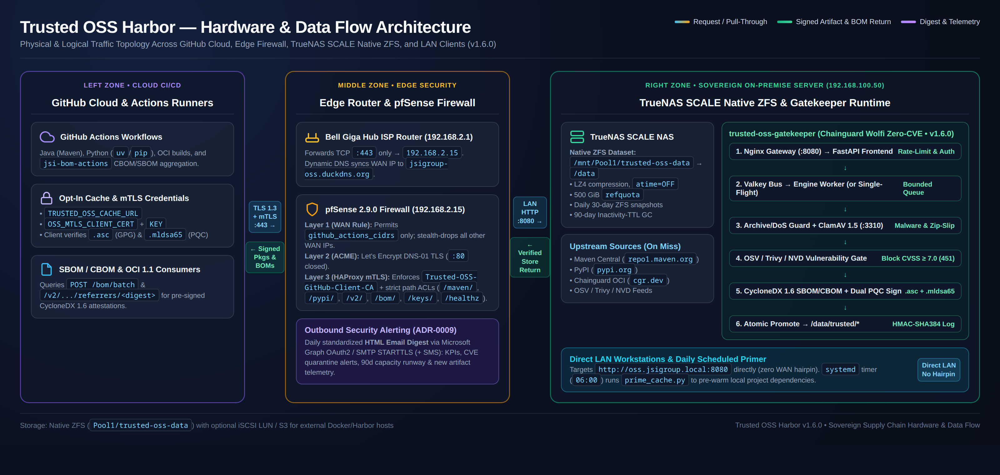
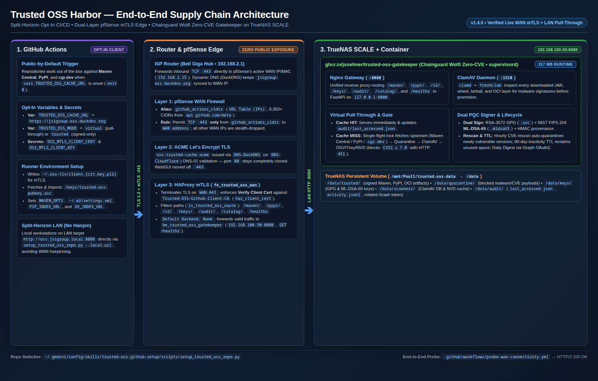
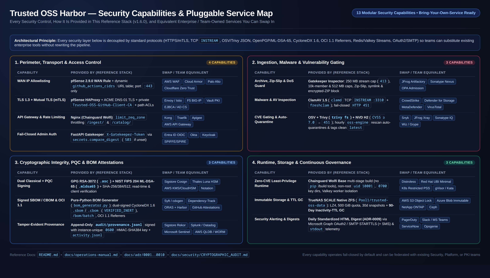
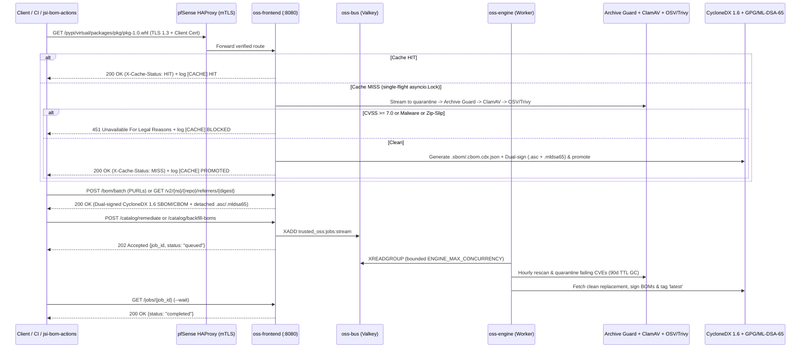

# Trusted OSS Supply Chain Platform (`trusted-oss-harbor`)

> **Build & Functional Verification**: Verified functional on `2026-11-20` by **Jeffs' Automated build and deploy agent** (44/44 unit & integration tests, Trusted OSS PyPI install, live browser & `curl` API checks) — see [`docs/BUILD_VERIFICATION.md`](docs/BUILD_VERIFICATION.md).

Self-hosted, containerized **Trusted Open-Source Software (OSS) Supply Chain Platform** combining **CNCF Harbor** (for OCI containers, Helm charts, and ORAS artifacts) with an automated **Quarantine $\rightarrow$ ClamAV Antivirus $\rightarrow$ Trivy/NVD Vulnerability Gate $\rightarrow$ GPG/Cosign Cryptographic Signer** for **Java (Maven)** and **Python (PyPI)** packages, designed to run behind a **pfSense** firewall backed by a **TrueNAS SCALE native ZFS dataset** (`/mnt/Pool1/trusted-oss-data`, with optional **TrueNAS iSCSI** block mount for external Linux hosts or **S3** object store).

---

## Architecture Overview

```mermaid
flowchart LR
    Client["Developer / CI Client / LAN Primer (06:00)"] -->|":443 mTLS (WAN) / :8080 (LAN)"| Edge["pfSense WAN Allowlist + HAProxy mTLS"]
    Edge --> Gateway["Nginx Gateway (Wolfi, rate-limited)"]
    Gateway -->|"/maven, /pypi, /v2, /bom, /jobs"| Frontend["oss-frontend (FastAPI, GATEKEEPER_ROLE=frontend)"]
    Frontend -->|"Cache HIT + BOM / OCI 1.1 Referrers"| Store["TrueNAS Native ZFS Trusted Store (.asc + .mldsa65 + .cdx.json)"]
    Frontend -->|"Enqueue warm / remediate / backfill_boms (202)"| Bus["oss-bus (Valkey Streams / InMemoryJobBus)"]
    Bus -->|"XREADGROUP (bounded concurrency)"| Engine["oss-engine (python -m app.worker)"]
    Engine -->|"Upstream Pull / Auto-Upgrade"| Upstream["Maven Central / PyPI / cgr.dev"]
    Upstream --> Quarantine["Quarantine + Archive/DoS Guard (250 MB)"]
    Quarantine --> ClamAV["ClamAV 1.5 (:3310 INSTREAM)"]
    ClamAV --> CVE["OSV / Trivy / NVD Gate (CVSS >= 7.0)"]
    CVE -->|"Clean"| BOM["CycloneDX 1.6 SBOM/CBOM Generator (VERIFIED_INERT)"]
    BOM --> Signer["Dual Signer (GPG RSA-3072 + ML-DSA-65 + SHA-384)"]
    CVE -->|"Infected or High/Crit CVE"| Reject["Quarantined / HTTP 451"]
    Signer -->|"Atomic Promote + HMAC-SHA384 Provenance"| Store
    Frontend & Engine -->|"stdout [CACHE] / [ENGINE] + activity.jsonl"| Digest["Daily HTML Digest (Graph OAuth2 / SMTP / SMS)"]
    Store --> VulnAPI["GET /catalog/vulnerabilities & POST /bom/batch"]
```











## Architecture Highlights

1. **Persistent Storage Mount (`OSS_DATA_ROOT`, live on TrueNAS `/mnt/Pool1/trusted-oss-data`)**:
   - `harbor/`: Harbor OCI blobs, PostgreSQL metadata, Redis cache, and job logs.
   - `packages/quarantine/`: Lightweight staging area for dynamically fetched upstream Maven/PyPI artifacts.
   - `packages/trusted-maven/` & `packages/trusted-pypi/`: Immutable, ClamAV-scanned, CVE-verified, and GPG-signed (`.asc`) package repositories (with `AUTO_PROMOTE_CLEAN_ARTIFACTS=true`).
   - `scanners/`: Persistent ClamAV virus definitions (`freshclam`), Trivy DB, and OWASP NVD H2 cache (`jsoehner/nvd-cache`).
   - `audit/provenance.jsonl`: Append-only cryptographic provenance log for every promoted component.
2. **Decoupled Frontend, Engine Worker & Valkey Message Bus (`oss-frontend`, `oss-engine`, `oss-bus`)**:
   - **Frontend (`oss-frontend`, `GATEKEEPER_ROLE=frontend`)**: Serves HTTP requests, artifact reads, `maven-metadata.xml`, PEP 503 indices, `/catalog/vulnerabilities`, and `/jobs/{job_id}` without blocking on heavy scans.
   - **Message Bus (`oss-bus`, `valkey/valkey:8-alpine`)**: Queues `remediate` and `warm` jobs via Redis/Valkey Streams (`BUS_URL=redis://oss-bus:6379/0`), with an automatic `InMemoryJobBus` fallback for single-container NAS appliance deployments (`GATEKEEPER_ROLE=all`).
   - **Engine Worker (`oss-engine`, `python -m app.worker`)**: Executes ClamAV/Trivy/OSV scans, hourly CVE rescans, auto-quarantine, `'latest'` tagging, and GPG/ML-DSA-65 signing with bounded concurrency (`ENGINE_MAX_CONCURRENCY=2`).
   - **Cryptographic Signing & Read-Time Verification**: Signs every promoted artifact with your **Trusted OSS GPG Key** (`.asc`) and **NIST FIPS 204 ML-DSA-65** (`.mldsa65`).
   - **Signed CycloneDX 1.6 SBOM/CBOM Attestations & Batch PURL API ([ADR 0010](docs/adr/0010-signed-artifact-cbom-attestations-and-purl-batch-api.md))**: Automatically generates and dual-signs `.sbom.cdx.json` and `.cbom.cdx.json` sidecars (including `VERIFIED_INERT` attestations) on promotion, serving them via `GET /bom/lookup?purl=...`, `POST /bom/batch`, and OCI 1.1 Referrers (`/v2/<ns>/<repo>/referrers/<digest>`) for direct assimilation by `jsoehner/jsi-bom-actions`. Existing caches can be backfilled via `POST /catalog/backfill-boms`.
3. **pfSense Edge Security (`config/pfsense/`)**:
   - Terminates TLS + Client Certificate Authentication (**mTLS**) at **pfSense HAProxy** and restricts WAN ingress to GitHub Actions IP ranges (`config/pfsense/update-github-cidrs.sh`).
4. **TrueNAS ZFS, iSCSI Block & Object Storage Roadmap (`docs/roadmap/truenas-iscsi-storage-roadmap.md`)**:
   - Production appliance runs directly on **TrueNAS SCALE** bound to native ZFS dataset `Pool1/trusted-oss-data` (`/mnt/Pool1/trusted-oss-data`, `LZ4`, `atime=OFF`, `500 GiB` `refquota`, daily 30-day ZFS snapshots).
   - Also includes [`scripts/setup_truenas_iscsi_mount.sh`](scripts/setup_truenas_iscsi_mount.sh) and [`docs/roadmap/truenas-iscsi-storage-roadmap.md`](docs/roadmap/truenas-iscsi-storage-roadmap.md) for external Linux Docker/Harbor hosts attaching a **TrueNAS iSCSI Zvol LUN** at `/mnt/truenas-iscsi-oss` (or configuring Harbor `storage_service.s3` against TrueNAS MinIO/S3).
5. **Chainguard Zero-CVE Containers (`jre` & `python`) + Shared Spring Boot Catalog Cache**:
   - **Harbor Chainguard Proxy Cache**: [`scripts/configure_harbor_projects.sh`](scripts/configure_harbor_projects.sh) provisions the `chainguard-cache` Proxy Cache project in Harbor backed by `https://cgr.dev`, and [`containers/chainguard-jre-python/Dockerfile`](containers/chainguard-jre-python/Dockerfile) demonstrates building a polyglot Spring Boot JRE + Python runtime from `${HARBOR_REGISTRY}/chainguard-cache/chainguard/jre:latest` and `${HARBOR_REGISTRY}/chainguard-cache/chainguard/python:latest`.
   - **Shared Spring Boot Component Collection**: [`config/catalog/trusted-seed-catalog.json`](config/catalog/trusted-seed-catalog.json) and the `POST /catalog/warm` / `GET /catalog/status` endpoints pre-warm, ClamAV-scan, and GPG-sign the core Spring Boot starters shared across `enterprise-command-center` and `spring-ai-blog-agent` (`spring-boot-starter-web`, `actuator`, `security`, `validation`, `data-jpa`, `amqp`, `test`, and `slf4j-api`).

---

## Quick Start

```bash
# 1. Copy and customize environment configuration (defaults to /home/jsoehner/trusted-oss-data)
cp .env.example .env

# 2. Initialize persistent storage, seed NVD cache from jsoehner/nvd-cache, and prepare Harbor
make bootstrap-harbor

# 3. Generate Trusted OSS GPG Signing Authority & export public key
make generate-keys

# 4. Launch ClamAV, Harbor Scanner Adapter, OSS Gatekeeper, and Unified Gateway
make up

# 5. Run the 5-stage automated verification & live Chainguard/Spring Boot cache suite
make verify-e2e

# 6. (Roadmap) Preview TrueNAS iSCSI external block storage mount & migration
make iscsi-roadmap-dryrun
```

---

## NAS Appliance Deployment (TrueNAS SCALE / Synology / Unraid)

To run the entire platform as a 24/7 self-contained appliance on your NAS without maintaining multiple daemon containers:

### 1. Pull the Published Image
```bash
docker pull ghcr.io/jsoehner/trusted-oss-gatekeeper:latest
```

### 2. Run via Docker CLI on your NAS
```bash
# Generate a strong admin token first: openssl rand -hex 32
docker run -d \
  --name trusted-oss-gatekeeper \
  --restart unless-stopped \
  -p 8080:8080 \
  -v /mnt/tank/trusted-oss-data:/data \
  -e CVSS_FAIL_THRESHOLD=7.0 \
  -e AUTO_PROMOTE_CLEAN_ARTIFACTS=true \
  -e GATEKEEPER_ADMIN_TOKEN="<your-generated-token>" \
  ghcr.io/jsoehner/trusted-oss-gatekeeper:latest
```

### 3. Or Deploy via Docker Compose on your NAS
```yaml
services:
  trusted-oss-gatekeeper:
    image: ghcr.io/jsoehner/trusted-oss-gatekeeper:latest
    container_name: trusted-oss-gatekeeper
    restart: unless-stopped
    ports:
      - "8080:8080"
    volumes:
      - /mnt/tank/trusted-oss-data:/data
    environment:
      OSS_DATA_ROOT: /data
      CVSS_FAIL_THRESHOLD: 7.0
      AUTO_PROMOTE_CLEAN_ARTIFACTS: "true"
      GATEKEEPER_ADMIN_TOKEN: "${GATEKEEPER_ADMIN_TOKEN:?set a strong token}"
```

The appliance automatically:
- Initializes the `/data` directory hierarchy on your NAS ZFS pool and runs the `gatekeeper` API as a non-root user (`10001`).
- Auto-generates RSA-3072 GPG, NIST FIPS 204 ML-DSA-65 PQC signing authorities, and an instance-unique provenance HMAC key on first boot.
- Auto-downloads and updates ClamAV virus signatures with persistent caching in `/data/scanners/clamav`.
- Serves the unified rate-limited gateway on port `8080`.

- **Chainguard Wolfi Zero-CVE Base (`cgr.dev/chainguard/wolfi-base:latest`, Python 3.13)**: Multi-stage build strips `pip` and build tooling from the runtime image (317 MB vs. 467 MB Debian), bundling `clamav-1.5`, `nginx-stable`, `gpg`, `supervisor`, and `gatekeeper` (`1.6.0`).
- **Public-by-Default, Single-Variable Cache Opt-In (`scripts/configure_trusted_cache.py`)**: Cloned repositories default to public upstream registries (Maven Central, PyPI, `cgr.dev`). Run `python3 scripts/configure_trusted_cache.py --interactive` (or `--url https://oss.yourdomain.com`) to redirect Maven, `uv`/`pip`, `.env`, Docker, and GitHub Actions (`vars.TRUSTED_OSS_CACHE_URL`) to your Trusted OSS Cache, or `--public` to revert.
- **pfSense GitHub-Only mTLS Edge ([`docs/pfsense-haproxy-mtls-guide.md`](docs/pfsense-haproxy-mtls-guide.md))**: Step-by-step illustrated guide (`pfSense 2.9.0-RELEASE`) for restricting WAN `:443` access strictly to GitHub Actions CIDRs + mTLS client certificates forwarding to `trusted-oss-gatekeeper:8080`.
- **Operations Manual & ADRs**: See [`docs/operations-manual.md`](docs/operations-manual.md) for live command screenshots, maintenance runbooks, and project integration guides, and [`docs/adr/0004-frontend-engine-message-bus-architecture.md`](docs/adr/0004-frontend-engine-message-bus-architecture.md) for the Frontend / Engine / Valkey Bus ADR.
- **TrueNAS Container App Cache Logging**: `gatekeeper` emits structured `[CACHE]` telemetry (`HIT`, `PROMOTED`, `BLOCKED`, `WARMUP_SUMMARY`) to container `stdout` so all caching and security gate activity is visible directly in TrueNAS SCALE's App Logs UI (`docker logs -f trusted-oss-gatekeeper`).
- **Virtual Repository Pull-Through**: Configure clients against `/maven/virtual/`, `/pypi/virtual/simple/`, or `/v2/virtual/` for automatic upstream fetch, ClamAV + OSV/Trivy CVE gating (`CVSS >= 7.0`), and dual GPG/ML-DSA-65 signing on cache miss.

### 4. Dynamic Discovery, Warmup & Per-Version Vulnerability Catalog
```bash
# Discover dependencies from local projects + GitHub and warm the appliance cache
GATEKEEPER_ADMIN_TOKEN="<your-token>" \
  python3 scripts/dynamic_warmup.py --roots "$HOME" --github --warm --gatekeeper-url http://oss.jsigroup.local:8080

# Catalog all cached components and per-version vulnerability status via frontend HTTP endpoints
GATEKEEPER_ADMIN_TOKEN="<your-token>" \
  python3 scripts/catalog_frontend.py --url http://oss.jsigroup.local:8080
```

---

## Security Capabilities & Pluggable Service Map

Every security control in `trusted-oss-harbor` is decoupled behind standard protocols (HTTPS/mTLS, TCP `INSTREAM`, OSV/Trivy JSON, OpenPGP/ML-DSA-65, CycloneDX 1.6, OCI 1.1 Referrers, Redis/Valkey Streams, OAuth2/SMTP) so teams can substitute existing enterprise tools or team-managed services without redesigning the supply chain flow:

| Tier | Security Capability | Provided By (This Reference Stack) | Bring-Your-Own / Enterprise Team Equivalent |
| :--- | :--- | :--- | :--- |
| **Perimeter & Access** | **WAN IP Allowlisting** | pfSense 2.9.0 WAN rule + dynamic `github_actions_cidrs` table (`:443` only) | AWS WAF, GCP Cloud Armor, Palo Alto, Cloudflare Zero Trust |
| **Perimeter & Access** | **TLS 1.3 + Mutual TLS (mTLS)** | pfSense HAProxy + ACME DNS-01 TLS + private `Trusted-OSS-GitHub-Client-CA` + strict path ACLs | Envoy / Istio, F5 BIG-IP, HashiCorp Vault PKI, EJBCA, AD CS |
| **Perimeter & Access** | **API Gateway & Rate Limiting** | Nginx on Chainguard Wolfi (`limit_req_zone` on `/ingest/` & `/catalog/`) | Kong, Traefik, Apigee, AWS API Gateway |
| **Perimeter & Access** | **Fail-Closed Admin Auth** | FastAPI `X-Gatekeeper-Token` via `secrets.compare_digest` (HTTP `503` if unset/placeholder) | Entra ID OIDC, Okta, Keycloak, SPIFFE/SPIRE |
| **Ingestion & Scanning** | **Archive, Zip-Slip & DoS Guard** | Gatekeeper inspector (`MAX_ARTIFACT_BYTES=250 MB` HTTP `413`, 10k-member & 512 MB caps, Zip-Slip/symlink/encrypted-ZIP rejection) | JFrog Artifactory / Sonatype Nexus content policies, OPA admission |
| **Ingestion & Scanning** | **Malware & AV Inspection** | ClamAV 1.5 (`clamd` TCP `INSTREAM :3310` + `freshclam`), fail-closed HTTP `451` | CrowdStrike, Microsoft Defender for Storage, MetaDefender, VirusTotal |
| **Ingestion & Scanning** | **CVE Gating & Auto-Quarantine** | OSV + Trivy (`trivy fs`, `TRIVY_REQUIRED`) + NVD H2 (`CVSS >= 7.0` -> `451`, `ALLOW_SIMULATED_CVSS=false`); hourly `oss-engine` rescan auto-quarantines & tags clean `latest` | Snyk, JFrog Xray, Sonatype IQ, Wiz, Anchore Grype |
| **Integrity & BOMs** | **Dual Classical + PQC Signing** | GPG RSA-3072 (`.asc`) + NIST FIPS 204 ML-DSA-65 (`.mldsa65`) + SHA-256/384/512; read-time & client verification | Sigstore Cosign, Thales Luna HSM, AWS KMS/CloudHSM, Notary/Notation |
| **Integrity & BOMs** | **Signed SBOM/CBOM & OCI 1.1** | Pure-Python `app/bom_generator.py` emitting dual-signed CycloneDX 1.6 `.sbom.cdx.json`/`.cbom.cdx.json` (`VERIFIED_INERT`), `/bom/lookup`, `/bom/batch`, OCI 1.1 Referrers | Syft, cdxgen, Dependency-Track, ORAS + Harbor, GitHub Attestations |
| **Integrity & BOMs** | **Tamper-Evident Provenance** | Append-only `audit/provenance.jsonl` signed with instance-unique `0o600` HMAC-SHA384 key (`PROVENANCE_HMAC_KEY`) + paginated `/audit/provenance` & `activity.jsonl` | Sigstore Rekor, Splunk, Datadog, Microsoft Sentinel, WORM Object Lock |
| **Runtime & Storage** | **Zero-CVE Least-Privilege Runtime** | Chainguard Wolfi multi-stage build (no `pip`/build tools), non-root `uid 10001`, `0o700` key dirs, Valkey worker isolation | Distroless, Red Hat UBI Minimal, Kubernetes `restricted` PSS, gVisor |
| **Runtime & Storage** | **Immutable Storage & TTL GC** | TrueNAS SCALE Native ZFS (`Pool1/trusted-oss-data`: LZ4, 500 GiB quota, daily 30d snapshots) + 90-day Inactivity-TTL GC (`audit/last_accessed.json`) | AWS S3 Object Lock + Lifecycle, Azure Immutable Blob, NetApp ONTAP, Ceph |
| **Governance & Alerting** | **Security Digests & Telemetry** | Daily Standardized HTML Email Digest ([ADR 0009](docs/adr/0009-standardized-html-email-notifications.md)) via Microsoft Graph OAuth2 / SMTP STARTTLS (+ ≤160-char SMS) & `stdout` `[CACHE]`/`[ENGINE]` telemetry | PagerDuty, Slack, Microsoft Teams, ServiceNow, Opsgenie |


---

## Locking GitHub Projects to Signed-Only Components

Drop the templates in [`client-templates/`](client-templates/) into your GitHub repositories:
- **Java / Maven**: [`client-templates/maven-settings.xml`](client-templates/maven-settings.xml) (`<mirrorOf>*</mirrorOf>`) + [`client-templates/pgpverify-plugin-snippet.xml`](client-templates/pgpverify-plugin-snippet.xml) (`<failNoSignature>true</failNoSignature>` verified against `https://${HARBOR_DOMAIN}/keys/trusted-oss-pubkey.asc`).
- **Python (`uv` / `pip`)**: [`client-templates/uv.toml`](client-templates/uv.toml) pointing exclusively to `https://${HARBOR_DOMAIN}/pypi/trusted/simple` (which only indexes wheels carrying a valid `.asc` signature and `#sha256=` digest).
- **GitHub Actions Opt-In Cache Setup**: [`client-templates/github-actions-trusted-oss.yml`](client-templates/github-actions-trusted-oss.yml).
- **GitHub Actions Component Health & Signed SBOM/CBOM Gate (ORAS + PURL API)**: [`client-templates/github-actions-verify-component.yml`](client-templates/github-actions-verify-component.yml) — reusable workflow that discovers attached CycloneDX 1.6 SBOM/CBOM referrers via **ORAS** (`oras discover --artifact-type application/vnd.cyclonedx+json`), cryptographically verifies detached GPG + ML-DSA-65 signatures (`/bom/lookup`), checks the live malware/CVE health record (`/catalog/vulnerabilities?verify_signatures=true`), and outputs `approved=true|false` (plus a `$GITHUB_STEP_SUMMARY` decision table) to gate downstream build/deploy jobs. See [`docs/operations-manual.md` Section 4.6](docs/operations-manual.md#46-querying-signed-sbomcbom-components-with-oras--automated-ci-health-gate) for ORAS CLI examples and [Section 5](docs/operations-manual.md#5-troubleshooting-http-451--debugging-component-lifecycle) for human-readable HTTP `451` & component lifecycle troubleshooting.
