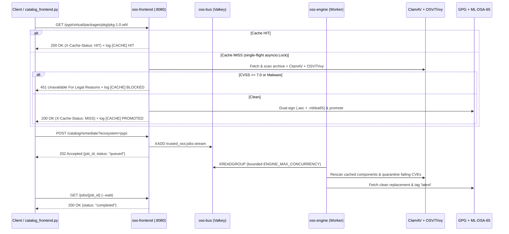

# Trusted OSS Supply Chain Platform (`trusted-oss-harbor`)

Self-hosted, containerized **Trusted Open-Source Software (OSS) Supply Chain Platform** combining **CNCF Harbor** (for OCI containers, Helm charts, and ORAS artifacts) with an automated **Quarantine $\rightarrow$ ClamAV Antivirus $\rightarrow$ Trivy/NVD Vulnerability Gate $\rightarrow$ GPG/Cosign Cryptographic Signer** for **Java (Maven)** and **Python (PyPI)** packages, designed to run behind a **pfSense** firewall with a persistent host mount (`/home/jsoehner/trusted-oss-data` now, with seamless migration to a **TrueNAS iSCSI** external block/object store).

---

## Architecture Overview

```mermaid
flowchart LR
    Client["Developer / CI Client"] -->|":8080 /maven/virtual, /pypi/virtual, /v2/virtual, /jobs"| Gateway["Nginx Gateway (Wolfi)"]
    Gateway --> Frontend["oss-frontend (FastAPI, GATEKEEPER_ROLE=frontend)"]
    Frontend -->|"Cache HIT"| Store["Trusted Store (.asc + .mldsa65)"]
    Frontend -->|"Enqueue remediate / warm (202 Accepted)"| Bus["oss-bus (Valkey Streams)"]
    Bus -->|"XREADGROUP (bounded concurrency)"| Engine["oss-engine (python -m app.worker)"]
    Engine -->|"Upstream Pull / Auto-Upgrade"| Upstream["Maven Central / PyPI / cgr.dev"]
    Upstream --> Quarantine["Quarantine Staging"]
    Quarantine --> ClamAV["ClamAV 1.5 (:3310)"]
    ClamAV --> CVE["OSV / Trivy Gate (CVSS >= 7.0)"]
    CVE -->|"Clean"| Signer["GPG RSA-3072 + ML-DSA-65"]
    CVE -->|"Infected or High/Crit CVE"| Reject["Quarantined / HTTP 451"]
    Signer --> Store
    Frontend & Engine -->|"stdout [CACHE] / [ENGINE] events"| Logs["TrueNAS App Logs / docker logs"]
    Store --> VulnAPI["GET /catalog/vulnerabilities"]
```





## Architecture Highlights

1. **Persistent Storage Mount (`OSS_DATA_ROOT=/home/jsoehner/trusted-oss-data`)**:
   - `harbor/`: Harbor OCI blobs, PostgreSQL metadata, Redis cache, and job logs.
   - `packages/quarantine/`: Lightweight staging area for dynamically fetched upstream Maven/PyPI artifacts.
   - `packages/trusted-maven/` & `packages/trusted-pypi/`: Immutable, ClamAV-scanned, CVE-verified, and GPG-signed (`.asc`) package repositories (with `AUTO_PROMOTE_CLEAN_ARTIFACTS=true`).
   - `scanners/`: Persistent ClamAV virus definitions (`freshclam`), Trivy DB, and OWASP NVD H2 cache (`jsoehner/nvd-cache`).
   - `audit/provenance.jsonl`: Append-only cryptographic provenance log for every promoted component.
2. **Decoupled Frontend, Engine Worker & Valkey Message Bus (`oss-frontend`, `oss-engine`, `oss-bus`)**:
   - **Frontend (`oss-frontend`, `GATEKEEPER_ROLE=frontend`)**: Serves HTTP requests, artifact reads, `maven-metadata.xml`, PEP 503 indices, `/catalog/vulnerabilities`, and `/jobs/{job_id}` without blocking on heavy scans.
   - **Message Bus (`oss-bus`, `valkey/valkey:8-alpine`)**: Queues `remediate` and `warm` jobs via Redis/Valkey Streams (`BUS_URL=redis://oss-bus:6379/0`), with an automatic `InMemoryJobBus` fallback for single-container NAS appliance deployments (`GATEKEEPER_ROLE=all`).
   - **Engine Worker (`oss-engine`, `python -m app.worker`)**: Executes ClamAV/Trivy/OSV scans, hourly CVE rescans, auto-quarantine, `'latest'` tagging, and GPG/ML-DSA-65 signing with bounded concurrency (`ENGINE_MAX_CONCURRENCY=2`).
   - **Cryptographic Signing & Read-Time Verification**: Signs every promoted artifact with your **Trusted OSS GPG Key** (`.asc`) and **NIST FIPS 204 ML-DSA-65** (`.mldsa65`).
3. **pfSense Edge Security (`config/pfsense/`)**:
   - Terminates TLS + Client Certificate Authentication (**mTLS**) at **pfSense HAProxy** and restricts WAN ingress to GitHub Actions IP ranges (`config/pfsense/update-github-cidrs.sh`).
4. **TrueNAS iSCSI Block & Object Storage Roadmap (`docs/roadmap/truenas-iscsi-storage-roadmap.md`)**:
   - Currently operates out of `/home/jsoehner/trusted-oss-data`.
   - Includes [`scripts/setup_truenas_iscsi_mount.sh`](scripts/setup_truenas_iscsi_mount.sh) and [`docs/roadmap/truenas-iscsi-storage-roadmap.md`](docs/roadmap/truenas-iscsi-storage-roadmap.md) to attach a **TrueNAS iSCSI Zvol LUN** at `/mnt/truenas-iscsi-oss` (or configure Harbor `storage_service.s3` against TrueNAS MinIO/S3) and migrate data with zero configuration drift.
5. **Chainguard Zero-CVE Containers (`jre` & `python`) + Shared Spring Boot Catalog Cache**:
   - **Harbor Chainguard Proxy Cache**: [`scripts/configure_harbor_projects.sh`](scripts/configure_harbor_projects.sh) provisions the `chainguard-cache` Proxy Cache project in Harbor backed by `https://cgr.dev`, and [`containers/chainguard-jre-python/Dockerfile`](containers/chainguard-jre-python/Dockerfile) demonstrates building a polyglot Spring Boot JRE + Python runtime from `${HARBOR_REGISTRY}/chainguard-cache/chainguard/jre:latest` and `${HARBOR_REGISTRY}/chainguard-cache/chainguard/python:latest`.
   - **Shared Spring Boot Component Collection**: [`config/catalog/trusted-seed-catalog.json`](config/catalog/trusted-seed-catalog.json) and the `POST /catalog/warm` / `GET /catalog/status` endpoints pre-warm, ClamAV-scan, and GPG-sign the core Spring Boot starters shared across `enterprise-command-center` and `spring-ai-blog-agent` (`spring-boot-starter-web`, `actuator`, `security`, `validation`, `data-jpa`, `amqp`, `test`, and `slf4j-api`).

---

## Quick Start

```bash
# 1. Copy and customize environment configuration (defaults to /home/jsoehner/trusted-oss-data)
cp .env.example .env

# 2. Initialize persistent storage, seed NVD cache from jsoehner/nvd-cache, and prepare Harbor
make bootstrap-harbor

# 3. Generate Trusted OSS GPG Signing Authority & export public key
make generate-keys

# 4. Launch ClamAV, Harbor Scanner Adapter, OSS Gatekeeper, and Unified Gateway
make up

# 5. Run the 5-stage automated verification & live Chainguard/Spring Boot cache suite
make verify-e2e

# 6. (Roadmap) Preview TrueNAS iSCSI external block storage mount & migration
make iscsi-roadmap-dryrun
```

---

## NAS Appliance Deployment (TrueNAS SCALE / Synology / Unraid)

To run the entire platform as a 24/7 self-contained appliance on your NAS without maintaining multiple daemon containers:

### 1. Pull the Published Image
```bash
docker pull ghcr.io/jsoehner/trusted-oss-gatekeeper:latest
```

### 2. Run via Docker CLI on your NAS
```bash
# Generate a strong admin token first: openssl rand -hex 32
docker run -d \
  --name trusted-oss-gatekeeper \
  --restart unless-stopped \
  -p 8080:8080 \
  -v /mnt/tank/trusted-oss-data:/data \
  -e CVSS_FAIL_THRESHOLD=7.0 \
  -e AUTO_PROMOTE_CLEAN_ARTIFACTS=true \
  -e GATEKEEPER_ADMIN_TOKEN="<your-generated-token>" \
  ghcr.io/jsoehner/trusted-oss-gatekeeper:latest
```

### 3. Or Deploy via Docker Compose on your NAS
```yaml
services:
  trusted-oss-gatekeeper:
    image: ghcr.io/jsoehner/trusted-oss-gatekeeper:latest
    container_name: trusted-oss-gatekeeper
    restart: unless-stopped
    ports:
      - "8080:8080"
    volumes:
      - /mnt/tank/trusted-oss-data:/data
    environment:
      OSS_DATA_ROOT: /data
      CVSS_FAIL_THRESHOLD: 7.0
      AUTO_PROMOTE_CLEAN_ARTIFACTS: "true"
      GATEKEEPER_ADMIN_TOKEN: "${GATEKEEPER_ADMIN_TOKEN:?set a strong token}"
```

The appliance automatically:
- Initializes the `/data` directory hierarchy on your NAS ZFS pool and runs the `gatekeeper` API as a non-root user (`10001`).
- Auto-generates RSA-3072 GPG, NIST FIPS 204 ML-DSA-65 PQC signing authorities, and an instance-unique provenance HMAC key on first boot.
- Auto-downloads and updates ClamAV virus signatures with persistent caching in `/data/scanners/clamav`.
- Serves the unified rate-limited gateway on port `8080`.

- **Chainguard Wolfi Zero-CVE Base (`cgr.dev/chainguard/wolfi-base:latest`, Python 3.13)**: Multi-stage build strips `pip` and build tooling from the runtime image (317 MB vs. 467 MB Debian), bundling `clamav-1.5`, `nginx-stable`, `gpg`, `supervisor`, and `gatekeeper` (`1.0.0`).
- **Operations Manual & ADRs**: See [`docs/operations-manual.md`](docs/operations-manual.md) for live command screenshots, maintenance runbooks, and project integration guides, and [`docs/adr/0004-frontend-engine-message-bus-architecture.md`](docs/adr/0004-frontend-engine-message-bus-architecture.md) for the Frontend / Engine / Valkey Bus ADR.
- **TrueNAS Container App Cache Logging**: `gatekeeper` emits structured `[CACHE]` telemetry (`HIT`, `PROMOTED`, `BLOCKED`, `WARMUP_SUMMARY`) to container `stdout` so all caching and security gate activity is visible directly in TrueNAS SCALE's App Logs UI (`docker logs -f trusted-oss-gatekeeper`).
- **Virtual Repository Pull-Through**: Configure clients against `/maven/virtual/`, `/pypi/virtual/simple/`, or `/v2/virtual/` for automatic upstream fetch, ClamAV + OSV/Trivy CVE gating (`CVSS >= 7.0`), and dual GPG/ML-DSA-65 signing on cache miss.

### 4. Dynamic Discovery, Warmup & Per-Version Vulnerability Catalog
```bash
# Discover dependencies from local projects + GitHub and warm the appliance cache
GATEKEEPER_ADMIN_TOKEN="<your-token>" \
  python3 scripts/dynamic_warmup.py --roots "$HOME" --github --warm --gatekeeper-url http://oss.jsigroup.local:8080

# Catalog all cached components and per-version vulnerability status via frontend HTTP endpoints
GATEKEEPER_ADMIN_TOKEN="<your-token>" \
  python3 scripts/catalog_frontend.py --url http://oss.jsigroup.local:8080
```

---

## Security Controls & Configuration

- **Fail-Closed Admin Token**: `GATEKEEPER_ADMIN_TOKEN` is required for `/ingest/*` and `/catalog/warm`. Unset or placeholder values (`ChangeMe_GatekeeperToken_2026!`) are rejected with HTTP `503`.
- **Vulnerability Scanning**: `scan_with_trivy()` runs `trivy fs` when `trivy` is installed; set `TRIVY_REQUIRED=true` to fail closed if the CLI is absent. `ALLOW_SIMULATED_CVSS` defaults to `false` so `X-Simulated-Cvss` headers are ignored in production.
- **Resource & Archive Guards**: Uploads and upstream pull-through downloads stream to disk with a `MAX_ARTIFACT_BYTES` cap (default `262144000` / 250 MB). Archives exceeding 10,000 members, 512 MB uncompressed, or containing encrypted entries are rejected.
- **Provenance Integrity**: `PROVENANCE_HMAC_KEY` signs `audit/provenance.jsonl` entries (auto-generated at `<OSS_DATA_ROOT>/keys/provenance.hmac.key` if unset). `/audit/provenance` supports `limit` and `offset` pagination.


---

## Locking GitHub Projects to Signed-Only Components

Drop the templates in [`client-templates/`](client-templates/) into your GitHub repositories:
- **Java / Maven**: [`client-templates/maven-settings.xml`](client-templates/maven-settings.xml) (`<mirrorOf>*</mirrorOf>`) + [`client-templates/pgpverify-plugin-snippet.xml`](client-templates/pgpverify-plugin-snippet.xml) (`<failNoSignature>true</failNoSignature>` verified against `https://${HARBOR_DOMAIN}/keys/trusted-oss-pubkey.asc`).
- **Python (`uv` / `pip`)**: [`client-templates/uv.toml`](client-templates/uv.toml) pointing exclusively to `https://${HARBOR_DOMAIN}/pypi/trusted/simple` (which only indexes wheels carrying a valid `.asc` signature and `#sha256=` digest).
- **GitHub Actions Workflow**: [`client-templates/github-actions-trusted-oss.yml`](client-templates/github-actions-trusted-oss.yml).
