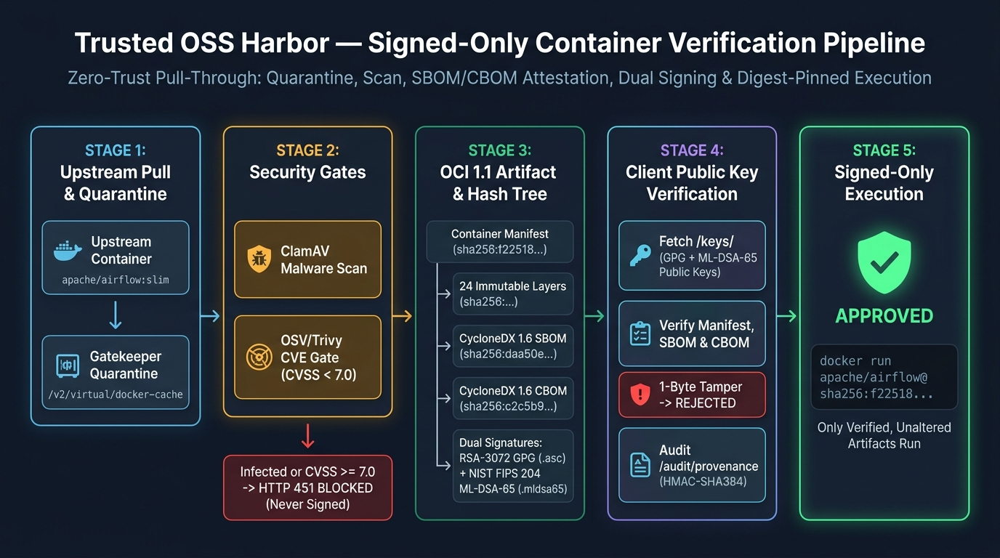

# Trusted OSS Harbor — Frequently Asked Questions (FAQ)



This standalone FAQ covers container verification, OCI 1.1 Referrers (SBOM/CBOM), dual-signature validation (GPG + NIST FIPS 204 ML-DSA-65), provenance auditing, and signed-only pipeline enforcement in `trusted-oss-harbor`. For the full step-by-step walkthrough and runnable `curl` commands, see [Section 7 of the Operations Manual](operations-manual.md#7-end-to-end-trusted-container-demo--inspecting-layers-sbomcbom-signatures--provenance-with-curl) or run [`scripts/trusted_container_demo.sh`](../scripts/trusted_container_demo.sh).

---

## 1. Why use a Trusted OSS Registry instead of pulling directly from Docker Hub, PyPI, or Maven Central?

Pulling directly from public registries exposes builds to three risks:
1. **Mutable tags**: Tags like `apache/airflow:slim-latest-python3.12` can change upstream without any change in your repository.
2. **Unscanned binaries**: Public registries do not enforce your organization's ClamAV malware policy or CVSS fail threshold (`CVSS < 7.0`).
3. **Missing cryptographic lineage**: Upstream artifacts lack your organization's dual signatures and signed CycloneDX 1.6 SBOM/CBOM attestations.

`trusted-oss-harbor` intercepts every cache miss in `packages/quarantine/`, scans it for malware and CVEs, generates CycloneDX 1.6 SBOM and CBOM manifests, dual-signs everything with **RSA-3072 GPG** and **NIST FIPS 204 ML-DSA-65**, records an HMAC-authenticated provenance entry, and promotes only clean artifacts to the trusted store.

---

## 2. How do I inspect a container's layers, SBOM, CBOM, and signature hashes using only `curl`?

Run the automated demo script against your Gatekeeper instance:

```bash
GATEKEEPER_URL=http://oss.jsigroup.local:8080 \
  NAMESPACE=docker-cache \
  REPO=apache/airflow \
  TAG=slim-latest-python3.12 \
  bash scripts/trusted_container_demo.sh
```

The script queries:
- `GET /v2/virtual/docker-cache/apache/airflow/manifests/slim-latest-python3.12` (OCI Image Index)
- `GET /v2/virtual/docker-cache/apache/airflow/manifests/sha256:<platform_digest>` (`linux/amd64` manifest containing the image config and all 24 layer digests)
- `GET /v2/docker-cache/apache/airflow/referrers/sha256:<platform_digest>` (OCI 1.1 Referrers returning CycloneDX 1.6 SBOM and CBOM digests)
- `GET /v2/docker-cache/apache/airflow/blobs/sha256:<bom_digest>` (content-addressed SBOM/CBOM JSON)
- `GET /v2/virtual/docker-cache/apache/airflow/manifests/sha256:<platform_digest>.asc` and `.mldsa65` (detached signature layers)

### Example Verified Output Tree (`apache/airflow:slim-latest-python3.12`)

```text
docker-cache/apache/airflow:slim-latest-python3.12  [OCI Image Index]
│  Digest: sha256:2d3e42b9de0eca948b9a869817068fedcb8a8eac9827b1e6215de3329d59335f
└── Platform Manifest (linux/amd64)
    │  Digest: sha256:f22518ba835f4b73d6b75ff32c6b4eda10a5ef0abac18f2d7c11ceced8b651b2  (4.7 KiB)
    ├── Image Config  (application/vnd.oci.image.config.v1+json, 22.7 KiB)
    │   └── sha256:09f01fae61878a378966ef7c9472ee388af4216560c3c0435056a573ff522cef
    ├── Container Layers (24 immutable filesystem layers)
    │   ├── Layer 01  177.1 KiB   sha256:c76ff3643382044a6a6dd7a482343bd6ae88018536beaccec1196a79768c7294  (tar+zstd)
    │   ├── Layer 02  37.66 MiB   sha256:2c92ce0a794ae71790367b8331d4f27171f920e302e6d5304165dc5439221697  (tar+zstd)
    │   │   ... (Layers 03–23 pinned by individual SHA-256 digests) ...
    │   └── Layer 24  32 B        sha256:4f4fb700ef54461cfa02571ae0db9a0dc1e0cdb5577484a6d75e68dc38e8acc1  (tar+gzip)
    ├── SBOM Manifest  (CycloneDX 1.6 — application/vnd.cyclonedx+json, 1.7 KiB)
    │   └── sha256:daa50ec6997f5c2da71081a35f780c3cfc488470a2bacd1777e3efd958dcde50
    ├── CBOM Manifest  (CycloneDX 1.6 — application/vnd.cyclonedx+json, 1.8 KiB)
    │   ├── Digest : sha256:c2c5b97348299c90a270d69595e3f603e35fa82368fba4e66efc2904a3ed7670
    │   └── Status : VERIFIED_INERT  [Assets: none (VERIFIED_INERT)]
    └── Signature Layers  (Registry Dual-Signed Proof)
        ├── Classical GPG (RSA-3072 .asc, 695 B)
        │   └── sha256:2468bc29afc104d7e1b14008628fe0a49d62a422c8905c2bf7657c6202142582
        └── Post-Quantum (NIST FIPS 204 ML-DSA-65 .mldsa65, 4.4 KiB)
            └── sha256:b6ab189fd1b084a4fa6007d885ddc0684e3288dedf0332343c526d7e330807ba
```

---

## 3. How do I fetch the Registry's public keys and prove an image is unaltered?

Fetch both public keys and the PQC fingerprint directly from Gatekeeper:

```bash
curl -fsSL http://oss.jsigroup.local:8080/keys/trusted-oss-pubkey.asc          -o trusted-oss-pubkey.asc
curl -fsSL http://oss.jsigroup.local:8080/keys/trusted-oss-mldsa65.pub         -o trusted-oss-mldsa65.pub
curl -fsSL http://oss.jsigroup.local:8080/keys/trusted-oss-mldsa65.fingerprint -o trusted-oss-mldsa65.fingerprint
```

Then verify the manifest, SBOM, and CBOM against both keys:

```bash
gpg --batch --import trusted-oss-pubkey.asc
GPG_FPR=$(gpg --with-colons --fingerprint | awk -F: '$1=="fpr"{print $10; exit}')
printf '%s:6:\n' "${GPG_FPR}" | gpg --batch --import-ownertrust
gpg --verify manifest.json.asc manifest.json
python3 client-templates/pqc-verify.py manifest.json manifest.json.mldsa65 trusted-oss-mldsa65.pub
```

Because the OCI manifest embeds the SHA-256 digest of the image config and every filesystem layer, verifying the manifest signature proves no layer was modified. Changing even 1 byte causes both `gpg --verify` and `pqc-verify.py` to fail closed and reject execution.

---

## 4. Why does Gatekeeper dual-sign with both GPG (RSA-3072) and NIST FIPS 204 ML-DSA-65?

- **RSA-3072 GPG (`.asc`)** integrates directly with existing build tools (`gpg`, Maven `pgpverify-maven-plugin`, standard Linux package tooling).
- **NIST FIPS 204 ML-DSA-65 (`.mldsa65`)** provides post-quantum lattice-based signatures immune to Shor's algorithm, protecting long-lived provenance records and container attestations from "Harvest Now, Forge Later" threats.

You can select which signature mode your client verifies via `--sig-mode` in [`scripts/trusted_container_demo.sh`](../scripts/trusted_container_demo.sh) (see [ADR-0012](adr/0012-selectable-signature-verification-modes-and-oci-container-demo.md)):
- `--sig-mode classic` — verifies **only** RSA-3072 GPG (`.asc`, no `dilithium-py` required)
- `--sig-mode pqc` — verifies **only** NIST FIPS 204 ML-DSA-65 (`.mldsa65`, no `gpg` required)
- `--sig-mode both` *(default)* — verifies **both** classical GPG (`[ultimate]`) and ML-DSA-65, with optional `EXPECTED_GPG_FPR` / `EXPECTED_PQC_FPR` pinning.

---

## 5. What is the difference between the SBOM and CBOM referrers?

- **SBOM (`sbom.cdx.json`)**: Software Bill of Materials listing component identity, PURL, version, and dependencies (including Wolfi APK OS packages extracted from OCI layers) in CycloneDX 1.6 format.
- **CBOM (`cbom.cdx.json`)**: Cryptographic Bill of Materials listing algorithms, key sizes, TLS protocols, X.509/JKS certificates, and PQC primitives discovered inside container layers or package archives. Gatekeeper classifies **Active Risks** (expired/weak/non-CA certificates, non-root SHA-1 chains, activated OpenSSL legacy providers, weak code calls) separately from **Passive Risks** (self-signed SHA-1 root CAs in truststores, policy-disabled runtime symbols, quantum-vulnerable classical anchors), tracks **Compiled Risk vs. Coding Risk** (`PQC_COMPILED_BUT_UNUSED` when PQC-ready libraries ship unused by application code), and surfaces `trusted-oss.crypto.*` annotations on OCI 1.1 Referrers and `GET /catalog/crypto-risk`. Only inspected artifacts with zero primitives and zero risks receive `VERIFIED_INERT`; manifest-only OCI scans without layers report `MANIFEST_ONLY_UNINSPECTED`.

---

## 6. How do I verify that the Registry scanned the container for malware and CVEs?

Query the HMAC-authenticated provenance log (`GET /audit/provenance`) filtered by the manifest's SHA-256 hex digest:

```bash
TOTAL=$(curl -fsSL "http://oss.jsigroup.local:8080/audit/provenance?limit=1" | jq -r '.total')
OFFSET=$(( TOTAL > 500 ? TOTAL - 500 : 0 ))
curl -fsSL "http://oss.jsigroup.local:8080/audit/provenance?offset=${OFFSET}&limit=500" | jq --arg sha "<manifest_sha256_hex>" '
  [.records[] | select(.sha256 == $sha)] | last
  | {timestamp, ecosystem, artifact, sha256, clamav_status, cve_status, max_cvss, cbom_scan_status, pqc_status, attestation_hmac}
'
```

Every record is signed with the Registry's persistent HMAC key (`/data/keys/provenance.hmac.key`) and records the exact ClamAV verdict (`CLAMD_OK`), CVE verdict (`CLEAN (max CVSS < 7.0)`), and dual-signature paths.

---

## 7. What happens if an artifact contains malware or a High/Critical CVE (`CVSS >= 7.0`)?

Gatekeeper aborts promotion, deletes the quarantined file, logs a `BLOCKED` event to `/audit/activity`, and responds with **`HTTP 451 Unavailable For Legal Reasons`**. Because Gatekeeper never signs blocked artifacts, a signed-only pipeline cannot run them. Use [Section 5 of the Operations Manual](operations-manual.md#5-troubleshooting-http-451--debugging-component-lifecycle) to inspect the block reason and find the newest clean replacement.

---

## 8. How do we enforce signed-only execution in CI/CD and production?

1. **Pre-flight CI Gate**: Require [`client-templates/github-actions-verify-component.yml`](../client-templates/github-actions-verify-component.yml) before build or deploy jobs (`if: ${{ needs.verify-base-image.outputs.approved == 'true' }}`).
2. **Pin by Immutable Digest**: Never execute mutable tags (`docker run apache/airflow:slim-latest-python3.12`). Always execute the verified digest:
   ```bash
   docker run --rm apache/airflow@sha256:f22518ba835f4b73d6b75ff32c6b4eda10a5ef0abac18f2d7c11ceced8b651b2 airflow version
   ```
3. **WAN mTLS Defense-in-Depth**: Over WAN, pfSense IP filtering (`github_actions_cidrs`) + HAProxy mutual TLS (`Trusted-OSS-GitHub-Client-CA`) ensure only authorized runners can query the Registry.

---

## 9. What if I want to continue using my existing pipeline to pull just the container image—won't pulling take longer, or will the image hash change compared to the public repo?

- **The image hash never changes.** `trusted-oss-harbor` does not rebuild, repackage, or mutate the upstream container manifest or any of its filesystem layers. The CycloneDX 1.6 SBOM, CBOM, GPG `.asc`, and ML-DSA-65 `.mldsa65` signatures attach externally via **OCI 1.1 Referrers** and sidecars—never inside the image manifest. For example, `apache/airflow:slim-latest-python3.12` (`linux/amd64`) keeps the exact same digest (`sha256:f22518ba835f4b73d6b75ff32c6b4eda10a5ef0abac18f2d7c11ceced8b651b2`) and all 24 layer digests as Docker Hub.
- **Pulls are faster after the first cache miss, not slower.** Only the first pull of a new tag incurs a brief quarantine scan (ClamAV + OSV/Trivy + SBOM/CBOM + dual signing). Every subsequent pull hits the local TrueNAS ZFS cache (`X-Cache-Status: HIT`), avoiding internet latency and Docker Hub pull rate limits (`HTTP 429`).
- **Existing pipelines pull only the image.** Standard `docker pull`, `podman pull`, or Kubernetes pulls fetch only the container manifest and layers—they do not download the SBOM, CBOM, or signature artifacts unless a verification step explicitly requests them. Your existing pipeline keeps working unchanged while still gaining fail-closed `HTTP 451` protection against malware and High/Critical CVEs.

