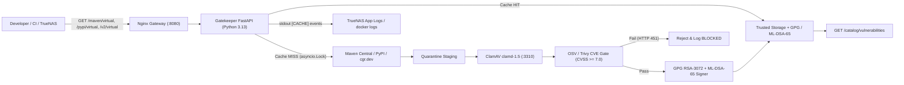

# ADR 0003: Chainguard Wolfi Zero-CVE Containers, Virtual Pull-Through, and Cache Telemetry

* **Status:** Accepted
* **Deciders:** Enterprise Architecture & Supply Chain Security Governance
* **Date:** 2026-11-14

---

## 1. Context & Problem Statement

Following the initial hardening in [ADR 0002](0002-gatekeeper-security-hardening-and-fail-closed-controls.md), operational deployment on TrueNAS SCALE (`ghcr.io/jsoehner/trusted-oss-gatekeeper:latest`) revealed four areas needing improvement:

1. **Base Image CVEs & Size**: The single-stage `python:3.12-slim-bookworm` Debian appliance image weighed 467 MB and inherited Debian OS-package CVEs alongside build-time tooling.
2. **Python Runtime Alignment**: GitHub Actions CI ran on Python 3.13 while the containers used Python 3.12, creating version skew.
3. **Cache Miss Ergonomics & Vulnerability Visibility**: Clients needed transparent virtual repository endpoints (`/maven/virtual/`, `/pypi/virtual/`, `/v2/virtual/`) that scan and sign on cache miss, dynamic discovery of dependencies across active repositories, and a frontend view showing all cached components with per-version vulnerability status.
4. **TrueNAS Container Logging**: Cache hits, upstream fetches, CVE blocks, and promotions were recorded only in `audit/provenance.jsonl` and were not visible in TrueNAS SCALE's container app log viewer (`stdout`/`stderr`).

---

## 2. Decision Drivers

1. **Zero-CVE Runtime Footprint**: Replace Debian `slim-bookworm` with a minimal Chainguard Wolfi multi-stage build, stripping `pip` and build artifacts from the final image.
2. **Python 3.13 Standard-GIL Alignment**: Standardize CI and containers on Python 3.13 (standard GIL) for optimal `asyncio` + `uvloop` + `httptools` + `pydantic-core` wheel compatibility and reduced `asyncio.to_thread` overhead.
3. **On-Demand Pull-Through with Single-Flight Safety**: Deduplicate concurrent cache misses with per-artifact `asyncio.Lock` and gate promotion via ClamAV + OSV/Trivy (`CVSS >= 7.0`).
4. **Operational Observability**: Emit structured `[CACHE]` telemetry to `stdout` and expose `GET /catalog/vulnerabilities` for frontend per-version reporting.

---

## 3. Decision Outcome

1. **Chainguard Wolfi Multi-Stage Images (`Dockerfile`, `gatekeeper/Dockerfile`)**:
   - Stage 1 (`builder`) installs `python-3.13` and `py3.13-pip` in `cgr.dev/chainguard/wolfi-base:latest` to build `/opt/venv`.
   - Stage 2 copies `/opt/venv` into a fresh `cgr.dev/chainguard/wolfi-base:latest` runtime with only `bash`, `ca-certificates`, `clamav-1.5`, `curl`, `gpg`, `gpg-agent`, `nginx-stable`, `python-3.13`, and `supervisor`, reducing the NAS appliance image from 467 MB to 317 MB (~32% reduction).
2. **Virtual Pull-Through & Dynamic Discovery (`gatekeeper/app/virtual_repo.py`, `gatekeeper/app/discovery.py`, `scripts/dynamic_warmup.py`)**:
   - Added `/maven/virtual/`, `/pypi/virtual/simple/`, `/pypi/virtual/packages/`, and `/v2/virtual/` with `asyncio.Lock` single-flighting and OSV/Trivy CVE gating.
   - Added `POST /catalog/discover` and `scripts/dynamic_warmup.py` to discover dependencies from local workspaces and GitHub projects and persist `dynamic-catalog.json` (with fallback to `audit/dynamic-catalog.json`).
3. **Per-Version Vulnerability Inventory & TrueNAS Stdout Logging (`gatekeeper/app/main.py`, `gatekeeper/app/signer.py`, `scripts/catalog_frontend.py`)**:
   - Extended `provenance.jsonl` with `max_cvss` and `cve_ids`.
   - Added `GET /catalog/vulnerabilities` and updated `scripts/catalog_frontend.py` to display every cached component version alongside its signature and vulnerability status (`CLEAN`, `VULNERABLE`, `UNSCANNED`).
   - Configured `gatekeeper` stdout logging (`[CACHE] HIT`, `PROMOTED`, `BLOCKED`, `WARMUP_SUMMARY`) for TrueNAS SCALE container app logs.

---

## 4. Consequences

* **Image Footprint & Security**: The NAS appliance image is 317 MB (down from 467 MB) and built on Chainguard Wolfi packages without Debian OS CVEs.
* **Runtime Alignment**: Local containers, standalone `gatekeeper`, and GitHub Actions CI all run on Python 3.13.
* **Observability**: Operators can inspect real-time caching and security decisions directly in TrueNAS SCALE App Logs or query `GET /catalog/vulnerabilities` via `scripts/catalog_frontend.py`.
