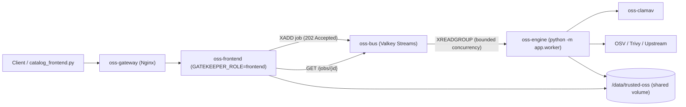
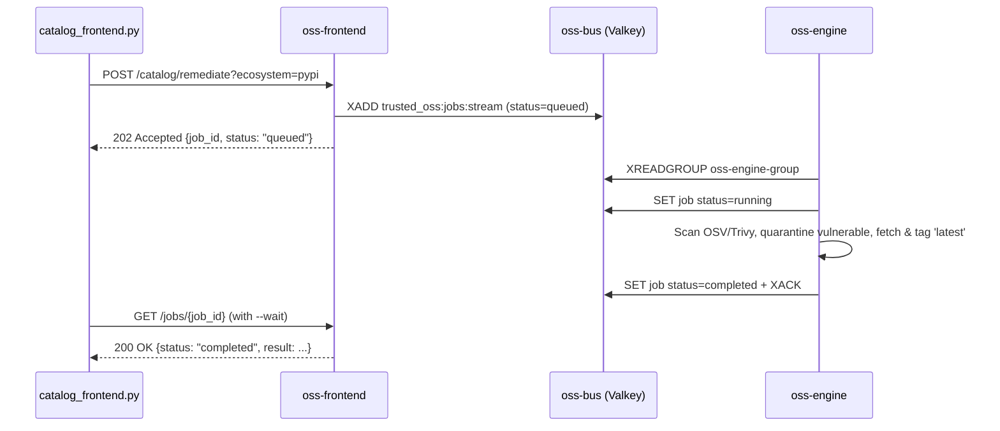

# ADR 0004: Decoupled Frontend, Engine Worker, and Valkey Message Bus Architecture

- **Status:** Accepted
- **Date:** 2026-11-14
- **Version:** 1.0.0

## Context and Problem Statement

Running the HTTP request server, ClamAV/Trivy/OSV vulnerability scans, upstream archive downloads, GPG/ML-DSA-65 signing subprocesses, and periodic CVE remediation inside a single `oss-gatekeeper` process caused CPU and memory contention on resource-constrained NAS hardware (e.g., TrueNAS SCALE containers). Heavy operations such as `POST /catalog/remediate` and `POST /catalog/warm` or per-file `gpg --verify` calls could block or saturate the event loop, resulting in client timeouts on `GET /catalog/vulnerabilities` and `catalog_frontend.py`.

## Decision Drivers

1. **Responsive Read/Serve Path**: Artifact downloads (`/maven/*`, `/pypi/*`, `/v2/*`), key distribution (`/keys/*`), and inventory queries (`/catalog/vulnerabilities`) must remain fast and non-blocking regardless of background scanning load.
2. **Backpressure & Bounded Concurrency**: Heavy scanning, upstream fetches, and auto-remediation must execute asynchronously with configurable bounded concurrency (`ENGINE_MAX_CONCURRENCY`) so constrained hosts are never overwhelmed.
3. **Lightweight Message Bus**: The message broker must consume minimal RAM (<30 MB) on NAS appliances and support consumer groups with acknowledgement and job status persistence.
4. **Backwards Compatibility**: Single-container NAS appliance builds (`Dockerfile` + `supervisord`) and local unit tests must continue to operate seamlessly without requiring an external broker when `BUS_URL` is unset.

## Decision

We split `oss-gatekeeper` into a three-tier decoupled architecture (`1.0.0`):

1. **Frontend Service (`oss-frontend`, `GATEKEEPER_ROLE=frontend`)**:
   - Serves HTTP traffic behind `oss-gateway` (Nginx): artifact reads, `maven-metadata.xml`, PEP 503 indices, `/catalog/vulnerabilities`, `/audit/provenance`, `/keys/*`, and `/healthz`.
   - Enqueues heavy operations (`POST /catalog/remediate`, `POST /catalog/warm`) onto the message bus and immediately returns `HTTP 202 Accepted` with a `job_id`, exposing `GET /jobs` and `GET /jobs/{job_id}` for progress/result inspection.
   - `GET /catalog/vulnerabilities` checks `.asc`/`.mldsa65` sidecars directly by default (`verify_signatures=false`) instead of forking 200+ `gpg --verify` subprocesses per request.
2. **Message Bus (`oss-bus`, `valkey/valkey:8-alpine`)**:
   - Implemented in `gatekeeper/app/bus.py` (`ValkeyJobBus`) using Redis/Valkey Streams (`XADD`, `XREADGROUP`, `XACK`) and TTL-bounded job state keys (`trusted_oss:job:<job_id>`).
   - Falls back to `InMemoryJobBus` (`asyncio.Queue`) when `BUS_URL` is empty (single-container appliance and tests).
3. **Engine Worker (`oss-engine`, `python -m app.worker`, `GATEKEEPER_ROLE=engine`)**:
   - Consumes `remediate` and `warm` jobs from `oss-bus` with bounded concurrency (`ENGINE_MAX_CONCURRENCY`, default `2`).
   - Executes the hourly CVE rescan loop (`CVE_RESCAN_INTERVAL_SECONDS=3600`), OSV/Trivy vulnerability checks, ClamAV scans, GPG + ML-DSA-65 signing, quarantine moves, and `'latest'` tag updates on the shared `/data/trusted-oss` volume.

## Consequences

- **Positive**:
  - HTTP serving (`oss-frontend`) stays responsive under heavy remediation or catalog warming workloads.
  - Constrained NAS deployments cap scan/upgrade parallelism via `ENGINE_MAX_CONCURRENCY` without dropping requests.
  - Clear separation of container logs between HTTP access/cache hits (`oss-frontend`) and background security/remediation activity (`oss-engine`).
- **Negative / Trade-offs**:
  - Multi-container Compose deployments add a lightweight `valkey/valkey:8-alpine` container (~15–30 MB RAM) and `oss-engine` container.
  - Callers invoking `POST /catalog/remediate` against `oss-frontend` receive `202 Accepted` unless `wait=true` or `--wait` is passed.
