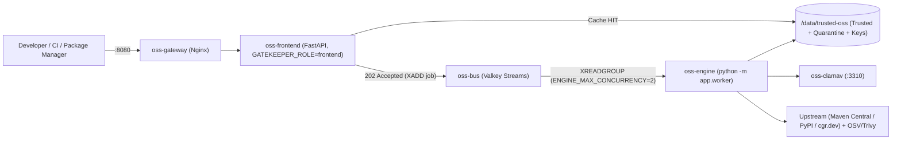
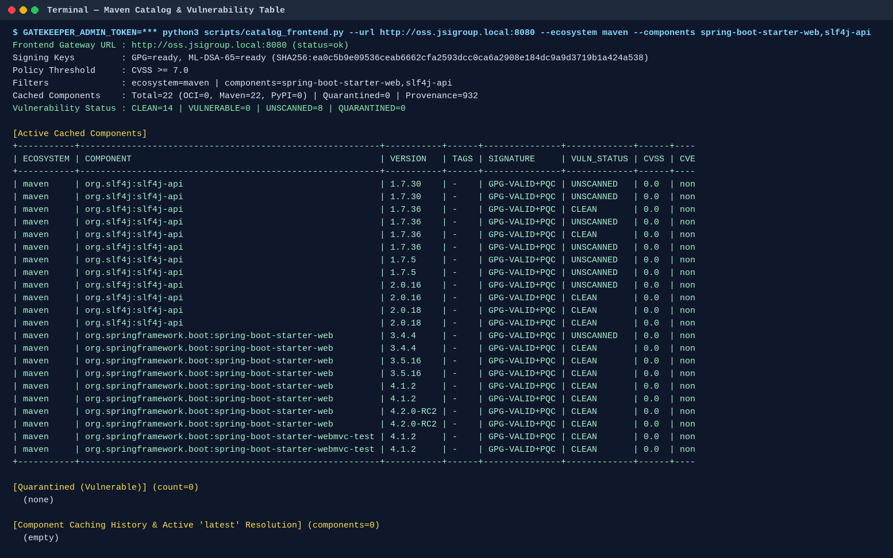
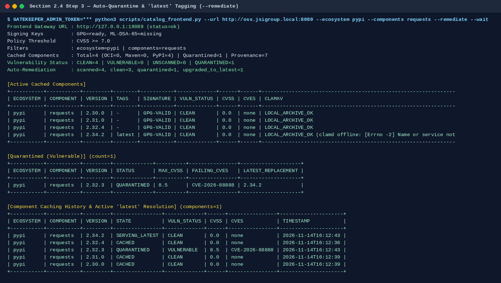

# Trusted OSS Supply Chain Platform — Operations Manual (`v1.4.0`)

This manual documents every operational capability of `trusted-oss-harbor` (`v1.4.0`), how to run and maintain the decoupled **Frontend + Engine + Valkey Message Bus** stack and the single-container **TrueNAS / NAS Appliance** image (`ghcr.io/jsoehner/trusted-oss-gatekeeper:1.4.0`), and how to integrate existing Java (Maven), Python (`uv`/`pip`), OCI/Docker, and GitHub Actions projects.

---

## 1. Architecture & Components

`trusted-oss-harbor` separates **HTTP request serving** from **heavy scanning and remediation** so package managers and inventory queries stay fast even on resource-constrained NAS hosts (such as TrueNAS SCALE).



| Service / Component | Role | Key Environment / Config |
| :--- | :--- | :--- |
| **`oss-gateway`** | Unified Nginx reverse proxy (`:8080` / `:8443`) | `config/nginx/oss-gateway.conf` |
| **`oss-frontend`** | Serves artifacts, PEP 503 / Maven metadata, keys, provenance, `/catalog/vulnerabilities`, and `/jobs` | `GATEKEEPER_ROLE=frontend`, `BUS_URL=redis://oss-bus:6379/0` |
| **`oss-bus`** | Lightweight Valkey Streams broker & job state store (~15–30 MB RAM) | `valkey/valkey:8-alpine` |
| **`oss-engine`** | Consumes `remediate` & `warm` jobs, runs hourly CVE rescans, ClamAV/OSV/Trivy checks, quarantine, and signing | `GATEKEEPER_ROLE=engine`, `ENGINE_MAX_CONCURRENCY=2`, `CVE_RESCAN_INTERVAL_SECONDS=3600` |
| **`oss-clamav`** | Antivirus daemon (`INSTREAM` TCP `:3310`) | `clamav/clamav:1.4` |

> [!NOTE]
> In single-container NAS appliance deployments (`Dockerfile` + `supervisord`), `GATEKEEPER_ROLE=all` runs with an automatic `InMemoryJobBus` fallback when `BUS_URL` is unset.

---

## 2. Core Functionality & Live Verification

### 2.1 Health Check & Post-Quantum Key Distribution

Every client and monitoring probe can verify service readiness, active role, bus backend, CVSS policy threshold, and the **GPG + NIST FIPS 204 ML-DSA-65** signing authorities:

- `GET /healthz` — Returns service status, version, role, bus backend, signing key readiness, and `cvss_fail_threshold`.
- `GET /keys/trusted-oss-pubkey.asc` — ASCII-armored Trusted OSS GPG public key.
- `GET /keys/trusted-oss-mldsa65.pub` — ML-DSA-65 post-quantum public key.
- `GET /keys/trusted-oss-mldsa65.fingerprint` — SHA-256 and SHA-384 key fingerprints.


### 2.2 Virtual Pull-Through & Trusted-Only Repositories

| Ecosystem | Virtual Pull-Through Endpoint (Auto-Quarantine -> Scan -> Sign) | Trusted-Only Endpoint (Pre-Signed Only) |
| :--- | :--- | :--- |
| **Maven** | `/maven/virtual/{group/artifact/version/file}` | `/maven/trusted/{group/artifact/version/file}` |
| **PyPI (PEP 503)** | `/pypi/virtual/simple/{pkg}/` | `/pypi/trusted/simple/{pkg}/` |
| **OCI (Chainguard)** | `/v2/chainguard-cache/{repo}/manifests/{ref}` | Harbor OCI Proxy Cache |

On a cache miss, `oss-frontend` / `oss-engine` uses per-artifact `asyncio.Lock` single-flight deduplication to:
1. Stream the upstream artifact into `packages/quarantine/` (enforcing `MAX_ARTIFACT_BYTES`).
2. Inspect `.jar`/`.whl`/`.tar.gz` archives for Zip-Slip traversal, symlinks, and encrypted entries.
3. Scan via ClamAV (`INSTREAM`) and OSV/Trivy (`CVSS_FAIL_THRESHOLD=7.0`).
4. Dual-sign clean artifacts with **GPG RSA-3072 (`.asc`)** and **ML-DSA-65 (`.mldsa65`)**, write `.sha256`/`.sha384`/`.sha512` digests, append an HMAC-SHA384 provenance entry to `audit/provenance.jsonl`, and atomically promote to `trusted-maven/` or `trusted-pypi/`.
5. Block infected or `CVSS >= 7.0` artifacts with `HTTP 451 Unavailable For Legal Reasons`.

### 2.3 Per-Version Vulnerability Catalog, Filtering & ASCII Tables

Use `scripts/catalog_frontend.py` to inspect cached components, signatures, ClamAV status, CVSS/CVE status, quarantined versions, and component caching history. It supports comma-separated `--ecosystem` and `--components` filters:

```bash
# PyPI components filtered by name
GATEKEEPER_ADMIN_TOKEN="<token>" \
  python3 scripts/catalog_frontend.py \
  --url http://oss.jsigroup.local:8080 \
  --ecosystem pypi \
  --components requests,httpx
```


```bash
# Maven components filtered by name
GATEKEEPER_ADMIN_TOKEN="<token>" \
  python3 scripts/catalog_frontend.py \
  --url http://oss.jsigroup.local:8080 \
  --ecosystem maven \
  --components spring-boot-starter-web,slf4j-api
```



### 2.4 Hourly CVE Rescan, Unscanned Sweeps, Auto-Quarantine & `N-2` Garbage Collection

`oss-engine` runs an initial `only_unscanned=true` sweep shortly after startup and an hourly rescan + garbage collection loop (`CVE_RESCAN_INTERVAL_SECONDS=3600`). Follow these four steps to inspect scheduled activity, scan `UNSCANNED` components, remediate newly vulnerable versions, and prune `N-2+` artifacts:

1. **Step 1 — Inspect the Scheduled Task & Engine Activity Log (`--activity`)**:
   Query `GET /audit/activity` to verify that `INITIAL_UNSCANNED_SCAN`, `HOURLY_CVE_RESCAN`, and `HOURLY_GC` ran and see what each run did:
   ```bash
   GATEKEEPER_ADMIN_TOKEN="<token>" \
     python3 scripts/catalog_frontend.py --url http://oss.jsigroup.local:8080 --activity
   ```
   

2. **Step 2 — Force Scanning of `UNSCANNED` Components (`--scan-unscanned --wait --activity`)**:
   Trigger an immediate sweep of every cached component whose provenance status classifies as `UNSCANNED` (including legacy `OSV_SKIPPED` or `NO_VULN_HEADER` records), persist `CLEAN` verdicts, and print the updated `MANUAL_UNSCANNED_SCAN` event:
   ```bash
   GATEKEEPER_ADMIN_TOKEN="<token>" \
     python3 scripts/catalog_frontend.py --url http://oss.jsigroup.local:8080 --scan-unscanned --wait --activity
   ```
   

3. **Step 3 — Auto-Quarantine Vulnerable Versions & Tag Clean `'latest'` (`--remediate --wait`)**:
   When a CVE exceeds `CVSS_FAIL_THRESHOLD` (`7.0`), `oss-engine` moves the vulnerable version to `packages/quarantine/`, fetches the newest clean upstream version, tags it `'latest'`, and displays `[Quarantined (Vulnerable)]` plus `[Component Caching History & Active 'latest' Resolution]`:
   ```bash
   GATEKEEPER_ADMIN_TOKEN="<token>" \
     python3 scripts/catalog_frontend.py --url http://oss.jsigroup.local:8080 \
     --ecosystem pypi --components requests --remediate --wait
   ```
   

4. **Step 4 — `N-2` Garbage Collection (`--gc --wait --activity`)**:
   Prune cached versions that are 2+ versions older than `latest` (`GC_RETENTION_VERSIONS=2` keeps `N` and `N-1`; pass `--gc-dry-run` to preview or `--gc-keep <n>` to override):
   ```bash
   GATEKEEPER_ADMIN_TOKEN="<token>" \
     python3 scripts/catalog_frontend.py --url http://oss.jsigroup.local:8080 \
     --ecosystem pypi --gc --wait --activity
   ```
   

### 2.5 Asynchronous Engine Jobs (`POST /catalog/remediate`, `GET /jobs`)

When `oss-frontend` runs with `GATEKEEPER_ROLE=frontend`, heavy mutations (`POST /catalog/remediate` and `POST /catalog/warm`) enqueue a job onto `oss-bus` and return `HTTP 202 Accepted` with a `job_id`:

```bash
# Trigger immediate targeted remediation asynchronously (returns 202 Accepted)
GATEKEEPER_ADMIN_TOKEN="<token>" \
  python3 scripts/catalog_frontend.py \
  --url http://oss.jsigroup.local:8080 \
  --ecosystem pypi \
  --components requests \
  --remediate

# Trigger remediation and wait for oss-engine to complete via GET /jobs/{job_id}
GATEKEEPER_ADMIN_TOKEN="<token>" \
  python3 scripts/catalog_frontend.py \
  --url http://oss.jsigroup.local:8080 \
  --ecosystem pypi,maven \
  --remediate --wait
```

---

## 3. Maintenance & Operations

### 3.1 Starting, Stopping, and Viewing Logs

```bash
# Start full decoupled stack (oss-bus, oss-frontend, oss-engine, oss-clamav, oss-gateway)
docker compose up -d --build

# Check service health
docker compose ps
curl -fsS http://oss.jsigroup.local:8080/healthz

# Stream Frontend HTTP/cache logs vs. Engine worker/remediation logs
docker logs -f oss-frontend
docker logs -f oss-engine
```

On TrueNAS SCALE, `[CACHE]` and `[ENGINE]` stdout lines appear directly in the **Apps -> trusted-oss-gatekeeper -> Logs** panel.

### 3.2 Dynamic Workspace & GitHub Discovery Warmup

Automatically discover dependencies across local projects (`pom.xml`, `build.gradle`, `requirements.txt`, `pyproject.toml`, `Dockerfile`) and GitHub repositories, then warm the cache:

```bash
GATEKEEPER_ADMIN_TOKEN="<token>" \
  python3 scripts/dynamic_warmup.py \
  --roots "$HOME" \
  --github \
  --warm \
  --gatekeeper-url http://oss.jsigroup.local:8080
```

#### Incremental Cache Primer (`scripts/prime_cache.py`)

When you add a new project with new dependencies, run `scripts/prime_cache.py` to compare all discovered components in your workspace against Gatekeeper's `/catalog/vulnerabilities` inventory, report **Already Cached** vs. **Will Be Queued & Fetched**, and queue only the missing items via `POST /catalog/warm`:

```bash
# Preview what is already cached vs. what will be queued & fetched
python3 scripts/prime_cache.py --url http://oss.jsigroup.local:8080 --dry-run

# Queue missing components (and wait for the warmup job to finish)
GATEKEEPER_ADMIN_TOKEN="<token>" \
  python3 scripts/prime_cache.py --url http://oss.jsigroup.local:8080 --wait
```

Use `--roots /path/to/new-project` to scope discovery to a specific directory, or `--json` for machine-readable output.

To schedule this automatically every day against your LAN server (`http://oss.jsigroup.local:8080`), install the systemd user timer:

```bash
./scripts/install_prime_timer.sh http://oss.jsigroup.local:8080
```

This creates `~/.config/systemd/user/trusted-oss-prime.service` and `trusted-oss-prime.timer` (running daily at `06:00` local time, reading `GATEKEEPER_ADMIN_TOKEN` from `~/.config/trusted-oss-harbor/prime.env`).

### 3.3 Storage & Scanner Cache Inspection

Inspect the backing storage directory (`/mnt/Pool1/trusted-oss-data` on TrueNAS SCALE, or a local/iSCSI `OSS_DATA_ROOT`), GPG/ML-DSA keys, NVD/ClamAV/Trivy caches, and quarantine count:

```bash
python3 scripts/catalog_storage.py --data-root /mnt/Pool1/trusted-oss-data
```

### 3.4 Running the Automated Verification Suite

Run the full offline unit and integration suite (31 tests covering path containment, archive security, ClamAV, OSV/Trivy gates, ML-DSA-65 + GPG dual signing, virtual pull-through, auto-quarantine remediation, and `oss-bus` async job queuing):

```bash
PYTHONPATH=gatekeeper uv run --python 3.11 --with-requirements gatekeeper/requirements.txt \
  pytest gatekeeper/tests -k "not test_live_remote_chainguard_cgr_and_maven_central_spring_boot_caching" -q
```


### 3.5 Daily Email & SMS Notifications (Outlook Port 587 / Graph 443 / SMS)

`scripts/daily_digest.py` and the in-container `run_daily_digest_loop` summarize gateway health, vulnerability counts, **cache capacity & disk runway** (`GET /catalog/retention`), **replaced vulnerable components**, **90-day inactivity space recovery** (`GC_MAX_UNUSED_DAYS=90`, warning at `GC_WARN_UNUSED_DAYS=75`), and the last 24 hours of `/audit/activity` events. Clean cached components are retained until they become vulnerable or remain unaccessed for over 90 days.

Preview the digest locally without sending:

```bash
GATEKEEPER_ADMIN_TOKEN="<token>" \
  python3 scripts/daily_digest.py --url http://oss.jsigroup.local:8080 --dry-run
```

Send via personal Outlook.com (`smtp-mail.outlook.com:587`) or Microsoft 365 (`smtp.office365.com:587`) using an app password, plus optional carrier Email-to-SMS (`@vtext.com`, `@txt.att.net`, `@tmomail.net`):

```bash
GATEKEEPER_ADMIN_TOKEN="<token>" \
  SMTP_HOST="smtp-mail.outlook.com" \
  SMTP_PORT=587 \
  SMTP_USER="you@outlook.com" \
  SMTP_PASSWORD="<app-password>" \
  python3 scripts/daily_digest.py \
    --url http://oss.jsigroup.local:8080 \
    --to "ops@example.com" \
    --sms-to "5551234567@vtext.com"
```

Alternative HTTPS port `443` transports (recommended when **MFA is enabled** or SMTP AUTH / port `587` is blocked):
- **Microsoft Graph OAuth2 Device Code + Long-Lived Refresh Token** (supports MFA, works over HTTPS `443`, and auto-rotates the refresh token on every daily run):
  1. Register a free Entra ID / Azure AD App Registration (Public client / native, **Allow public client flows = Yes**) with delegated Microsoft Graph permissions `Mail.Send` and `offline_access`.
  2. Run the one-time interactive MFA login to store the refresh token in `~/.config/trusted-oss-harbor/msgraph_token.json` (`chmod 600`):
     ```bash
     python3 scripts/daily_digest.py \
       --graph-auth \
       --graph-client-id "<your-app-client-id>" \
       --graph-tenant-id "common"
     ```
  3. Send daily email + carrier Email-to-SMS over HTTPS `443` using the cached refresh token:
     ```bash
     GATEKEEPER_ADMIN_TOKEN="<token>" \
       python3 scripts/daily_digest.py \
         --url http://oss.jsigroup.local:8080 \
         --to "ops@example.com" \
         --sms-to "5551234567@vtext.com"
     ```
  4. Or run it automatically inside the `oss-engine` Docker container by setting these in `.env` and restarting `docker compose up -d --build oss-engine` (rotated tokens persist in `/data/trusted-oss/audit/msgraph_token.json` and send timestamps in `last_digest_sent.txt`, controlled by `DIGEST_INTERVAL_SECONDS=86400`):
     ```dotenv
     DIGEST_ENABLED=true
     DIGEST_TO=ops@example.com
     DIGEST_SMS_TO=5551234567@vtext.com
     GRAPH_CLIENT_ID=<your-app-client-id>
     GRAPH_TENANT_ID=common
     GRAPH_REFRESH_TOKEN=<refresh_token_from_msgraph_token.json>
     ```
  5. Or enable it in the single-container **TrueNAS / NAS Appliance** (`ghcr.io/jsoehner/trusted-oss-gatekeeper:1.4.0` or `:latest`, where `/data` is your persistent volume):
     ```yaml
     environment:
       - DIGEST_ENABLED=true
       - DIGEST_INTERVAL_SECONDS=86400
       - DIGEST_TO=ops@example.com
       - DIGEST_SMS_TO=5551234567@vtext.com
       - GRAPH_CLIENT_ID=<your-app-client-id>
       - GRAPH_TENANT_ID=<your-tenant-id-or-common>
       - GRAPH_REFRESH_TOKEN=<refresh_token_from_msgraph_token.json>
       - GRAPH_TOKEN_FILE=/data/audit/msgraph_token.json
     ```
- **Microsoft Graph (direct token)**: pass `--graph-token "$GRAPH_ACCESS_TOKEN"` and `--to "ops@example.com"`.
- **Twilio SMS**: pass `--twilio-sid`, `--twilio-token`, `--twilio-from`, and `--twilio-to "+15551234567"`.

Schedule a daily cron job on the host (e.g., 07:30 every day, using the cached Graph refresh token) in `crontab -e`:

```cron
30 7 * * * cd /home/jsoehner/trusted-oss-harbor && GATEKEEPER_ADMIN_TOKEN="<token>" /usr/bin/python3 scripts/daily_digest.py --url http://oss.jsigroup.local:8080 --to "ops@example.com" --sms-to "5551234567@vtext.com" >> /var/log/oss-harbor-digest.log 2>&1
```

---

## 4. Integrating Existing Software Projects

### 4.0 Public-by-Default & Single-Variable Opt-In (`scripts/configure_trusted_cache.py`)

Every repository defaults to **public upstream repositories** (Maven Central, PyPI, `cgr.dev`) when `TRUSTED_OSS_CACHE_URL` is unset. When you download or onboard a repository and want to route it to your Trusted OSS Cache (or switch it back to public), run:

```bash
# Interactive prompt (defaults to public repos; enter your Trusted Cache URL to opt in)
python3 scripts/configure_trusted_cache.py --repo /path/to/repo --interactive

# Non-interactive switch (updates .mvn/settings.xml, .mvn/maven.config, uv.toml, .env)
python3 scripts/configure_trusted_cache.py --repo /path/to/repo --url https://oss.yourdomain.com

# Also set the GitHub Actions variable TRUSTED_OSS_CACHE_URL on the remote repo
python3 scripts/configure_trusted_cache.py --repo /path/to/repo --github-repo owner/repo --url https://oss.yourdomain.com

# Revert back to public upstream repositories
python3 scripts/configure_trusted_cache.py --repo /path/to/repo --public
```

### 4.1 Java / Maven Projects

1. Copy [`client-templates/maven-settings.xml`](../client-templates/maven-settings.xml) to `~/.m2/settings.xml` and set `HARBOR_DOMAIN` (or point `<url>` to `http://oss.jsigroup.local:8080/maven/virtual` for pull-through or `/maven/trusted` for pre-approved artifacts only).
2. *(Optional strict signature enforcement)* Add [`client-templates/pgpverify-plugin-snippet.xml`](../client-templates/pgpverify-plugin-snippet.xml) to your project's `pom.xml` under `<build><plugins>` so Maven fails the build if any dependency lacks a valid `.asc` signature from `/keys/trusted-oss-pubkey.asc`.

### 4.2 Python Projects (`uv` and `pip`)

Drop [`client-templates/uv.toml`](../client-templates/uv.toml) into your project root (or `~/.config/uv/uv.toml`):

```toml
index-url = "http://oss.jsigroup.local:8080/pypi/virtual/simple"
no-build = true
```

For `pip`, export:

```bash
export PIP_INDEX_URL="http://oss.jsigroup.local:8080/pypi/virtual/simple"
```

Use `/pypi/trusted/simple` instead of `/pypi/virtual/simple` in production CI if you only want pre-warmed, already-signed wheels.

### 4.3 Post-Quantum (ML-DSA-65) Client Verification

Verify any downloaded artifact against its `.mldsa65` signature using [`client-templates/pqc-verify.py`](../client-templates/pqc-verify.py):

```bash
curl -fsSLO http://oss.jsigroup.local:8080/keys/trusted-oss-mldsa65.pub
python3 client-templates/pqc-verify.py \
  --pubkey trusted-oss-mldsa65.pub \
  --artifact my-package.whl \
  --sig my-package.whl.mldsa65
```

### 4.4 Container Builds (Chainguard Zero-CVE Base Images)

Point Dockerfiles to the Harbor Chainguard proxy cache (see [`containers/chainguard-jre-python/Dockerfile`](../containers/chainguard-jre-python/Dockerfile)):

```dockerfile
FROM ${HARBOR_REGISTRY}/chainguard-cache/chainguard/jre:latest
```

### 4.5 Setting Up a GitHub Repository for the Local Trusted Container Cache

Repositories remain **public-by-default** (Maven Central, PyPI, `cgr.dev`) until you opt a repository in with `TRUSTED_OSS_CACHE_URL`. Follow these steps to connect any GitHub repository to your local TrueNAS `trusted-oss-gatekeeper` container behind pfSense:

1. **Ensure pfSense Edge & mTLS PKI Are Ready**:
   - Complete [`docs/pfsense-haproxy-mtls-guide.md`](pfsense-haproxy-mtls-guide.md) so pfSense WAN `:443` accepts GitHub Actions CIDRs with mTLS (`Trusted-OSS-GitHub-Client-CA`) and forwards to `<TRUENAS_LAN_IP>:8080`.
   - Locate `./mtls-pki/client.crt` and `./mtls-pki/client.key` generated by `./scripts/generate_mtls_keys.sh`.

2. **Add mTLS Client Secrets to the GitHub Repository (or Organization)**:
   ```bash
   gh secret set OSS_MTLS_CLIENT_CERT -R owner/repo < mtls-pki/client.crt
   gh secret set OSS_MTLS_CLIENT_KEY  -R owner/repo < mtls-pki/client.key
   ```
   *(In GitHub WebUI: **Settings → Secrets and variables → Actions → Secrets → New repository secret**.)*

3. **Opt the Repository In via `TRUSTED_OSS_CACHE_URL`**:
   ```bash
   # Enable trusted cache routing for this repo (use --mode virtual or trusted)
   gh variable set TRUSTED_OSS_CACHE_URL -R owner/repo --body "https://oss.yourdomain.com"
   gh variable set TRUSTED_OSS_MODE      -R owner/repo --body "virtual"

   # Or configure both local files (.mvn/settings.xml, uv.toml, .env) and GitHub variable together:
   python3 scripts/configure_trusted_cache.py \
     --repo /path/to/repo \
     --github-repo owner/repo \
     --url https://oss.yourdomain.com
   ```
   *(To revert a repository back to public upstream registries, delete `TRUSTED_OSS_CACHE_URL` or run `configure_trusted_cache.py --public`.)*

4. **Add the Trusted OSS Step to `.github/workflows/*.yml`**:
   - Copy [`client-templates/github-actions-trusted-oss.yml`](../client-templates/github-actions-trusted-oss.yml) into your workflow before `mvn`, `pip`, or `uv` commands (and include [`client-templates/maven-settings.xml`](../client-templates/maven-settings.xml) if building Maven projects).
   - When `vars.TRUSTED_OSS_CACHE_URL` is **unset**, the step exits `0` and uses public upstream registries.
   - When `vars.TRUSTED_OSS_CACHE_URL` is **set**, the step writes `~/.oss-tls/client.{crt,key,p12}`, imports `/keys/trusted-oss-pubkey.asc`, exports `MAVEN_OPTS`, `PIP_INDEX_URL`, and `UV_INDEX_URL`, and generates `~/.m2/settings.xml`.

5. **Verify End-to-End Connectivity**:
   - Run [`.github/workflows/probe-wan-connectivity.yml`](../.github/workflows/probe-wan-connectivity.yml) (`gh workflow run probe-wan-connectivity.yml`) and confirm `/healthz` returns `HTTP/2 200` with mTLS while unauthenticated requests without a client certificate are rejected.

6. **Signed Upstream SBOM/CBOM Attestations & Backfill (`v1.6.0+`)**:
   - Every newly promoted Maven, PyPI, or OCI artifact automatically generates dual-signed CycloneDX 1.6 `.sbom.cdx.json` and `.cbom.cdx.json` sidecars (`.asc` + `.mldsa65`), including explicit `VERIFIED_INERT` attestations when zero cryptographic primitives are present.
   - To backfill signed SBOM/CBOM sidecars for artifacts cached prior to `v1.6.0`:
     ```bash
     curl -fsSL -X POST \
       -H "X-Gatekeeper-Token: ${GATEKEEPER_ADMIN_TOKEN}" \
       "http://oss.jsigroup.local:8080/catalog/backfill-boms?wait=true"
     ```
   - Downstream `jsoehner/jsi-bom-actions@v1.2.0` workflows query `POST /bom/batch` over mTLS (using `trusted-oss-url`, `trusted-oss-mtls-cert`, and `trusted-oss-mtls-key`) to eliminate third-party cryptographic blind spots.

