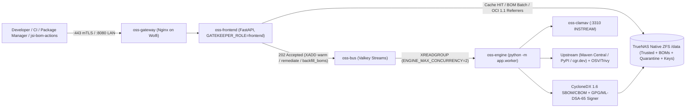
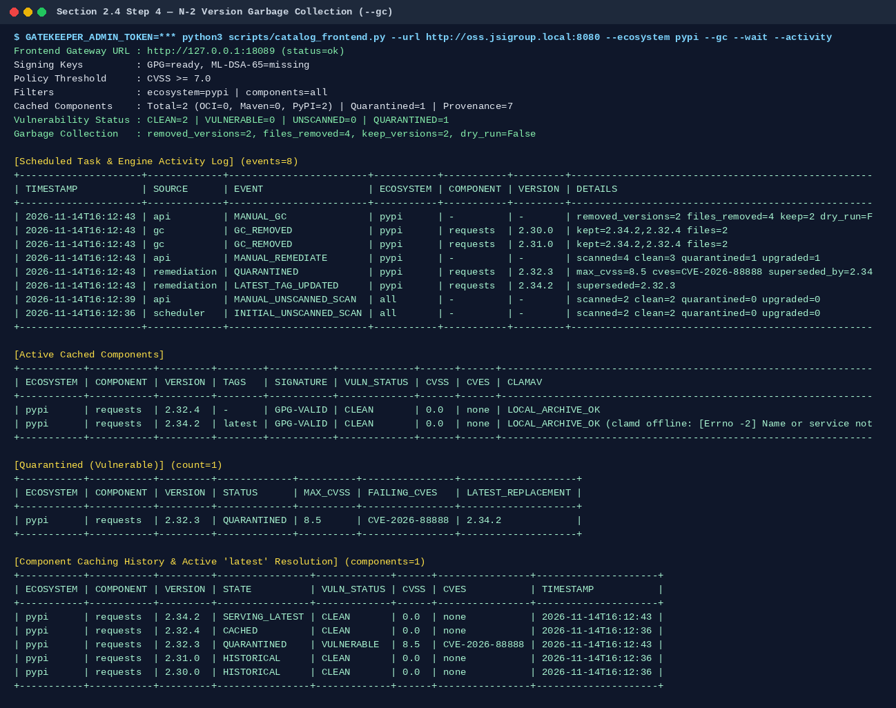
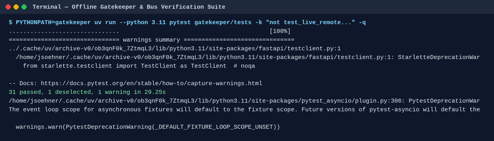
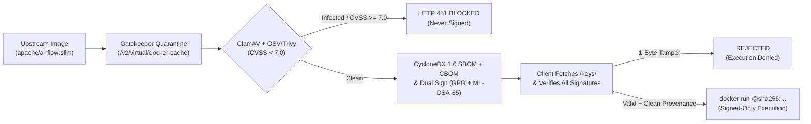

# Trusted OSS Supply Chain Platform — Operations Manual (`v1.7.0`)

This manual documents every operational capability of `trusted-oss-harbor` (`v1.7.0`), how to run and maintain the decoupled **Frontend + Engine + Valkey Message Bus** stack and the single-container **TrueNAS / NAS Appliance** image (`ghcr.io/jsoehner/trusted-oss-gatekeeper:latest`, auto-versioned per commit on `main`), and how to integrate existing Java (Maven), Python (`uv`/`pip`), OCI/Docker, BOM consumers (`jsi-bom-actions`), and GitHub Actions projects.

---

## 1. Architecture & Components

`trusted-oss-harbor` separates **HTTP request serving** from **heavy scanning, CycloneDX 1.6 SBOM/CBOM generation, and remediation** so package managers and inventory queries stay fast even on resource-constrained NAS hosts (such as TrueNAS SCALE running on native ZFS dataset `Pool1/trusted-oss-data`).




| Service / Component | Role | Key Environment / Config |
| :--- | :--- | :--- |
| **`oss-gateway`** | Unified Nginx reverse proxy (`:8080` / `:8443`) | `config/nginx/oss-gateway.conf` |
| **`oss-frontend`** | Serves artifacts, PEP 503 / Maven metadata, keys, provenance, `/catalog/vulnerabilities`, and `/jobs` | `GATEKEEPER_ROLE=frontend`, `BUS_URL=redis://oss-bus:6379/0` |
| **`oss-bus`** | Lightweight Valkey Streams broker & job state store (~15–30 MB RAM) | `valkey/valkey:8-alpine` |
| **`oss-engine`** | Consumes `remediate` & `warm` jobs, runs hourly CVE rescans, ClamAV/OSV/Trivy checks, quarantine, and signing | `GATEKEEPER_ROLE=engine`, `ENGINE_MAX_CONCURRENCY=2`, `CVE_RESCAN_INTERVAL_SECONDS=3600` |
| **`oss-clamav`** | Antivirus daemon (`INSTREAM` TCP `:3310`) | `clamav/clamav:1.4` |

> [!NOTE]
> In single-container NAS appliance deployments (`Dockerfile` + `supervisord`), `GATEKEEPER_ROLE=all` runs with an automatic `InMemoryJobBus` fallback when `BUS_URL` is unset.

---

## 2. Core Functionality & Live Verification

### 2.1 Health Check & Post-Quantum Key Distribution

Every client and monitoring probe can verify service readiness, active role, bus backend, CVSS policy threshold, and the **GPG + NIST FIPS 204 ML-DSA-65** signing authorities:

- `GET /healthz` — Returns service status, version, role, bus backend, signing key readiness, and `cvss_fail_threshold`.
- `GET /keys/trusted-oss-pubkey.asc` — ASCII-armored Trusted OSS GPG public key.
- `GET /keys/trusted-oss-mldsa65.pub` — ML-DSA-65 post-quantum public key.
- `GET /keys/trusted-oss-mldsa65.fingerprint` — SHA-256 and SHA-384 key fingerprints.


### 2.2 Virtual Pull-Through & Trusted-Only Repositories

| Ecosystem | Virtual Pull-Through Endpoint (Auto-Quarantine -> Scan -> Sign) | Trusted-Only Endpoint (Pre-Signed Only) |
| :--- | :--- | :--- |
| **Maven** | `/maven/virtual/{group/artifact/version/file}` | `/maven/trusted/{group/artifact/version/file}` |
| **PyPI (PEP 503)** | `/pypi/virtual/simple/{pkg}/` | `/pypi/trusted/simple/{pkg}/` |
| **OCI (Chainguard)** | `/v2/chainguard-cache/{repo}/manifests/{ref}` | Harbor OCI Proxy Cache |

On a cache miss, `oss-frontend` / `oss-engine` uses per-artifact `asyncio.Lock` single-flight deduplication to:
1. Stream the upstream artifact into `packages/quarantine/` (enforcing `MAX_ARTIFACT_BYTES`).
2. Inspect `.jar`/`.whl`/`.tar.gz` archives for Zip-Slip traversal, symlinks, and encrypted entries.
3. Scan via ClamAV (`INSTREAM`) and OSV/Trivy (`CVSS_FAIL_THRESHOLD=7.0`).
4. Dual-sign clean artifacts with **GPG RSA-3072 (`.asc`)** and **ML-DSA-65 (`.mldsa65`)**, write `.sha256`/`.sha384`/`.sha512` digests, append an HMAC-SHA384 provenance entry to `audit/provenance.jsonl`, and atomically promote to `trusted-maven/` or `trusted-pypi/`.
5. Block infected or `CVSS >= 7.0` artifacts with `HTTP 451 Unavailable For Legal Reasons`.

### 2.3 Per-Version Vulnerability Catalog, Filtering & ASCII Tables

Use `scripts/catalog_frontend.py` to inspect cached components, signatures, ClamAV status, CVSS/CVE status, quarantined versions, and component caching history. It supports comma-separated `--ecosystem` and `--components` filters:

```bash
# PyPI components filtered by name
GATEKEEPER_ADMIN_TOKEN="<token>" \
  python3 scripts/catalog_frontend.py \
  --url http://oss.jsigroup.local:8080 \
  --ecosystem pypi \
  --components requests,httpx
```


```bash
# Maven components filtered by name
GATEKEEPER_ADMIN_TOKEN="<token>" \
  python3 scripts/catalog_frontend.py \
  --url http://oss.jsigroup.local:8080 \
  --ecosystem maven \
  --components spring-boot-starter-web,slf4j-api
```


### 2.4 Hourly CVE Rescan, Unscanned Sweeps, Auto-Quarantine & `N-2` Garbage Collection

`oss-engine` runs an initial `only_unscanned=true` sweep shortly after startup and an hourly rescan + garbage collection loop (`CVE_RESCAN_INTERVAL_SECONDS=3600`). Follow these four steps to inspect scheduled activity, scan `UNSCANNED` components, remediate newly vulnerable versions, and prune `N-2+` artifacts:

1. **Step 1 — Inspect the Scheduled Task & Engine Activity Log (`--activity`)**:
   Query `GET /audit/activity` to verify that `INITIAL_UNSCANNED_SCAN`, `HOURLY_CVE_RESCAN`, and `HOURLY_GC` ran and see what each run did:
   ```bash
   GATEKEEPER_ADMIN_TOKEN="<token>" \
     python3 scripts/catalog_frontend.py --url http://oss.jsigroup.local:8080 --activity
   ```
   

2. **Step 2 — Force Scanning of `UNSCANNED` Components (`--scan-unscanned --wait --activity`)**:
   Trigger an immediate sweep of every cached component whose provenance status classifies as `UNSCANNED` (including legacy `OSV_SKIPPED` or `NO_VULN_HEADER` records), persist `CLEAN` verdicts, and print the updated `MANUAL_UNSCANNED_SCAN` event:
   ```bash
   GATEKEEPER_ADMIN_TOKEN="<token>" \
     python3 scripts/catalog_frontend.py --url http://oss.jsigroup.local:8080 --scan-unscanned --wait --activity
   ```
   

3. **Step 3 — Auto-Quarantine Vulnerable Versions & Tag Clean `'latest'` (`--remediate --wait`)**:
   When a CVE exceeds `CVSS_FAIL_THRESHOLD` (`7.0`), `oss-engine` moves the vulnerable version to `packages/quarantine/`, fetches the newest clean upstream version, tags it `'latest'`, and displays `[Quarantined (Vulnerable)]` plus `[Component Caching History & Active 'latest' Resolution]`:
   ```bash
   GATEKEEPER_ADMIN_TOKEN="<token>" \
     python3 scripts/catalog_frontend.py --url http://oss.jsigroup.local:8080 \
     --ecosystem pypi --components requests --remediate --wait
   ```
   

4. **Step 4 — `N-2` Garbage Collection (`--gc --wait --activity`)**:
   Prune cached versions that are 2+ versions older than `latest` (`GC_RETENTION_VERSIONS=2` keeps `N` and `N-1`; pass `--gc-dry-run` to preview or `--gc-keep <n>` to override):
   ```bash
   GATEKEEPER_ADMIN_TOKEN="<token>" \
     python3 scripts/catalog_frontend.py --url http://oss.jsigroup.local:8080 \
     --ecosystem pypi --gc --wait --activity
   ```
   

### 2.5 Asynchronous Engine Jobs (`POST /catalog/remediate`, `GET /jobs`)

When `oss-frontend` runs with `GATEKEEPER_ROLE=frontend`, heavy mutations (`POST /catalog/remediate` and `POST /catalog/warm`) enqueue a job onto `oss-bus` and return `HTTP 202 Accepted` with a `job_id`:

```bash
# Trigger immediate targeted remediation asynchronously (returns 202 Accepted)
GATEKEEPER_ADMIN_TOKEN="<token>" \
  python3 scripts/catalog_frontend.py \
  --url http://oss.jsigroup.local:8080 \
  --ecosystem pypi \
  --components requests \
  --remediate

# Trigger remediation and wait for oss-engine to complete via GET /jobs/{job_id}
GATEKEEPER_ADMIN_TOKEN="<token>" \
  python3 scripts/catalog_frontend.py \
  --url http://oss.jsigroup.local:8080 \
  --ecosystem pypi,maven \
  --remediate --wait
```

---

## 3. Maintenance & Operations

### 3.1 Starting, Stopping, and Viewing Logs

```bash
# Start full decoupled stack (oss-bus, oss-frontend, oss-engine, oss-clamav, oss-gateway)
docker compose up -d --build

# Check service health
docker compose ps
curl -fsS http://oss.jsigroup.local:8080/healthz

# Stream Frontend HTTP/cache logs vs. Engine worker/remediation logs
docker logs -f oss-frontend
docker logs -f oss-engine
```

On TrueNAS SCALE, `[CACHE]` and `[ENGINE]` stdout lines appear directly in the **Apps -> trusted-oss-gatekeeper -> Logs** panel.

### 3.2 Dynamic Workspace & GitHub Discovery Warmup

Automatically discover dependencies across local projects (`pom.xml`, `build.gradle`, `requirements.txt`, `pyproject.toml`, `Dockerfile`) and GitHub repositories, then warm the cache:

```bash
GATEKEEPER_ADMIN_TOKEN="<token>" \
  python3 scripts/dynamic_warmup.py \
  --roots "$HOME" \
  --github \
  --warm \
  --gatekeeper-url http://oss.jsigroup.local:8080
```

#### Incremental Cache Primer (`scripts/prime_cache.py`)

When you add a new project with new dependencies, run `scripts/prime_cache.py` to compare all discovered components in your workspace against Gatekeeper's `/catalog/vulnerabilities` inventory, report **Already Cached** vs. **Will Be Queued & Fetched**, and queue only the missing items via `POST /catalog/warm`:

```bash
# Preview what is already cached vs. what will be queued & fetched
python3 scripts/prime_cache.py --url http://oss.jsigroup.local:8080 --dry-run

# Queue missing components (and wait for the warmup job to finish)
GATEKEEPER_ADMIN_TOKEN="<token>" \
  python3 scripts/prime_cache.py --url http://oss.jsigroup.local:8080 --wait
```

Use `--roots /path/to/new-project` to scope discovery to a specific directory, or `--json` for machine-readable output.

To schedule this automatically every day against your LAN server (`http://oss.jsigroup.local:8080`), install the systemd user timer:

```bash
./scripts/install_prime_timer.sh http://oss.jsigroup.local:8080
```

This creates `~/.config/systemd/user/trusted-oss-prime.service` and `trusted-oss-prime.timer` (running daily at `06:00` local time, reading `GATEKEEPER_ADMIN_TOKEN` from `~/.config/trusted-oss-harbor/prime.env`).

### 3.3 Storage & Scanner Cache Inspection

Inspect the backing storage directory (`/mnt/Pool1/trusted-oss-data` on TrueNAS SCALE, or a local/iSCSI `OSS_DATA_ROOT`), GPG/ML-DSA keys, NVD/ClamAV/Trivy caches, and quarantine count:

```bash
python3 scripts/catalog_storage.py --data-root /mnt/Pool1/trusted-oss-data
```

### 3.4 Running the Automated Verification Suite

Run the full offline unit and integration suite (31 tests covering path containment, archive security, ClamAV, OSV/Trivy gates, ML-DSA-65 + GPG dual signing, virtual pull-through, auto-quarantine remediation, and `oss-bus` async job queuing):

```bash
PYTHONPATH=gatekeeper uv run --python 3.11 --with-requirements gatekeeper/requirements.txt \
  pytest gatekeeper/tests -k "not test_live_remote_chainguard_cgr_and_maven_central_spring_boot_caching" -q
```



### 3.5 Daily Email & SMS Notifications (Outlook Port 587 / Graph 443 / SMS)

`scripts/daily_digest.py` and the in-container `run_daily_digest_loop` summarize gateway health, vulnerability counts, **cache capacity & disk runway** (`GET /catalog/retention`), **replaced vulnerable components**, **90-day inactivity space recovery** (`GC_MAX_UNUSED_DAYS=90`, warning at `GC_WARN_UNUSED_DAYS=75`), and the last 24 hours of `/audit/activity` events. Clean cached components are retained until they become vulnerable or remain unaccessed for over 90 days.

Preview the digest locally without sending:

```bash
GATEKEEPER_ADMIN_TOKEN="<token>" \
  python3 scripts/daily_digest.py --url http://oss.jsigroup.local:8080 --dry-run
```

Send via personal Outlook.com (`smtp-mail.outlook.com:587`) or Microsoft 365 (`smtp.office365.com:587`) using an app password, plus optional carrier Email-to-SMS (`@vtext.com`, `@txt.att.net`, `@tmomail.net`):

```bash
GATEKEEPER_ADMIN_TOKEN="<token>" \
  SMTP_HOST="smtp-mail.outlook.com" \
  SMTP_PORT=587 \
  SMTP_USER="you@outlook.com" \
  SMTP_PASSWORD="<app-password>" \
  python3 scripts/daily_digest.py \
    --url http://oss.jsigroup.local:8080 \
    --to "ops@example.com" \
    --sms-to "5551234567@vtext.com"
```

Alternative HTTPS port `443` transports (recommended when **MFA is enabled** or SMTP AUTH / port `587` is blocked):
- **Microsoft Graph OAuth2 Device Code + Long-Lived Refresh Token** (supports MFA, works over HTTPS `443`, and auto-rotates the refresh token on every daily run):
  1. Register a free Entra ID / Azure AD App Registration (Public client / native, **Allow public client flows = Yes**) with delegated Microsoft Graph permissions `Mail.Send` and `offline_access`.
  2. Run the one-time interactive MFA login to store the refresh token in `~/.config/trusted-oss-harbor/msgraph_token.json` (`chmod 600`):
     ```bash
     python3 scripts/daily_digest.py \
       --graph-auth \
       --graph-client-id "<your-app-client-id>" \
       --graph-tenant-id "common"
     ```
  3. Send daily email + carrier Email-to-SMS over HTTPS `443` using the cached refresh token:
     ```bash
     GATEKEEPER_ADMIN_TOKEN="<token>" \
       python3 scripts/daily_digest.py \
         --url http://oss.jsigroup.local:8080 \
         --to "ops@example.com" \
         --sms-to "5551234567@vtext.com"
     ```
  4. Or run it automatically inside the `oss-engine` Docker container by setting these in `.env` and restarting `docker compose up -d --build oss-engine` (rotated tokens persist in `/data/trusted-oss/audit/msgraph_token.json` and send timestamps in `last_digest_sent.txt`, controlled by `DIGEST_INTERVAL_SECONDS=86400`):
     ```dotenv
     DIGEST_ENABLED=true
     DIGEST_TO=ops@example.com
     DIGEST_SMS_TO=5551234567@vtext.com
     GRAPH_CLIENT_ID=<your-app-client-id>
     GRAPH_TENANT_ID=common
     GRAPH_REFRESH_TOKEN=<refresh_token_from_msgraph_token.json>
     ```
  5. Or enable it in the single-container **TrueNAS / NAS Appliance** (`ghcr.io/jsoehner/trusted-oss-gatekeeper:1.4.0` or `:latest`, where `/data` is your persistent volume):
     ```yaml
     environment:
       - DIGEST_ENABLED=true
       - DIGEST_INTERVAL_SECONDS=86400
       - DIGEST_TO=ops@example.com
       - DIGEST_SMS_TO=5551234567@vtext.com
       - GRAPH_CLIENT_ID=<your-app-client-id>
       - GRAPH_TENANT_ID=<your-tenant-id-or-common>
       - GRAPH_REFRESH_TOKEN=<refresh_token_from_msgraph_token.json>
       - GRAPH_TOKEN_FILE=/data/audit/msgraph_token.json
     ```
- **Microsoft Graph (direct token)**: pass `--graph-token "$GRAPH_ACCESS_TOKEN"` and `--to "ops@example.com"`.
- **Twilio SMS**: pass `--twilio-sid`, `--twilio-token`, `--twilio-from`, and `--twilio-to "+15551234567"`.

Schedule a daily cron job on the host (e.g., 07:30 every day, using the cached Graph refresh token) in `crontab -e`:

```cron
30 7 * * * cd /home/jsoehner/trusted-oss-harbor && GATEKEEPER_ADMIN_TOKEN="<token>" /usr/bin/python3 scripts/daily_digest.py --url http://oss.jsigroup.local:8080 --to "ops@example.com" --sms-to "5551234567@vtext.com" >> /var/log/oss-harbor-digest.log 2>&1
```

---

## 4. Integrating Existing Software Projects

### 4.0 Public-by-Default & Single-Variable Opt-In (`scripts/configure_trusted_cache.py`)

Every repository defaults to **public upstream repositories** (Maven Central, PyPI, `cgr.dev`) when `TRUSTED_OSS_CACHE_URL` is unset. When you download or onboard a repository and want to route it to your Trusted OSS Cache (or switch it back to public), run:

```bash
# Interactive prompt (defaults to public repos; enter your Trusted Cache URL to opt in)
python3 scripts/configure_trusted_cache.py --repo /path/to/repo --interactive

# Non-interactive switch (updates .mvn/settings.xml, .mvn/maven.config, uv.toml, .env)
python3 scripts/configure_trusted_cache.py --repo /path/to/repo --url https://oss.yourdomain.com

# Also set the GitHub Actions variable TRUSTED_OSS_CACHE_URL on the remote repo
python3 scripts/configure_trusted_cache.py --repo /path/to/repo --github-repo owner/repo --url https://oss.yourdomain.com

# Revert back to public upstream repositories
python3 scripts/configure_trusted_cache.py --repo /path/to/repo --public
```

### 4.1 Java / Maven Projects

1. Copy [`client-templates/maven-settings.xml`](../client-templates/maven-settings.xml) to `~/.m2/settings.xml` and set `HARBOR_DOMAIN` (or point `<url>` to `http://oss.jsigroup.local:8080/maven/virtual` for pull-through or `/maven/trusted` for pre-approved artifacts only).
2. *(Optional strict signature enforcement)* Add [`client-templates/pgpverify-plugin-snippet.xml`](../client-templates/pgpverify-plugin-snippet.xml) to your project's `pom.xml` under `<build><plugins>` so Maven fails the build if any dependency lacks a valid `.asc` signature from `/keys/trusted-oss-pubkey.asc`.

### 4.2 Python Projects (`uv` and `pip`)

Drop [`client-templates/uv.toml`](../client-templates/uv.toml) into your project root (or `~/.config/uv/uv.toml`):

```toml
index-url = "http://oss.jsigroup.local:8080/pypi/virtual/simple"
no-build = true
```

For `pip`, export:

```bash
export PIP_INDEX_URL="http://oss.jsigroup.local:8080/pypi/virtual/simple"
```

Use `/pypi/trusted/simple` instead of `/pypi/virtual/simple` in production CI if you only want pre-warmed, already-signed wheels.

### 4.3 Post-Quantum (ML-DSA-65) Client Verification

Verify any downloaded artifact against its `.mldsa65` signature using [`client-templates/pqc-verify.py`](../client-templates/pqc-verify.py):

```bash
curl -fsSLO http://oss.jsigroup.local:8080/keys/trusted-oss-mldsa65.pub
python3 client-templates/pqc-verify.py \
  my-package.whl \
  my-package.whl.mldsa65 \
  trusted-oss-mldsa65.pub
```

### 4.4 Container Builds (Chainguard Zero-CVE Base Images)

Point Dockerfiles to the Harbor Chainguard proxy cache (see [`containers/chainguard-jre-python/Dockerfile`](../containers/chainguard-jre-python/Dockerfile)):

```dockerfile
FROM ${HARBOR_REGISTRY}/chainguard-cache/chainguard/jre:latest
```

### 4.5 Setting Up a GitHub Repository for the Local Trusted Container Cache

Repositories remain **public-by-default** (Maven Central, PyPI, `cgr.dev`) until you opt a repository in with `TRUSTED_OSS_CACHE_URL`. Follow these steps to connect any GitHub repository to your local TrueNAS `trusted-oss-gatekeeper` container behind pfSense:

1. **Ensure pfSense Edge & mTLS PKI Are Ready**:
   - Complete [`docs/pfsense-haproxy-mtls-guide.md`](pfsense-haproxy-mtls-guide.md) so pfSense WAN `:443` accepts GitHub Actions CIDRs with mTLS (`Trusted-OSS-GitHub-Client-CA`) and forwards to `<TRUENAS_LAN_IP>:8080`.
   - Locate `./mtls-pki/client.crt` and `./mtls-pki/client.key` generated by `./scripts/generate_mtls_keys.sh`.

2. **Add mTLS Client Secrets to the GitHub Repository (or Organization)**:
   ```bash
   gh secret set OSS_MTLS_CLIENT_CERT -R owner/repo < mtls-pki/client.crt
   gh secret set OSS_MTLS_CLIENT_KEY  -R owner/repo < mtls-pki/client.key
   ```
   *(In GitHub WebUI: **Settings → Secrets and variables → Actions → Secrets → New repository secret**.)*

3. **Opt the Repository In via `TRUSTED_OSS_CACHE_URL`**:
   ```bash
   # Enable trusted cache routing for this repo (use --mode virtual or trusted)
   gh variable set TRUSTED_OSS_CACHE_URL -R owner/repo --body "https://oss.yourdomain.com"
   gh variable set TRUSTED_OSS_MODE      -R owner/repo --body "virtual"

   # Or configure both local files (.mvn/settings.xml, uv.toml, .env) and GitHub variable together:
   python3 scripts/configure_trusted_cache.py \
     --repo /path/to/repo \
     --github-repo owner/repo \
     --url https://oss.yourdomain.com
   ```
   *(To revert a repository back to public upstream registries, delete `TRUSTED_OSS_CACHE_URL` or run `configure_trusted_cache.py --public`.)*

4. **Add the Trusted OSS Step to `.github/workflows/*.yml`**:
   - Copy [`client-templates/github-actions-trusted-oss.yml`](../client-templates/github-actions-trusted-oss.yml) into your workflow before `mvn`, `pip`, or `uv` commands (and include [`client-templates/maven-settings.xml`](../client-templates/maven-settings.xml) if building Maven projects).
   - When `vars.TRUSTED_OSS_CACHE_URL` is **unset**, the step exits `0` and uses public upstream registries.
   - When `vars.TRUSTED_OSS_CACHE_URL` is **set**, the step writes `~/.oss-tls/client.{crt,key,p12}`, imports `/keys/trusted-oss-pubkey.asc`, exports `MAVEN_OPTS`, `PIP_INDEX_URL`, and `UV_INDEX_URL`, and generates `~/.m2/settings.xml`.

5. **Verify End-to-End Connectivity**:
   - Run [`.github/workflows/probe-wan-connectivity.yml`](../.github/workflows/probe-wan-connectivity.yml) (`gh workflow run probe-wan-connectivity.yml`) and confirm `/healthz` returns `HTTP/2 200` with mTLS while unauthenticated requests without a client certificate are rejected.

6. **Signed Upstream SBOM/CBOM Attestations & Backfill (`v1.6.0+`)**:
   - Every newly promoted Maven, PyPI, or OCI artifact automatically generates dual-signed CycloneDX 1.6 `.sbom.cdx.json` and `.cbom.cdx.json` sidecars (`.asc` + `.mldsa65`), including explicit `VERIFIED_INERT` attestations when zero cryptographic primitives are present.
   - To backfill signed SBOM/CBOM sidecars for artifacts cached prior to `v1.6.0`:
     ```bash
     curl -fsSL -X POST \
       -H "X-Gatekeeper-Token: ${GATEKEEPER_ADMIN_TOKEN}" \
       "http://oss.jsigroup.local:8080/catalog/backfill-boms?wait=true"
     ```
   - Downstream `jsoehner/jsi-bom-actions@v1.2.0` workflows query `POST /bom/batch` over mTLS (using `trusted-oss-url`, `trusted-oss-mtls-cert`, and `trusted-oss-mtls-key`) to eliminate third-party cryptographic blind spots.

### 4.6 Pulling Signed Components & Supporting Artifacts with `oras` and Validating the Proof

Developers, security auditors, and CI/CD pipelines can use the standard CNCF **`oras`** CLI together with Gatekeeper's cryptographic key and posture APIs to:
1. **Pull the signed OCI component manifest** and resolve its immutable `sha256` digest.
2. **Discover and pull all supporting OCI 1.1 Referrers** (CycloneDX 1.6 **SBOM** and **CBOM** attestations).
3. **Pull the detached cryptographic proofs** (RSA-3072 **GPG `.asc`** and NIST FIPS 204 **ML-DSA-65 `.mldsa65`** signatures) and verify them offline against Gatekeeper's public signing keys.
4. **Confirm the live security posture** (ClamAV malware scan, OSV/Trivy CVE verdict, active advisory/quarantine status, and HMAC-signed provenance ledger) before allowing a build or deployment to proceed.

#### Prerequisites
- **Install `oras` (`v1.2+`)**:
  - macOS / Linux Homebrew: `brew install oras`
  - Windows Winget: `winget install ORASProject.ORAS`
  - GitHub Actions: `uses: oras-project/setup-oras@<pinned-sha>` (see [`client-templates/github-actions-verify-component.yml`](../client-templates/github-actions-verify-component.yml))
- **Backfill pre-`v1.6.0` cached OCI images (one-time after upgrading)**: If an OCI image was cached prior to `v1.6.0`, run `POST /catalog/backfill-boms?wait=true` once so Gatekeeper generates its dual-signed CycloneDX 1.6 SBOM/CBOM sidecars and populates OCI 1.1 Referrers:
  ```bash
  curl -fsSL -X POST \
    -H "X-Gatekeeper-Token: ${GATEKEEPER_ADMIN_TOKEN}" \
    "http://oss.jsigroup.local:8080/catalog/backfill-boms?wait=true"
  ```

#### Step 1 — Resolve the Immutable Digest & Pull the Signed Component Manifest with `oras`

*(LAN HTTP examples below use `--plain-http`. Over WAN behind pfSense HAProxy mTLS `https://oss.yourdomain.com`, omit `--plain-http` and pass `--cert ~/.oss-tls/client.crt --key ~/.oss-tls/client.key` to `curl` or configure your mTLS client cert.)*

```bash
export REGISTRY="oss.jsigroup.local:8080"
export COMPONENT="chainguard-cache/chainguard/jre:latest"
export PROOF_DIR="./oss-proof"
mkdir -p "${PROOF_DIR}"

# 1. Resolve the tag to its immutable OCI digest
export MANIFEST_DIGEST=$(oras resolve --plain-http "${REGISTRY}/${COMPONENT}")
echo "Resolved digest: ${MANIFEST_DIGEST}"

# 2. Fetch the signed OCI manifest itself and verify its sha256 matches the resolved digest
oras manifest fetch --plain-http --output "${PROOF_DIR}/manifest.json" "${REGISTRY}/${COMPONENT}"
sha256sum "${PROOF_DIR}/manifest.json"
```

#### Step 2 — Discover & Pull All Supporting Attestation Artifacts (SBOM & CBOM) with `oras`

Every cached OCI manifest exposes attached CycloneDX 1.6 SBOM and CBOM descriptors via the **OCI Distribution Spec v1.1 Referrers API** (`GET /v2/{namespace}/{repo}/referrers/{digest}` and `HEAD`/`GET /v2/{namespace}/{repo}/blobs/{digest}`):

```bash
# 1. Visual tree of all attached CycloneDX 1.6 referrers (SBOM + CBOM)
oras discover --plain-http \
  --artifact-type application/vnd.cyclonedx+json \
  --format tree \
  "${REGISTRY}/${COMPONENT}"

# 2. Save machine-readable Referrers index JSON
oras discover --plain-http \
  --artifact-type application/vnd.cyclonedx+json \
  --format json \
  "${REGISTRY}/${COMPONENT}" > "${PROOF_DIR}/referrers.json"

# 3. Extract the CBOM and SBOM blob digests and pull both artifacts with `oras blob fetch`
CBOM_DIGEST=$(jq -r '.referrers[] | select(.annotations["io.cyclonedx.type"]=="cbom") | .digest' "${PROOF_DIR}/referrers.json")
SBOM_DIGEST=$(jq -r '.referrers[] | select(.annotations["io.cyclonedx.type"]=="sbom") | .digest' "${PROOF_DIR}/referrers.json")

oras blob fetch --plain-http --output "${PROOF_DIR}/cbom.cdx.json" \
  "${REGISTRY}/chainguard-cache/chainguard/jre@${CBOM_DIGEST}"
oras blob fetch --plain-http --output "${PROOF_DIR}/sbom.cdx.json" \
  "${REGISTRY}/chainguard-cache/chainguard/jre@${SBOM_DIGEST}"

# 4. Verify blob integrity against the OCI Referrers digests
echo "${CBOM_DIGEST#sha256:}  ${PROOF_DIR}/cbom.cdx.json" | sha256sum -c -
echo "${SBOM_DIGEST#sha256:}  ${PROOF_DIR}/sbom.cdx.json" | sha256sum -c -
```

> [!TIP]
> Over WAN behind pfSense HAProxy mTLS (`https://oss.yourdomain.com`), you can also query the Referrers API directly with `curl --cert ~/.oss-tls/client.crt --key ~/.oss-tls/client.key "https://oss.yourdomain.com/v2/chainguard-cache/chainguard/jre/referrers/${MANIFEST_DIGEST}?artifactType=application/vnd.cyclonedx%2Bjson"`.

#### Step 3 — Pull Detached Cryptographic Signatures & Validate the Proof (GPG + NIST FIPS 204 ML-DSA-65)

Pull Gatekeeper's public signing keys and the detached `.asc` (RSA-3072 GPG) and `.mldsa65` (Post-Quantum ML-DSA-65) signatures for the manifest, SBOM, and CBOM, then verify them locally:

```bash
export GATEKEEPER="http://${REGISTRY}"

# 1. Fetch Trusted OSS public signing keys (GPG + ML-DSA-65)
curl -fsSL "${GATEKEEPER}/keys/trusted-oss-pubkey.asc"  -o "${PROOF_DIR}/trusted-oss-pubkey.asc"
curl -fsSL "${GATEKEEPER}/keys/trusted-oss-mldsa65.pub" -o "${PROOF_DIR}/trusted-oss-mldsa65.pub"
gpg --import "${PROOF_DIR}/trusted-oss-pubkey.asc"

# 2. Fetch detached GPG (.asc) and ML-DSA-65 (.mldsa65) signatures for the manifest & BOMs
curl -fsSL "${GATEKEEPER}/v2/chainguard-cache/chainguard/jre/manifests/latest.asc"                -o "${PROOF_DIR}/manifest.json.asc"
curl -fsSL "${GATEKEEPER}/v2/chainguard-cache/chainguard/jre/manifests/latest.mldsa65"            -o "${PROOF_DIR}/manifest.json.mldsa65"
curl -fsSL "${GATEKEEPER}/v2/chainguard-cache/chainguard/jre/manifests/latest.cbom.cdx.json.asc"  -o "${PROOF_DIR}/cbom.cdx.json.asc"
curl -fsSL "${GATEKEEPER}/v2/chainguard-cache/chainguard/jre/manifests/latest.cbom.cdx.json.mldsa65" -o "${PROOF_DIR}/cbom.cdx.json.mldsa65"
curl -fsSL "${GATEKEEPER}/v2/chainguard-cache/chainguard/jre/manifests/latest.sbom.cdx.json.asc"  -o "${PROOF_DIR}/sbom.cdx.json.asc"
curl -fsSL "${GATEKEEPER}/v2/chainguard-cache/chainguard/jre/manifests/latest.sbom.cdx.json.mldsa65" -o "${PROOF_DIR}/sbom.cdx.json.mldsa65"

# 3. Verify classical RSA-3072 GPG signatures
gpg --verify "${PROOF_DIR}/manifest.json.asc" "${PROOF_DIR}/manifest.json"
gpg --verify "${PROOF_DIR}/cbom.cdx.json.asc" "${PROOF_DIR}/cbom.cdx.json"
gpg --verify "${PROOF_DIR}/sbom.cdx.json.asc" "${PROOF_DIR}/sbom.cdx.json"

# 4. Verify NIST FIPS 204 ML-DSA-65 post-quantum signatures (args: <artifact> <signature> <pubkey>)
python3 client-templates/pqc-verify.py "${PROOF_DIR}/manifest.json" "${PROOF_DIR}/manifest.json.mldsa65" "${PROOF_DIR}/trusted-oss-mldsa65.pub"
python3 client-templates/pqc-verify.py "${PROOF_DIR}/cbom.cdx.json" "${PROOF_DIR}/cbom.cdx.json.mldsa65" "${PROOF_DIR}/trusted-oss-mldsa65.pub"
python3 client-templates/pqc-verify.py "${PROOF_DIR}/sbom.cdx.json" "${PROOF_DIR}/sbom.cdx.json.mldsa65" "${PROOF_DIR}/trusted-oss-mldsa65.pub"
```

*(For Maven or PyPI packages—or a single-call JSON bundle of BOM + detached signatures across any ecosystem—use `/bom/lookup` or `/bom/batch`:)*

```bash
curl -fsSL "${GATEKEEPER}/bom/lookup?purl=pkg:oci/chainguard/jre@latest&bom_type=cbom&include_signatures=true" | jq '{
  purl,
  artifact_sha256,
  has_gpg_sig: (.signature_gpg | length > 0),
  has_pqc_sig: (.signature_mldsa65 | length > 0),
  crypto_status: (.cbom.metadata.properties[] | select(.name=="trusted-oss:crypto-scan-status") | .value)
}'
```

#### Step 4 — Inspect Live Security Posture (Malware, CVEs, Advisories & Provenance)

```bash
# 1. Live component health record (signatures, ClamAV, CVE/CVSS, quarantine state)
curl -fsSL "${GATEKEEPER}/catalog/vulnerabilities?ecosystem=oci&components=chainguard/jre&verify_signatures=true" | jq '.components[0] | {
  component, version, signature_valid, pqc_signed, clamav_status, vulnerability_status, max_cvss, cve_ids
}'

# 2. Confirm zero active security advisories for this component
curl -fsSL "${GATEKEEPER}/catalog/advisories?ecosystem=oci&component=chainguard/jre" | jq '{count, advisories}'

# 3. Inspect cryptographic assets detected inside the pulled CBOM
jq '{
  purl: .metadata.component.purl,
  crypto_scan_status: (.metadata.properties[] | select(.name=="trusted-oss:crypto-scan-status") | .value),
  crypto_assets: [.components[]? | select(.type=="cryptographic-asset") | .name]
}' "${PROOF_DIR}/cbom.cdx.json"
```

A component is **approved for use** only when all four checks pass:
1. **ORAS / BOM Presence**: Both CycloneDX 1.6 **SBOM** and **CBOM** exist and match their OCI 1.1 Referrers `sha256` digests (with `CRYPTO_ASSETS_DETECTED` or `VERIFIED_INERT` status).
2. **Dual Cryptographic Proof**: Detached **GPG (`.asc`)** verifies against `/keys/trusted-oss-pubkey.asc` and **ML-DSA-65 (`.mldsa65`)** verifies via `client-templates/pqc-verify.py` against `/keys/trusted-oss-mldsa65.pub`.
3. **Malware & CVE Health Record**: `clamav_status == "CLEAN"`, `vulnerability_status == "CLEAN"`, and `max_cvss < 7.0`.
4. **Zero Active Advisories / Quarantine**: Component is not listed under `/catalog/advisories` or `quarantined`.

#### Step 5 — Automated GitHub Action Decision Gate (`client-templates/github-actions-verify-component.yml`)

Pipeline owners can drop in the reusable workflow template [`client-templates/github-actions-verify-component.yml`](../client-templates/github-actions-verify-component.yml) to automatically decide whether a requested component is signed, carries verified CycloneDX SBOM/CBOM attestations (discovered via ORAS for OCI), and has a `CLEAN` health record before allowing downstream build/deploy jobs to proceed:

```yaml
jobs:
  verify-base-image:
    uses: jsoehner/trusted-oss-harbor/client-templates/github-actions-verify-component.yml@main
    with:
      ecosystem: oci
      component_name: chainguard/jre
      component_ref: chainguard-cache/chainguard/jre:latest
      purl: pkg:oci/chainguard/jre@latest
      require_pqc: true
      max_cvss: "7.0"
    secrets:
      OSS_MTLS_CLIENT_CERT: ${{ secrets.OSS_MTLS_CLIENT_CERT }}
      OSS_MTLS_CLIENT_KEY: ${{ secrets.OSS_MTLS_CLIENT_KEY }}

  build-and-deploy:
    needs: verify-base-image
    if: ${{ needs.verify-base-image.outputs.approved == 'true' }}
    runs-on: ubuntu-latest
    steps:
      - run: echo "Building with verified digest ${{ needs.verify-base-image.outputs.artifact_sha256 }}"
```

The action fails closed (exits non-zero) if any signature, SBOM/CBOM referrer, malware check, or CVE threshold fails, and publishes a Markdown **Trusted OSS Component Verification Decision** table directly to `$GITHUB_STEP_SUMMARY`.

> [!TIP]
> **Acquiring Uncached Containers (`HTTP 451` 15s Timer + PowerShell ORAS Demo):** For a full report on pulling brand-new uncached container artifacts with a bounded 15-second `HTTP 451` retry timer followed by `oras` SBOM/CBOM and vulnerability verification, see [`docs/reports/container-artifact-acquisition-and-oras-verification.md`](reports/container-artifact-acquisition-and-oras-verification.md) and run [`scripts/demo_container_acquisition_oras.ps1`](../scripts/demo_container_acquisition_oras.ps1) (supports `-Detailed`, `-ShowHeaders`, and ANSI-colored `-TranscriptPath` logs).

---

## 5. Troubleshooting HTTP 451 & Debugging Component Lifecycle

### 5.1 Why Automation Loops on HTTP `451` (and How to Stop Wasting Retries/Tokens)

`HTTP 451 Unavailable For Legal Reasons` (RFC 7725) is **never a transient network error**. In `trusted-oss-harbor`, `451` means Gatekeeper **intentionally blocked** the requested version because it failed a supply-chain policy gate (ClamAV malware detection, Zip-Slip/encrypted archive violation, or a High/Critical vulnerability with `CVSS >= 7.0`).

Because package managers (`mvn`, `pip`, `uv`) and AI/CI upgrade bots often treat non-200 HTTP responses as retryable failures, they can burn retries, build minutes, and LLM tokens repeatedly requesting the same quarantined version. **Before letting automation retry**, a human (or pre-flight gate) should inspect the component's lifecycle in the registry to see:
1. **How many versions are cached locally**
2. **Which versions are clean and releasable** (`SERVING_LATEST` / `CACHED`)
3. **Which versions are blocked/quarantined** (`QUARANTINED`, with exact CVE IDs, CVSS score, and clean replacement)

### 5.2 Human-Readable Endpoints (Gatekeeper vs. Underlying Harbor)

| Tool / Layer | Human-Readable Path / Command | Ecosystems Covered | What It Shows |
| :--- | :--- | :--- | :--- |
| **Gatekeeper Security Advisory Dashboard** | `http://oss.jsigroup.local:8080/catalog/advisories/dashboard` | **OCI, Maven, PyPI** | Zero-JS, CSP-safe HTML Security Advisory Center showing `CRITICAL`/`HIGH` badges, OSV/NVD links, and clean `UPGRADE_TO` versions |
| **Gatekeeper Advisories RSS 2.0 Feed** | `http://oss.jsigroup.local:8080/catalog/advisories.rss` | **OCI, Maven, PyPI** | Subscribable RSS 2.0 feed for Slack, Teams, or feed readers (supports `?ecosystem=`, `?component=`, `?min_cvss=`) |
| **Gatekeeper Interactive Web UI (Swagger)** | `http://oss.jsigroup.local:8080/docs` | **OCI, Maven, PyPI** | Browser UI to query `/catalog/vulnerabilities`, `/catalog/advisories`, `/catalog/retention`, `/audit/activity`, and `/bom/lookup` without writing `curl` commands |
| **Gatekeeper CLI Table Viewer** | `python3 scripts/catalog_frontend.py --url http://oss.jsigroup.local:8080 --components <name>` | **OCI, Maven, PyPI** | Formatted ASCII tables: **Cached (Releasable)**, **Quarantined (Blocked)**, and **Component Caching History (`SERVING_LATEST` / `CACHED` / `QUARANTINED` / `HISTORICAL`)** |
| **Gatekeeper Lifecycle JSON API** | `GET /catalog/vulnerabilities?ecosystem=<eco>&components=<name>` | **OCI, Maven, PyPI** | `summary` counts, `components` (releasable), `quarantined` (blocked + CVEs + replacement), and `history` (full version lifecycle) |
| **Gatekeeper Retention & TTL API** | `GET /catalog/retention` | **OCI, Maven, PyPI** | Every cached version's inactivity age and 90-day TTL runway (`active`, `expiring_soon`, `expired`) |
| **Gatekeeper Activity Audit Log** | `GET /audit/activity?limit=50` | **OCI, Maven, PyPI** | Recent `BLOCKED`, `QUARANTINED`, `ARTIFACT_REQUESTED`, and `HOURLY_CVE_RESCAN` events |
| **Harbor Web Portal** *(when full Harbor is deployed)* | `https://<harbor-host>/harbor/projects` | **OCI / Helm / ORAS only** | Browser UI showing container tags, Trivy CVE summaries, signatures, and OCI 1.1 Referrer accessories |
| **Harbor API Explorer / REST v2.0** *(full Harbor)* | `https://<harbor-host>/devcenter-api-2.0` & `GET /api/v2.0/projects/chainguard-cache/repositories/{repo}/artifacts?with_scan_overview=true&with_signature=true&with_accessory=true` | **OCI / Helm / ORAS only** | Per-digest Trivy scan overview, signature status, and attached SBOM/CBOM accessories |

> [!NOTE]
> Underlying **CNCF Harbor** only tracks OCI container/Helm/ORAS artifacts. **Gatekeeper's `/docs`, `/catalog/vulnerabilities`, and `scripts/catalog_frontend.py`** are the unified human-readable interface covering **Maven, PyPI, and OCI** together, including quarantine status and clean replacements.

### 5.3 Step-by-Step Human Debugging Playbook

#### Step 1 — Inspect the Component's Full Lifecycle Table (Recommended First Step)

Run `scripts/catalog_frontend.py` filtered to the component that returned `451` (for example, `requests` or `spring-boot-starter-web`):

```bash
GATEKEEPER_ADMIN_TOKEN="<token>" \
  python3 scripts/catalog_frontend.py \
  --url http://oss.jsigroup.local:8080 \
  --ecosystem pypi \
  --components requests
```

This prints three human-readable tables:
1. **Cached Components (Releasable)** — Every version currently in `/data/packages/trusted-*` that **can be downloaded**, with signature status, ClamAV status, CVSS, and tags (`latest`).
2. **Quarantined (Vulnerable / Blocked)** — Every version that **cannot be downloaded** (`HTTP 451`), showing `MAX_CVSS`, `FAILING_CVES`, and `LATEST_REPLACEMENT`.
3. **Component Caching History** — The complete version timeline showing `SERVING_LATEST`, `CACHED`, `QUARANTINED`, and `HISTORICAL` states.

#### Step 2 — Query Counts, Releasable Versions & Blocked Versions via `curl` + `jq`

If you only have `curl` and `jq` (or want to inspect over WAN mTLS using `--cert ~/.oss-tls/client.crt --key ~/.oss-tls/client.key`):

```bash
curl -fsSL "http://oss.jsigroup.local:8080/catalog/vulnerabilities?ecosystem=pypi&components=requests" | jq '{
  cvss_threshold: .cvss_fail_threshold,
  cached_locally_count: .summary.total,
  clean_releasable_count: .summary.clean,
  quarantined_blocked_count: .summary.quarantined,
  recommended_latest: (.history[0].serving_latest_version // "none"),
  releasable_versions: [.components[] | select(.vulnerability_status == "CLEAN") | {version, tags, max_cvss}],
  blocked_quarantined_versions: [.quarantined[] | {version, max_cvss, cve_ids, latest_replacement}],
  full_lifecycle: (.history[0].versions // [])
}'
```

#### Step 3 — Check Why a Pull-Through Request Was Blocked in Real Time

Inspect the recent activity log to see the exact block reason (e.g., `CVSS >= 7.0`, ClamAV signature, or archive guard) for an uncached version that never made it into the trusted store:

```bash
curl -fsSL "http://oss.jsigroup.local:8080/audit/activity?limit=25" | jq '.events[] | select(.event | test("BLOCKED|QUARANTINED")) | {timestamp, event, ecosystem, component, version, details}'
```

#### Step 4 — Resolve the Block & Prevent Future Retry Loops

1. **Pin to a Releasable Version**: Update the project's dependency (`pom.xml`, `pyproject.toml`, `Dockerfile`) to `recommended_latest` (a version listed under `releasable_versions` with `SERVING_LATEST` or `CLEAN`).
2. **Trigger Auto-Remediation if No Clean Version Is Cached Yet**:
   ```bash
   GATEKEEPER_ADMIN_TOKEN="<token>" \
     python3 scripts/catalog_frontend.py \
     --url http://oss.jsigroup.local:8080 \
     --ecosystem pypi --components requests --remediate --wait
   ```
   This instructs `oss-engine` to find the newest clean upstream version below `CVSS_FAIL_THRESHOLD`, scan & dual-sign it, and tag it `latest`.
3. **Gate Automation Up Front**: Wire [`client-templates/github-actions-verify-component.yml`](../client-templates/github-actions-verify-component.yml) into CI/CD pipelines so jobs check `/catalog/vulnerabilities` and fail fast with a clear `$GITHUB_STEP_SUMMARY` instead of retrying `451` downloads.

---

### 5.4 Proactive Vulnerability Advisories, RSS Subscriptions & Real-Time Alerts ([SecADR-0011](adr/0011-security-assessment-remediation-and-governance.md))

Rather than waiting for a developer build to fail with `HTTP 451`, operators and engineering teams can monitor newly vulnerable cached components and their verified clean upgrade targets through four channels:

#### 1. Browser Security Advisory Center (Zero-JS HTML Dashboard)
Open `http://oss.jsigroup.local:8080/catalog/advisories/dashboard` (or `https://oss.yourdomain.com/catalog/advisories/dashboard` over WAN mTLS).
- Renders a self-contained, CSP-safe (`script-src 'none'`) HTML dashboard with KPI summary cards (`Total`, `Clean`, `Quarantined`, `Unscanned`), severity badges (`CRITICAL`, `HIGH`, `MEDIUM`, `LOW`), clickable **OSV.dev / NVD** links, and the **newest `CLEAN` cached version** available for upgrade.
- Supports query-string filters directly in the URL:
  - `?ecosystem=maven` (or `pypi`, `oci`)
  - `?component=spring` (substring match)
  - `?min_cvss=7.0`
  - `?since_hours=24`

#### 2. Subscribable RSS 2.0 Feed (Slack / Microsoft Teams / RSS Readers)
Subscribe to `http://oss.jsigroup.local:8080/catalog/advisories.rss` (supports the same `?ecosystem=`, `?component=`, `?min_cvss=`, and `?since_hours=` filters):
- **Slack**: `/feed subscribe http://oss.jsigroup.local:8080/catalog/advisories.rss?min_cvss=7.0`
- **Microsoft Teams**: Add the **RSS** connector to a Security/Platform channel and point it to `/catalog/advisories.rss`.
- Nginx forwards `Host: $http_host` and `X-Forwarded-Proto` on `/catalog/` so `<link>` URLs inside the RSS feed preserve `:8080` on LAN and stay portless over WAN HTTPS `:443`.

#### 3. Operator CLI & Filterable JSON API
```bash
# Formatted ASCII table of all active advisories, CVE IDs, UPGRADE_TO versions, and OSV links
python3 scripts/catalog_frontend.py \
  --url http://oss.jsigroup.local:8080 \
  --advisories

# Filter to Maven High/Critical advisories only
python3 scripts/catalog_frontend.py \
  --url http://oss.jsigroup.local:8080 \
  --ecosystem maven \
  --advisories

# Filterable JSON API (e.g., Critical/High advisories discovered in the last 24h)
curl -fsSL "http://oss.jsigroup.local:8080/catalog/advisories?min_cvss=7.0&since_hours=24" | jq '{
  count,
  summary,
  advisories: [.advisories[] | {id, severity, max_cvss, cve_ids, superseded_by, guidance}]
}'
```

#### 4. Real-Time Webhook Alerts, Immediate Email & Enriched Daily Digest
Configure real-time push alerts in `.env`, `docker-compose.yml`, or TrueNAS container environment variables:

```dotenv
# Optional Slack / Teams / Generic JSON webhook endpoint (must be http:// or https://)
VULN_ALERT_WEBHOOK_URL=https://hooks.example.com/services/T000/B000/XXXX
# Optional HMAC-SHA256 signing secret (sends X-Trusted-OSS-Signature: sha256=<hex>)
VULN_ALERT_WEBHOOK_SECRET=replace-with-random-32-byte-secret
# Optional: also send an immediate Microsoft Graph HTML email on newly quarantined CVEs
VULN_ALERT_IMMEDIATE_EMAIL=false
```

- **Deduplication**: Sent alerts are tracked in `/data/audit/vuln_alerts.jsonl` (keyed by ecosystem, component, version, and CVE set) so repeated hourly scans do not spam channels.
- **Webhook Signature Verification**: When `VULN_ALERT_WEBHOOK_SECRET` is set, receivers can verify authenticity by computing `HMAC-SHA256(secret, raw_request_body)` and comparing it in constant time against the `X-Trusted-OSS-Signature` header (`sha256=<hexdigest>`).
- **Daily Digest Upgrade Paths**: Both plain-text and HTML Daily Digests (`scripts/daily_digest.py` and the in-container `oss-engine` digest loop) automatically pair every vulnerable/quarantined version with clickable OSV links and the **newest `CLEAN` (passing-scan) version** available for upgrade.

---

## 6. Security Controls, Operational Limits & Hardening Reference ([SecADR-0011](adr/0011-security-assessment-remediation-and-governance.md))

Starting with `v1.6.x` (see [SECURITY_POSTURE.md](../SECURITY_POSTURE.md) and [SecADR-0011](adr/0011-security-assessment-remediation-and-governance.md)), Gatekeeper and the Nginx gateway enforce strict fail-closed bounds. Operators should be aware of these defaults and how to tune them when legitimate exceptions arise:

| Control / Setting | Default | Behavior When Triggered | How to Tune / Operate |
| :--- | :--- | :--- | :--- |
| **`MAX_ARTIFACT_BYTES`** | `262144000` (250 MB) | Streaming upload/pull-through aborts with `HTTP 413 Payload Too Large` (Nginx cap: `260M`) | Raise `MAX_ARTIFACT_BYTES` in `.env` and `client_max_body_size` in Nginx if caching large ML wheels/JARs |
| **Archive Bomb Guard** | `10,000` members / `512 MB` uncompressed | Blocks oversized ZIP/TAR archives, symlinks, encrypted entries, and Windows backslash/drive-letter Zip-Slip paths | Hardcoded defense-in-depth in `gatekeeper/app/scanner.py` |
| **`POST /bom/batch` Limits** | Max `500` PURLs; `trigger_pull_on_miss` admin-gated | `>500` PURLs returns `HTTP 400`; `trigger_pull_on_miss=true` without `X-Gatekeeper-Token` returns `HTTP 403` | Chunk large BOM manifests into batches of `<= 500` PURLs; pass `X-Gatekeeper-Token` only for CI warmups |
| **Admin-Gated Endpoints** | `X-Gatekeeper-Token` required | `GET /jobs`, `GET /jobs/{id}`, `GET /status/{job_id}`, `POST /catalog/remediate`, `POST /catalog/warm`, `POST /catalog/gc`, `POST /catalog/backfill-boms`, `POST /ingest/*` return `HTTP 403` without a valid token | Set a strong random `GATEKEEPER_ADMIN_TOKEN` (default placeholder tokens are rejected on startup) |
| **`TRUSTED_SOURCES` SSRF Allowlist** | Approved upstream registries | Dynamic OCI warmup (`POST /catalog/warm`) skips untrusted `Dockerfile` registries | Add private/approved upstream registries explicitly via `TRUSTED_SOURCES` in `.env` |
| **`TRIVY_REQUIRED`** | `false` | When `true`, Gatekeeper fails closed if `trivy` is unavailable or errors during scanning | Set `TRIVY_REQUIRED=true` in strict high-assurance environments |
| **Paginated Provenance Log** | `offset=0`, `limit=100` (max `1000`) | `GET /audit/provenance?offset=0&limit=100` returns `{count, total, offset, limit, records}` | Page through large provenance ledgers using `offset` & `limit` |
| **Persistent Provenance HMAC Key** | `/data/keys/provenance.hmac.key` (`0600`) | Every entry in `audit/provenance.jsonl` is signed with a persistent key (or `PROVENANCE_HMAC_KEY`) | Back up `/data/keys/` alongside GPG/ML-DSA keys to preserve long-term ledger verifiability |
| **CI Security Governance Gate** | `.github/workflows/security-governance.yml` | Runs Gitleaks, Bandit (`-ll`), Semgrep (`ERROR`), and `pip-audit` on every push/PR; Dependabot enforces a 7-day cooldown across `github-actions`, `pip`, and `docker` | Review findings in the GitHub **Security -> Code scanning** tab |

---

## 7. End-to-End Trusted Container Demo — Inspecting Layers, SBOM/CBOM, Signatures & Provenance with `curl`


This section demonstrates why a Trusted OSS Registry replaces blind `docker pull` workflows. Using only `curl`, `jq`, `gpg`, and `client-templates/pqc-verify.py`, we cache a minimal **Apache Airflow** image (`apache/airflow:slim-latest-python3.12`) through Gatekeeper, inspect every container layer alongside its SBOM, CBOM, and signature hashes, verify the Registry's public keys, prove tamper detection fails closed, and inspect the malware/CVE provenance record before allowing execution.



> [!TIP]
> Run the complete automated walkthrough against your Gatekeeper instance with selectable signature verification modes ([ADR-0012](adr/0012-selectable-signature-verification-modes-and-oci-container-demo.md)):
> ```bash
> # Dual hybrid mode (default: verifies BOTH RSA-3072 GPG + NIST FIPS 204 ML-DSA-65)
> GATEKEEPER_URL=http://oss.jsigroup.local:8080 \
>   bash scripts/trusted_container_demo.sh --sig-mode both
>
> # Classical PGP/GPG-only mode (no Python PQC library required)
> GATEKEEPER_URL=http://oss.jsigroup.local:8080 \
>   bash scripts/trusted_container_demo.sh --sig-mode classic
>
> # Post-Quantum ML-DSA-65-only mode (no gpg binary required)
> GATEKEEPER_URL=http://oss.jsigroup.local:8080 \
>   bash scripts/trusted_container_demo.sh --sig-mode pqc
> ```
> Pin your Registry signing authorities in CI/CD with `EXPECTED_GPG_FPR` and/or `EXPECTED_PQC_FPR`. Over WAN behind pfSense HAProxy mTLS, export `OSS_MTLS_CLIENT_CERT=~/.oss-tls/client.crt` and `OSS_MTLS_CLIENT_KEY=~/.oss-tls/client.key`.

### 7.1 Step 1 — Cache, Scan, Attest & Dual-Sign the Sample Container (`apache/airflow:slim-latest-python3.12`)

Requesting a tag through `/v2/virtual/docker-cache/...` triggers Gatekeeper's pull-through pipeline on a cache miss:

1. **Quarantine & Scan**: Streams the upstream OCI manifest into `packages/quarantine/`, scans it with ClamAV and OSV/Trivy (`CVSS < 7.0`).
2. **Generate Attestations**: Builds CycloneDX 1.6 **SBOM** and **CBOM** manifests bound to the artifact's SHA-256/SHA-384 digests.
3. **Dual-Sign & Promote**: Signs the manifest, SBOM, and CBOM with both **RSA-3072 GPG (`.asc`)** and **NIST FIPS 204 ML-DSA-65 (`.mldsa65`)**, appends an HMAC-SHA384 record to `audit/provenance.jsonl`, and atomically promotes the files into the trusted store.

```bash
export GATEKEEPER="http://oss.jsigroup.local:8080"
export MANIFEST_BASE="${GATEKEEPER}/v2/virtual/docker-cache/apache/airflow/manifests"
mkdir -p /tmp/airflow-proof

# 1. Pull the multi-arch OCI Image Index through Gatekeeper (triggers scan + SBOM/CBOM + signing)
curl -fsSL -D /tmp/airflow-proof/index.hdrs \
  "${MANIFEST_BASE}/slim-latest-python3.12" \
  -o /tmp/airflow-proof/index.json

# 2. Extract the linux/amd64 platform manifest digest and cache/sign it as well
PLATFORM_DIGEST=$(jq -r \
  '[.manifests[] | select(.platform.os=="linux" and .platform.architecture=="amd64")][0].digest' \
  /tmp/airflow-proof/index.json)

curl -fsSL -D /tmp/airflow-proof/platform.hdrs \
  "${MANIFEST_BASE}/${PLATFORM_DIGEST}" \
  -o /tmp/airflow-proof/manifest.json

echo "Platform manifest digest: ${PLATFORM_DIGEST}"
```

### 7.2 Step 2 — Query OCI 1.1 Referrers (SBOM + CBOM) & Detached Signatures with `curl`

With the platform manifest cached, fetch its attached CycloneDX 1.6 SBOM and CBOM descriptors via the **OCI 1.1 Referrers API**, download the content-addressed blobs via `/blobs/{digest}`, and pull both signature layers:

```bash
# 1. Discover attached SBOM & CBOM via OCI 1.1 Referrers
curl -fsSL "${GATEKEEPER}/v2/docker-cache/apache/airflow/referrers/${PLATFORM_DIGEST}" \
  -o /tmp/airflow-proof/referrers.json

SBOM_DIGEST=$(jq -r '.manifests[] | select(.annotations["io.cyclonedx.type"]=="sbom") | .digest' /tmp/airflow-proof/referrers.json)
CBOM_DIGEST=$(jq -r '.manifests[] | select(.annotations["io.cyclonedx.type"]=="cbom") | .digest' /tmp/airflow-proof/referrers.json)

# 2. Download content-addressed SBOM & CBOM blobs
curl -fsSL "${GATEKEEPER}/v2/docker-cache/apache/airflow/blobs/${SBOM_DIGEST}" -o /tmp/airflow-proof/sbom.cdx.json
curl -fsSL "${GATEKEEPER}/v2/docker-cache/apache/airflow/blobs/${CBOM_DIGEST}" -o /tmp/airflow-proof/cbom.cdx.json

# 3. Download classical GPG (.asc) and Post-Quantum ML-DSA-65 (.mldsa65) signature layers
for f in "" ".sbom.cdx.json" ".cbom.cdx.json"; do
  curl -fsSL "${MANIFEST_BASE}/${PLATFORM_DIGEST}${f}.asc"     -o "/tmp/airflow-proof/target${f}.asc"
  curl -fsSL "${MANIFEST_BASE}/${PLATFORM_DIGEST}${f}.mldsa65" -o "/tmp/airflow-proof/target${f}.mldsa65"
done
```

### 7.3 Complete Container, Layer, SBOM, CBOM & Signature Tree (Verified Output)

Running `scripts/trusted_container_demo.sh` against the Gatekeeper container runtime produces this unified tree for `apache/airflow:slim-latest-python3.12`, showing the root index hash, the `linux/amd64` manifest hash, the image config hash, all **24 immutable filesystem layers**, the CycloneDX 1.6 **SBOM** and **CBOM** hashes, and both **signature layers**:

```text
docker-cache/apache/airflow:slim-latest-python3.12  [OCI Image Index]
│  Digest: sha256:2d3e42b9de0eca948b9a869817068fedcb8a8eac9827b1e6215de3329d59335f
└── Platform Manifest (linux/amd64)
    │  Digest: sha256:f22518ba835f4b73d6b75ff32c6b4eda10a5ef0abac18f2d7c11ceced8b651b2  (4.7 KiB)
    ├── Image Config  (application/vnd.oci.image.config.v1+json, 22.7 KiB)
    │   └── sha256:09f01fae61878a378966ef7c9472ee388af4216560c3c0435056a573ff522cef
    ├── Container Layers (24 immutable filesystem layers)
    │   ├── Layer 01  177.1 KiB   sha256:c76ff3643382044a6a6dd7a482343bd6ae88018536beaccec1196a79768c7294  (application/vnd.oci.image.layer.v1.tar+zstd)
    │   ├── Layer 02  37.66 MiB   sha256:2c92ce0a794ae71790367b8331d4f27171f920e302e6d5304165dc5439221697  (application/vnd.oci.image.layer.v1.tar+zstd)
    │   ├── Layer 03  441 B       sha256:f91c86c201df591b7b5fd69dac2e1283d4a97c5ab3eaa76f3a6539f486b39079  (application/vnd.oci.image.layer.v1.tar+zstd)
    │   ├── Layer 04  18.9 KiB    sha256:3f7a389cc4808ad227769d60856881df4f2b5fa3446ed31fbda6673e4f635d35  (application/vnd.oci.image.layer.v1.tar+zstd)
    │   ├── Layer 05  6.3 KiB     sha256:1dacaf7b80941f3bce02ceecfd2f6a85f844876e88682705653290e8d594c708  (application/vnd.oci.image.layer.v1.tar+zstd)
    │   ├── Layer 06  32 B        sha256:4f4fb700ef54461cfa02571ae0db9a0dc1e0cdb5577484a6d75e68dc38e8acc1  (application/vnd.oci.image.layer.v1.tar+gzip)
    │   ├── Layer 07  10.2 KiB    sha256:6c7aace33a77d8009391f11cbdf3d97179eebbac0be5e055742592d8714c05c6  (application/vnd.oci.image.layer.v1.tar+gzip)
    │   ├── Layer 08  92.75 MiB   sha256:2b28bc768f40a1d419f07b10e21d5116e412ead8c803ec1cb08df7b5d799fbdc  (application/vnd.oci.image.layer.v1.tar+gzip)
    │   ├── Layer 09  2.6 KiB     sha256:b80ce5a389847175481768dab13bdc1182dd7d105b342cdfcc523ac05fc3f0e3  (application/vnd.oci.image.layer.v1.tar+gzip)
    │   ├── Layer 10  7.4 KiB     sha256:63f49ba062a88dbbcf8b5df836a6a013b7ce5f86838b1faa2a02f53595c497c4  (application/vnd.oci.image.layer.v1.tar+gzip)
    │   ├── Layer 11  2.5 KiB     sha256:b2eeb3fb6b68c1a04d69cb4b9cf6319a05261a5f02058c6db1158171bfd985f5  (application/vnd.oci.image.layer.v1.tar+gzip)
    │   ├── Layer 12  24.50 MiB   sha256:41ddc896e5e4e6612fedfb45c05efef2a7c9bdf4632d6a777cf6c0a126234d4d  (application/vnd.oci.image.layer.v1.tar+gzip)
    │   ├── Layer 13  93.71 MiB   sha256:a5faeeea27be8fe9ec48efbc0bf679464e3b8fec9a9f37a7c3e5abbf7a25c35a  (application/vnd.oci.image.layer.v1.tar+gzip)
    │   ├── Layer 14  7.0 KiB     sha256:dc27740bc5e50a0645875ca108c34a45d0e06e944985e38bd24e23a912c0cfd0  (application/vnd.oci.image.layer.v1.tar+gzip)
    │   ├── Layer 15  29.8 KiB    sha256:d3b28ddf24b109204b54c604de94d2b9959aa789538f118ad004a365e5def0c2  (application/vnd.oci.image.layer.v1.tar+gzip)
    │   ├── Layer 16  4.1 KiB     sha256:30f9781bf748fc3e7737f836376cee6bbc66e8afcca9d1c12352c3da1731ce8c  (application/vnd.oci.image.layer.v1.tar+gzip)
    │   ├── Layer 17  907 B       sha256:0110ceff6640e9ccd780c42504cae0fd2777c3f3ba6c69ac033b1f70f04aeecc  (application/vnd.oci.image.layer.v1.tar+gzip)
    │   ├── Layer 18  291 B       sha256:0e58f6319232a3307d3f61e7fa30c2a9a4b590b03f6338662758e7057d8b6a12  (application/vnd.oci.image.layer.v1.tar+gzip)
    │   ├── Layer 19  5.8 KiB     sha256:ed41f037a77a9f529dd576f3c6eb1e2a6e8e0274243bb3422382663fa753d1a2  (application/vnd.oci.image.layer.v1.tar+gzip)
    │   ├── Layer 20  1.0 KiB     sha256:9ab47caf40dcc0083372d79cd5386928b6c20b5fd117da26899fe18fecabab3f  (application/vnd.oci.image.layer.v1.tar+gzip)
    │   ├── Layer 21  113 B       sha256:f6d61faa3454cab0cbe99e8a6126bae4d57525f5ab64bc2bd431b43ae75e1033  (application/vnd.oci.image.layer.v1.tar+gzip)
    │   ├── Layer 22  430 B       sha256:6f5097129756f714cd16f326757be50805e6d323830738bc1a8eebcc362430c5  (application/vnd.oci.image.layer.v1.tar+gzip)
    │   ├── Layer 23  428 B       sha256:b557c6370b1a920bbccfaef8339a8e84276494a06a5d0e73c0cd705efe6ce5da  (application/vnd.oci.image.layer.v1.tar+gzip)
    │   └── Layer 24  32 B        sha256:4f4fb700ef54461cfa02571ae0db9a0dc1e0cdb5577484a6d75e68dc38e8acc1  (application/vnd.oci.image.layer.v1.tar+gzip)
    ├── SBOM Manifest  (CycloneDX 1.6 — application/vnd.cyclonedx+json, 1.7 KiB)
    │   └── sha256:daa50ec6997f5c2da71081a35f780c3cfc488470a2bacd1777e3efd958dcde50
    ├── CBOM Manifest  (CycloneDX 1.6 — application/vnd.cyclonedx+json, 1.8 KiB)
    │   ├── Digest : sha256:c2c5b97348299c90a270d69595e3f603e35fa82368fba4e66efc2904a3ed7670
    │   └── Status : VERIFIED_INERT  [Assets: none (VERIFIED_INERT)]
    └── Signature Layers  (Registry Dual-Signed Proof)
        ├── Classical GPG (RSA-3072 .asc, 695 B)
        │   └── sha256:2468bc29afc104d7e1b14008628fe0a49d62a422c8905c2bf7657c6202142582
        └── Post-Quantum (NIST FIPS 204 ML-DSA-65 .mldsa65, 4.4 KiB)
            └── sha256:b6ab189fd1b084a4fa6007d885ddc0684e3288dedf0332343c526d7e330807ba
```

### 7.4 Step 3 — Fetch Registry Public Keys & Validate Integrity (Fail-Closed Gate)

Before running the container, fetch the Registry's public signing keys and verify all three artifacts (container manifest, SBOM, and CBOM) against **both** RSA-3072 GPG and NIST FIPS 204 ML-DSA-65:

```bash
# 1. Fetch Registry public keys and PQC fingerprint
curl -fsSL "${GATEKEEPER}/keys/trusted-oss-pubkey.asc"          -o /tmp/airflow-proof/trusted-oss-pubkey.asc
curl -fsSL "${GATEKEEPER}/keys/trusted-oss-mldsa65.pub"         -o /tmp/airflow-proof/trusted-oss-mldsa65.pub
curl -fsSL "${GATEKEEPER}/keys/trusted-oss-mldsa65.fingerprint" -o /tmp/airflow-proof/trusted-oss-mldsa65.fingerprint

# 2. Import the GPG public key into an isolated keyring, grant ultimate trust (:6:), and verify
export GNUPGHOME=/tmp/airflow-proof/gnupg && mkdir -p "${GNUPGHOME}" && chmod 700 "${GNUPGHOME}"
gpg --batch --import /tmp/airflow-proof/trusted-oss-pubkey.asc
GPG_FPR=$(gpg --with-colons --fingerprint | awk -F: '$1=="fpr"{print $10; exit}')
printf '%s:6:\n' "${GPG_FPR}" | gpg --batch --import-ownertrust
gpg --verify /tmp/airflow-proof/target.asc               /tmp/airflow-proof/manifest.json
gpg --verify /tmp/airflow-proof/target.sbom.cdx.json.asc /tmp/airflow-proof/sbom.cdx.json
gpg --verify /tmp/airflow-proof/target.cbom.cdx.json.asc /tmp/airflow-proof/cbom.cdx.json

# 3. Verify Post-Quantum NIST FIPS 204 (ML-DSA-65) signatures
python3 client-templates/pqc-verify.py /tmp/airflow-proof/manifest.json /tmp/airflow-proof/target.mldsa65               /tmp/airflow-proof/trusted-oss-mldsa65.pub
python3 client-templates/pqc-verify.py /tmp/airflow-proof/sbom.cdx.json /tmp/airflow-proof/target.sbom.cdx.json.mldsa65 /tmp/airflow-proof/trusted-oss-mldsa65.pub
python3 client-templates/pqc-verify.py /tmp/airflow-proof/cbom.cdx.json /tmp/airflow-proof/target.cbom.cdx.json.mldsa65 /tmp/airflow-proof/trusted-oss-mldsa65.pub
```

**Proving Fail-Closed Tamper Detection**: Flipping even 1 byte in `manifest.json` causes both `gpg --verify` and `pqc-verify.py` to exit non-zero and halt the pipeline:

```text
  [NEGATIVE TEST — TAMPER DETECTION] Flipping 1 byte in a copy of manifest.json:
    [BLOCKED] GPG rejected tampered manifest (1-byte modification detected)
    [BLOCKED] ML-DSA-65 rejected tampered manifest (execution denied)
```

### 7.5 Step 4 — Verify Malware/CVE Provenance & Run Only the Digest-Pinned Image

Query the HMAC-authenticated provenance ledger (`/audit/provenance`) to confirm the Registry downloaded, scanned (ClamAV + OSV/Trivy), and signed this exact SHA-256 digest:

```bash
MANIFEST_HEX="${PLATFORM_DIGEST#sha256:}"
TOTAL=$(curl -fsSL "${GATEKEEPER}/audit/provenance?limit=1" | jq -r '.total')
OFFSET=$(( TOTAL > 500 ? TOTAL - 500 : 0 ))
curl -fsSL "${GATEKEEPER}/audit/provenance?offset=${OFFSET}&limit=500" | jq --arg sha "${MANIFEST_HEX}" '
  [.records[] | select(.sha256 == $sha)] | last
  | {timestamp, ecosystem, artifact, sha256, clamav_status, cve_status, max_cvss, cbom_scan_status, pqc_status}
'
```

Only after every gate passes does the pipeline execute the container—pinned to its **immutable SHA-256 digest** rather than a mutable tag:

```bash
# Approved by signature + SBOM/CBOM + provenance gate:
docker run --rm apache/airflow@sha256:f22518ba835f4b73d6b75ff32c6b4eda10a5ef0abac18f2d7c11ceced8b651b2 airflow version
```

> [!IMPORTANT]
> **Signed-Only Pipeline Policy**: Never run `docker run <repo>:<tag>` directly from an upstream registry in CI/CD or production. Always verify the Registry's GPG + ML-DSA-65 signatures and `CLEAN` provenance record first, then execute by immutable `@sha256:<digest>`.

---

## 8. Frequently Asked Questions (FAQ) — Trusted OSS Container Verification & Signed-Only Pipelines

*(Also available as a standalone reference in [`docs/FAQ.md`](FAQ.md).)*

### Q1: Why shouldn't our CI/CD pipeline just `docker pull apache/airflow:slim-latest-python3.12` directly from Docker Hub?
Mutable tags like `:latest` or `:slim-latest-python3.12` can be overwritten upstream at any time without changing your Dockerfile or pipeline YAML. Pulling directly also bypasses antivirus scanning, CVE thresholds, SBOM/CBOM generation, and internal cryptographic signing. Routing through `trusted-oss-harbor` guarantees every artifact is scanned by ClamAV and OSV/Trivy (`CVSS < 7.0`), attested with CycloneDX 1.6 SBOM/CBOM, and dual-signed by your own Registry keys before any developer or runner consumes it.

### Q2: How do I know the container image I'm about to run hasn't been tampered with?
Verify the downloaded OCI manifest against both Registry public keys fetched from `/keys/trusted-oss-pubkey.asc` (RSA-3072 GPG) and `/keys/trusted-oss-mldsa65.pub` (NIST FIPS 204 ML-DSA-65). Because the OCI manifest contains the SHA-256 hash of the image config and every single filesystem layer (`layers[0..N]`), verifying the manifest's signature cryptographically binds all 24 layers. Modifying even 1 byte in any layer changes its SHA-256 digest, breaks the manifest hash, and causes both `gpg --verify` and `pqc-verify.py` to fail closed.

### Q3: Why does the Registry sign artifacts with *both* GPG (RSA-3072) and ML-DSA-65?
Classical RSA-3072 GPG provides immediate compatibility with existing Maven (`pgpverify`), Linux, and CI toolchains. **NIST FIPS 204 ML-DSA-65** adds quantum-resistant lattice signatures so long-lived provenance records and container attestations remain unforgeable against future quantum cryptanalysis ("Harvest Now, Forge Later").

### Q4: What is the difference between the SBOM and CBOM attached via OCI 1.1 Referrers?
- **SBOM (`sbom.cdx.json`)** lists the software components, versions, PURLs, and dependencies packaged in the artifact.
- **CBOM (`cbom.cdx.json`)** inventories cryptographic assets (algorithms, key lengths, TLS protocols, certificates, PQC primitives) discovered inside the artifact. When no cryptographic primitives are present in the manifest itself, Gatekeeper explicitly marks it `VERIFIED_INERT` so downstream compliance audits distinguish "scanned and clean" from "never scanned."

### Q5: How does the provenance log prove the image was scanned for viruses and CVEs?
When Gatekeeper promotes an artifact from `packages/quarantine/` to the trusted store, it writes an append-only JSONL record to `/data/audit/provenance.jsonl` (queryable via `GET /audit/provenance`) containing `sha256`, `clamav_status` (`CLAMD_OK`), `cve_status` (`CLEAN`), `max_cvss`, `cbom_scan_status`, signature filenames, and an `attestation_hmac` computed with the Registry's persistent HMAC key (`/data/keys/provenance.hmac.key`).

### Q6: What happens if a container or package fails ClamAV or has a CVE with CVSS >= 7.0?
Gatekeeper deletes the staged file from quarantine, logs a `BLOCKED` event to `/audit/activity`, and returns **`HTTP 451 Unavailable For Legal Reasons`**. No signature is ever issued for a blocked artifact, so a signed-only pipeline cannot execute it. See [Section 5](#5-troubleshooting-http-451--debugging-component-lifecycle) for debugging `HTTP 451` blocks.

### Q7: Do I need the `oras` CLI to inspect the container tree and verify proofs?
No. While `oras discover` and `oras blob fetch` work natively (see [Section 4.6](#46-pulling-signed-components--supporting-artifacts-with-oras-and-validating-the-proof)), every endpoint speaks standard HTTP/JSON. You can run the entire inspection, tree rendering, and dual-signature verification using only `curl`, `jq`, `gpg`, and `python3` via `scripts/trusted_container_demo.sh`.

### Q8: How do we enforce "signed-only execution" automatically in GitHub Actions?
Wire the reusable gate workflow [`client-templates/github-actions-verify-component.yml`](../client-templates/github-actions-verify-component.yml) as a prerequisite `needs:` job before any `build` or `deploy` job, and pass `if: ${{ needs.verify-base-image.outputs.approved == 'true' }}`. If any signature, SBOM/CBOM referrer, ClamAV verdict, or CVSS threshold fails, the gate exits non-zero and blocks deployment.

### Q9: What if I want to continue using my existing pipeline to pull just the container image—won't pulling take longer, or will the image hash change compared to the public repo?
- **No hash change:** `trusted-oss-harbor` never mutates or repackages the upstream container manifest or layers. SBOM, CBOM, GPG `.asc`, and ML-DSA-65 `.mldsa65` proofs attach externally via **OCI 1.1 Referrers** and sidecars, so the manifest digest (e.g., `sha256:f22518ba835f4b73d6b75ff32c6b4eda10a5ef0abac18f2d7c11ceced8b651b2` for `apache/airflow:slim-latest-python3.12`) and every layer hash match the public registry byte-for-byte.
- **Faster repeat pulls:** Only the first cache miss runs the quarantine scan and signing step. All subsequent pulls serve from local ZFS cache (`X-Cache-Status: HIT`), avoiding WAN latency and Docker Hub rate limits.
- **Zero extra payload on standard pulls:** Standard `docker pull` / `podman pull` commands fetch only the container image and layers—not the attached SBOM, CBOM, or signatures—unless your pipeline explicitly queries them.


