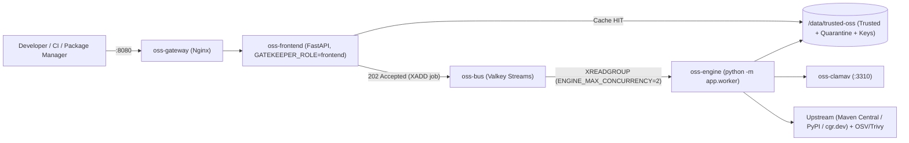
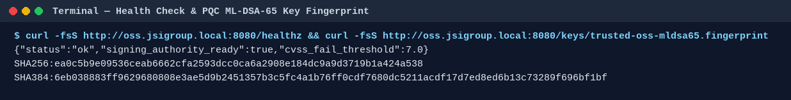
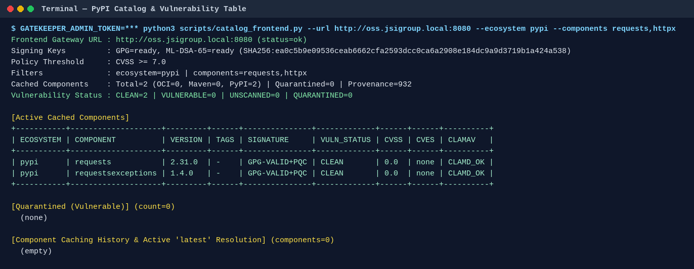
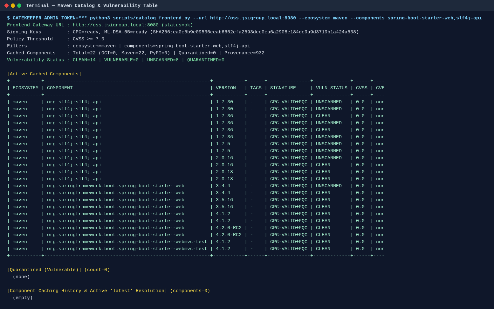
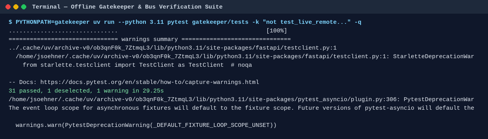

# Trusted OSS Supply Chain Platform — Operations Manual (`v1.0.0`)

This manual documents every operational capability of `trusted-oss-harbor` (`v1.0.0`), how to run and maintain the decoupled **Frontend + Engine + Valkey Message Bus** stack, and how to integrate existing Java (Maven), Python (`uv`/`pip`), OCI/Docker, and GitHub Actions projects.

---

## 1. Architecture & Components

`trusted-oss-harbor` separates **HTTP request serving** from **heavy scanning and remediation** so package managers and inventory queries stay fast even on resource-constrained NAS hosts (such as TrueNAS SCALE).



| Service / Component | Role | Key Environment / Config |
| :--- | :--- | :--- |
| **`oss-gateway`** | Unified Nginx reverse proxy (`:8080` / `:8443`) | `config/nginx/oss-gateway.conf` |
| **`oss-frontend`** | Serves artifacts, PEP 503 / Maven metadata, keys, provenance, `/catalog/vulnerabilities`, and `/jobs` | `GATEKEEPER_ROLE=frontend`, `BUS_URL=redis://oss-bus:6379/0` |
| **`oss-bus`** | Lightweight Valkey Streams broker & job state store (~15–30 MB RAM) | `valkey/valkey:8-alpine` |
| **`oss-engine`** | Consumes `remediate` & `warm` jobs, runs hourly CVE rescans, ClamAV/OSV/Trivy checks, quarantine, and signing | `GATEKEEPER_ROLE=engine`, `ENGINE_MAX_CONCURRENCY=2`, `CVE_RESCAN_INTERVAL_SECONDS=3600` |
| **`oss-clamav`** | Antivirus daemon (`INSTREAM` TCP `:3310`) | `clamav/clamav:1.4` |

> [!NOTE]
> In single-container NAS appliance deployments (`Dockerfile` + `supervisord`), `GATEKEEPER_ROLE=all` runs with an automatic `InMemoryJobBus` fallback when `BUS_URL` is unset.

---

## 2. Core Functionality & Live Verification

### 2.1 Health Check & Post-Quantum Key Distribution

Every client and monitoring probe can verify service readiness, active role, bus backend, CVSS policy threshold, and the **GPG + NIST FIPS 204 ML-DSA-65** signing authorities:

- `GET /healthz` — Returns service status, version, role, bus backend, signing key readiness, and `cvss_fail_threshold`.
- `GET /keys/trusted-oss-pubkey.asc` — ASCII-armored Trusted OSS GPG public key.
- `GET /keys/trusted-oss-mldsa65.pub` — ML-DSA-65 post-quantum public key.
- `GET /keys/trusted-oss-mldsa65.fingerprint` — SHA-256 and SHA-384 key fingerprints.



### 2.2 Virtual Pull-Through & Trusted-Only Repositories

| Ecosystem | Virtual Pull-Through Endpoint (Auto-Quarantine -> Scan -> Sign) | Trusted-Only Endpoint (Pre-Signed Only) |
| :--- | :--- | :--- |
| **Maven** | `/maven/virtual/{group/artifact/version/file}` | `/maven/trusted/{group/artifact/version/file}` |
| **PyPI (PEP 503)** | `/pypi/virtual/simple/{pkg}/` | `/pypi/trusted/simple/{pkg}/` |
| **OCI (Chainguard)** | `/v2/chainguard-cache/{repo}/manifests/{ref}` | Harbor OCI Proxy Cache |

On a cache miss, `oss-frontend` / `oss-engine` uses per-artifact `asyncio.Lock` single-flight deduplication to:
1. Stream the upstream artifact into `packages/quarantine/` (enforcing `MAX_ARTIFACT_BYTES`).
2. Inspect `.jar`/`.whl`/`.tar.gz` archives for Zip-Slip traversal, symlinks, and encrypted entries.
3. Scan via ClamAV (`INSTREAM`) and OSV/Trivy (`CVSS_FAIL_THRESHOLD=7.0`).
4. Dual-sign clean artifacts with **GPG RSA-3072 (`.asc`)** and **ML-DSA-65 (`.mldsa65`)**, write `.sha256`/`.sha384`/`.sha512` digests, append an HMAC-SHA384 provenance entry to `audit/provenance.jsonl`, and atomically promote to `trusted-maven/` or `trusted-pypi/`.
5. Block infected or `CVSS >= 7.0` artifacts with `HTTP 451 Unavailable For Legal Reasons`.

### 2.3 Per-Version Vulnerability Catalog, Filtering & ASCII Tables

Use `scripts/catalog_frontend.py` to inspect cached components, signatures, ClamAV status, CVSS/CVE status, quarantined versions, and component caching history. It supports comma-separated `--ecosystem` and `--components` filters:

```bash
# PyPI components filtered by name
GATEKEEPER_ADMIN_TOKEN="<token>" \
  python3 scripts/catalog_frontend.py \
  --url http://oss.jsigroup.local:8080 \
  --ecosystem pypi \
  --components requests,httpx
```



```bash
# Maven components filtered by name
GATEKEEPER_ADMIN_TOKEN="<token>" \
  python3 scripts/catalog_frontend.py \
  --url http://oss.jsigroup.local:8080 \
  --ecosystem maven \
  --components spring-boot-starter-web,slf4j-api
```



### 2.4 Hourly CVE Rescan, Unscanned Sweeps, Auto-Quarantine & `N-2` Garbage Collection

- **`oss-engine`** runs an initial sweep shortly after startup (`only_unscanned=true`) to scan any `UNSCANNED` cached components and persist their `CLEAN` / `QUARANTINED` verdicts, followed by an hourly rescan + garbage collection loop (`CVE_RESCAN_INTERVAL_SECONDS=3600`).
- **Auto-Quarantine & `'latest'` Tagging**: When a previously clean cached version is affected by a newly published CVE with `CVSS >= CVSS_FAIL_THRESHOLD`:
  1. The vulnerable version and its sidecars are moved to `packages/quarantine/` with CVE metadata (`max_cvss`, `cve_ids`, `superseded_by`).
  2. The newest clean upstream version is fetched, scanned, dual-signed, and tagged as **`latest`** (`maven-metadata.xml` for Maven; `latest` resolution metadata for PyPI).
  3. `GET /catalog/vulnerabilities` and `catalog_frontend.py` display the active `'latest'` version, the `[Quarantined (Vulnerable)]` table, and the `[Component Caching History & Active 'latest' Resolution]` table.
- **`N-2` Garbage Collection (`POST /catalog/gc`)**: Automatically prunes cached versions that are 2+ versions older than `latest` (retaining `GC_RETENTION_VERSIONS=2`, i.e., `N` and `N-1`), removing `N-2` and older artifacts and their sidecars (`.asc`, `.mldsa65`, `.sha256`, `.sha384`, `.sha512`). You can also trigger GC manually:
  ```bash
  curl -X POST -H "X-Gatekeeper-Token: <token>" \
    "http://oss.jsigroup.local:8080/catalog/gc?ecosystem=pypi,maven"
  ```

### 2.5 Asynchronous Engine Jobs (`POST /catalog/remediate`, `GET /jobs`)

When `oss-frontend` runs with `GATEKEEPER_ROLE=frontend`, heavy mutations (`POST /catalog/remediate` and `POST /catalog/warm`) enqueue a job onto `oss-bus` and return `HTTP 202 Accepted` with a `job_id`:

```bash
# Trigger immediate targeted remediation asynchronously (returns 202 Accepted)
GATEKEEPER_ADMIN_TOKEN="<token>" \
  python3 scripts/catalog_frontend.py \
  --url http://oss.jsigroup.local:8080 \
  --ecosystem pypi \
  --components requests \
  --remediate

# Trigger remediation and wait for oss-engine to complete via GET /jobs/{job_id}
GATEKEEPER_ADMIN_TOKEN="<token>" \
  python3 scripts/catalog_frontend.py \
  --url http://oss.jsigroup.local:8080 \
  --ecosystem pypi,maven \
  --remediate --wait
```

---

## 3. Maintenance & Operations

### 3.1 Starting, Stopping, and Viewing Logs

```bash
# Start full decoupled stack (oss-bus, oss-frontend, oss-engine, oss-clamav, oss-gateway)
docker compose up -d --build

# Check service health
docker compose ps
curl -fsS http://oss.jsigroup.local:8080/healthz

# Stream Frontend HTTP/cache logs vs. Engine worker/remediation logs
docker logs -f oss-frontend
docker logs -f oss-engine
```

On TrueNAS SCALE, `[CACHE]` and `[ENGINE]` stdout lines appear directly in the **Apps -> trusted-oss-gatekeeper -> Logs** panel.

### 3.2 Dynamic Workspace & GitHub Discovery Warmup

Automatically discover dependencies across local projects (`pom.xml`, `build.gradle`, `requirements.txt`, `pyproject.toml`, `Dockerfile`) and GitHub repositories, then warm the cache:

```bash
GATEKEEPER_ADMIN_TOKEN="<token>" \
  python3 scripts/dynamic_warmup.py \
  --roots "$HOME" \
  --github \
  --warm \
  --gatekeeper-url http://oss.jsigroup.local:8080
```

### 3.3 Storage & Scanner Cache Inspection

Inspect the backing storage directory (`/home/jsoehner/trusted-oss-data` or TrueNAS iSCSI mount), GPG/ML-DSA keys, NVD/ClamAV/Trivy caches, and quarantine count:

```bash
python3 scripts/catalog_storage.py --data-root /home/jsoehner/trusted-oss-data
```

### 3.4 Running the Automated Verification Suite

Run the full offline unit and integration suite (31 tests covering path containment, archive security, ClamAV, OSV/Trivy gates, ML-DSA-65 + GPG dual signing, virtual pull-through, auto-quarantine remediation, and `oss-bus` async job queuing):

```bash
PYTHONPATH=gatekeeper uv run --python 3.11 --with-requirements gatekeeper/requirements.txt \
  pytest gatekeeper/tests -k "not test_live_remote_chainguard_cgr_and_maven_central_spring_boot_caching" -q
```



---

## 4. Integrating Existing Software Projects

### 4.1 Java / Maven Projects

1. Copy [`client-templates/maven-settings.xml`](../client-templates/maven-settings.xml) to `~/.m2/settings.xml` and set `HARBOR_DOMAIN` (or point `<url>` to `http://oss.jsigroup.local:8080/maven/virtual` for pull-through or `/maven/trusted` for pre-approved artifacts only).
2. *(Optional strict signature enforcement)* Add [`client-templates/pgpverify-plugin-snippet.xml`](../client-templates/pgpverify-plugin-snippet.xml) to your project's `pom.xml` under `<build><plugins>` so Maven fails the build if any dependency lacks a valid `.asc` signature from `/keys/trusted-oss-pubkey.asc`.

### 4.2 Python Projects (`uv` and `pip`)

Drop [`client-templates/uv.toml`](../client-templates/uv.toml) into your project root (or `~/.config/uv/uv.toml`):

```toml
index-url = "http://oss.jsigroup.local:8080/pypi/virtual/simple"
no-build = true
```

For `pip`, export:

```bash
export PIP_INDEX_URL="http://oss.jsigroup.local:8080/pypi/virtual/simple"
```

Use `/pypi/trusted/simple` instead of `/pypi/virtual/simple` in production CI if you only want pre-warmed, already-signed wheels.

### 4.3 Post-Quantum (ML-DSA-65) Client Verification

Verify any downloaded artifact against its `.mldsa65` signature using [`client-templates/pqc-verify.py`](../client-templates/pqc-verify.py):

```bash
curl -fsSLO http://oss.jsigroup.local:8080/keys/trusted-oss-mldsa65.pub
python3 client-templates/pqc-verify.py \
  --pubkey trusted-oss-mldsa65.pub \
  --artifact my-package.whl \
  --sig my-package.whl.mldsa65
```

### 4.4 Container Builds (Chainguard Zero-CVE Base Images)

Point Dockerfiles to the Harbor Chainguard proxy cache (see [`containers/chainguard-jre-python/Dockerfile`](../containers/chainguard-jre-python/Dockerfile)):

```dockerfile
FROM ${HARBOR_REGISTRY}/chainguard-cache/chainguard/jre:latest
```

### 4.5 GitHub Actions CI/CD Integration

Use [`client-templates/github-actions-trusted-oss.yml`](../client-templates/github-actions-trusted-oss.yml) in your `.github/workflows/*.yml` pipelines to configure mTLS credentials, import `/keys/trusted-oss-pubkey.asc`, and route Maven builds exclusively through your Trusted OSS gateway.
