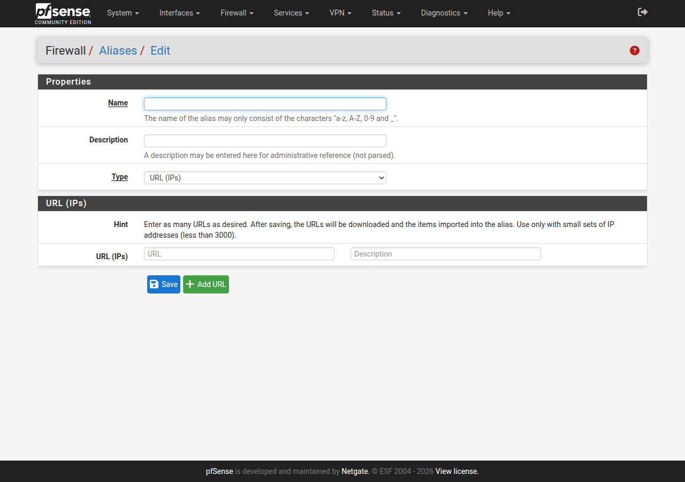
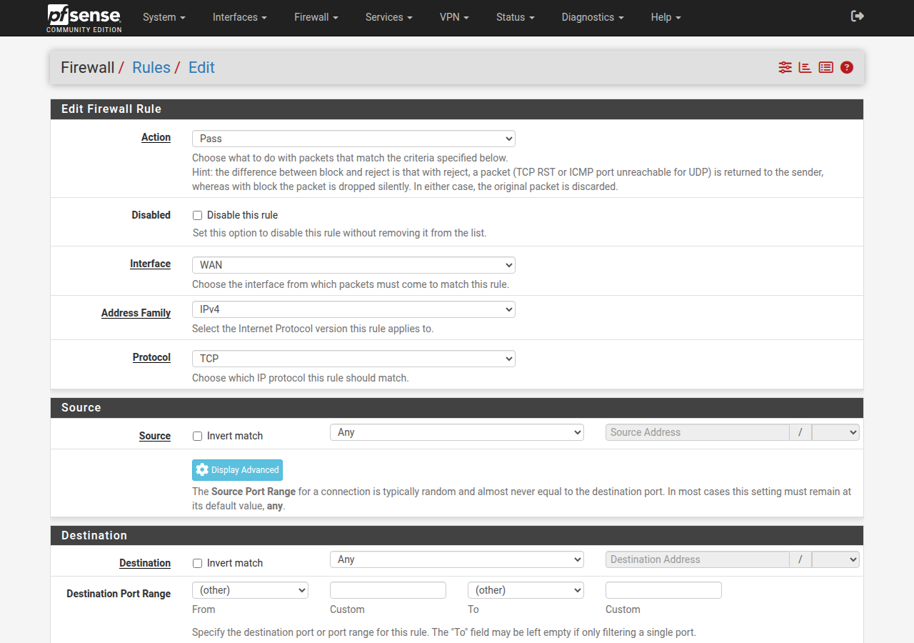
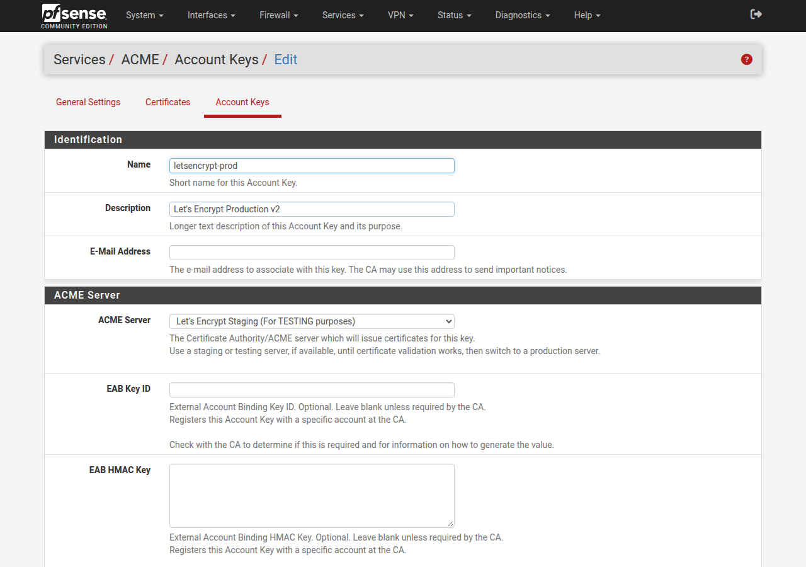
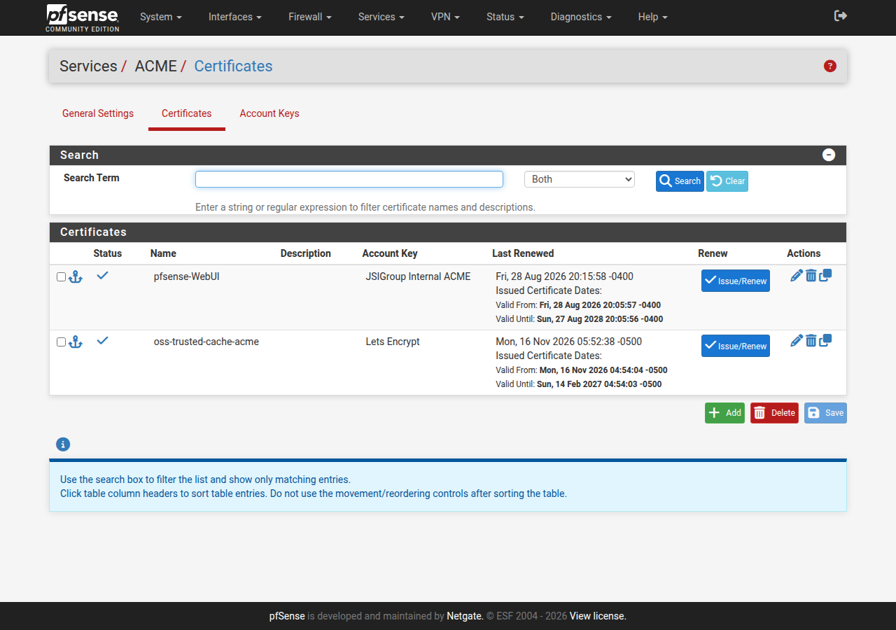
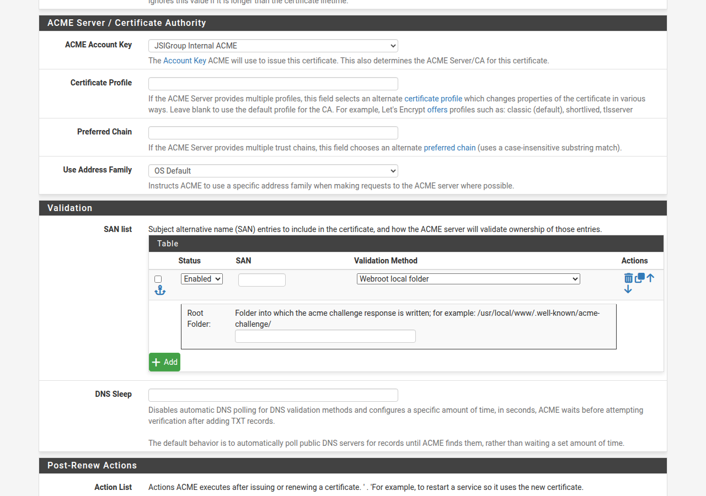
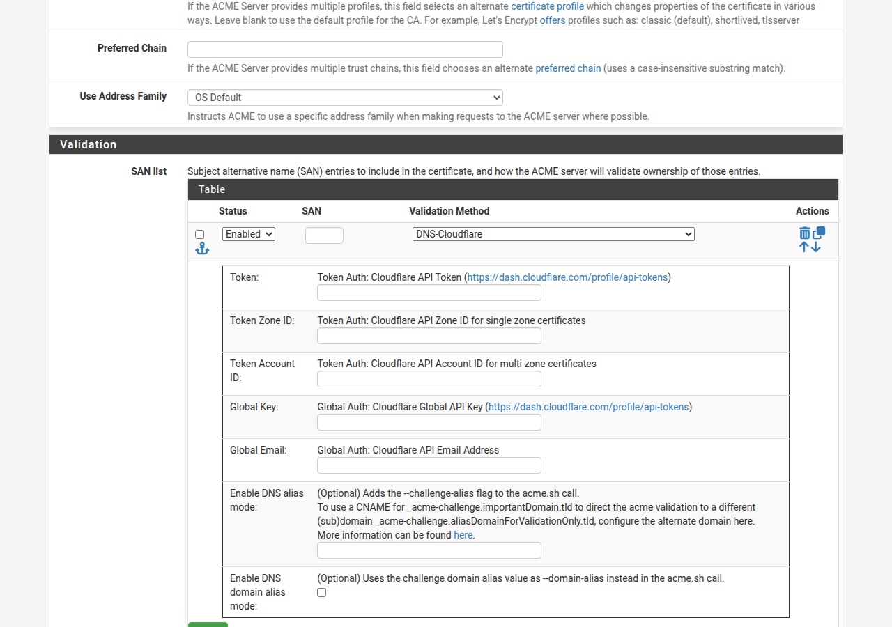
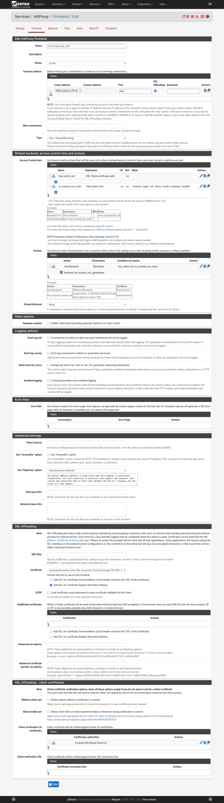

# pfSense `2.9.0-RELEASE` Edge Security Guide: GitHub-Only mTLS Access to `trusted-oss-gatekeeper`

- **Guide Version:** `2.3` (relocated alongside [`operations-manual.md`](operations-manual.md) with step-by-step WebGUI illustrations)
- **Target Firewall Platform:** pfSense `2.9.0-RELEASE (amd64)` (built `Fri Aug 28 13:53:00 EDT 2026`, `FreeBSD 16.0-CURRENT`)
- **Required pfSense Packages:** `acme`, `haproxy`, `cron` (**System $\rightarrow$ Package Manager**)

This guide configures **pfSense** so **only your GitHub Actions runners** can reach your `trusted-oss-gatekeeper` container on TrueNAS (`<TRUENAS_LAN_IP>:8080`) over WAN `:443`, while all other WAN traffic is stealth-dropped.

---

## Architecture Overview

```text
GitHub Actions Runner (vars.TRUSTED_OSS_CACHE_URL set)
  │  1. Source IP in GitHub Actions CIDRs (api.github.com/meta)
  │  2. Presents mTLS Client Cert (OSS_MTLS_CLIENT_CERT / OSS_MTLS_CLIENT_KEY)
  ▼
pfSense 2.9.0-RELEASE WAN (:443)
  ├─ Layer 1 (WAN Firewall Rule): Permit TCP/443 ONLY from alias `github_actions_cidrs`
  └─ Layer 2 (HAProxy Frontend `fe_trusted_oss_https`):
       ├─ ACME Let's Encrypt TLS Server Cert (`oss.yourdomain.com`)
       ├─ Verify Client Certificate (`Trusted-OSS-GitHub-Client-CA`, `ssl_c_used`)
       └─ Route `/maven/`, `/pypi/`, `/v2/`, `/keys/`, `/audit/`, `/catalog/`, `/healthz`
            ▼
TrueNAS Appliance Container (`trusted-oss-gatekeeper` on `<TRUENAS_LAN_IP>:8080`)
```

> **Note:** If a repository does **not** set `TRUSTED_OSS_CACHE_URL`, builds default to public upstream repositories (Maven Central, PyPI, `cgr.dev`) and do not contact pfSense. Setting `TRUSTED_OSS_CACHE_URL` on a repository triggers the trusted mTLS connection for that repository.

---

## Step 1: Generate & Import the mTLS Client CA (`System → Cert. Manager → CAs`)

1. Run the helper script on your Linux workstation (creates `./mtls-pki/` with `ca.crt`, `client.crt`, `client.key`, and `client.p12`):
   ```bash
   ./scripts/generate_mtls_keys.sh
   ```
   Expected output:
   ```text
   [INFO] Generating CA private key and certificate...
   [INFO] Generating Client private key and CSR...
   [INFO] Signing Client certificate with CA...
   Certificate request self-signature ok
   subject=C=CA, ST=Ontario, L=Local, O=JSI Group, OU=GitHubActions, CN=github-actions-runner-client
   [INFO] Creating PKCS#12 bundle for Java/Maven...
   ================================================================================
   ✅ mTLS PKI Generation Complete in: ./mtls-pki
   ================================================================================
   1. pfSense Import File (Upload this as Internal CA in pfSense Cert Manager):
      -> ./mtls-pki/ca.crt

   2. GitHub Action Repository Secret (OSS_MTLS_CLIENT_CERT):
      -> ./mtls-pki/client.crt

   3. GitHub Action Repository Secret (OSS_MTLS_CLIENT_KEY):
      -> ./mtls-pki/client.key

   4. PKCS#12 Bundle (Password: 'changeit') for Java / Maven:
      -> ./mtls-pki/client.p12
   ================================================================================
   ```
2. Print `./mtls-pki/ca.crt` and copy the entire `-----BEGIN CERTIFICATE----- ... -----END CERTIFICATE-----` block:
   ```bash
   cat ./mtls-pki/ca.crt
   ```
3. In pfSense WebGUI, navigate to **System $\rightarrow$ Certificates $\rightarrow$ Authorities $\rightarrow$ + Add**:
   - **Descriptive name**: `Trusted-OSS-GitHub-Client-CA`
   - **Method**: `Import an existing Certificate Authority`
   - **Trust Store**: leave unchecked
   - **Randomize Serial**: leave unchecked
   - **Existing Certificate Authority $\rightarrow$ Certificate data**: Paste the contents of `./mtls-pki/ca.crt`
   - **Certificate Private Key (optional)**: leave blank
   - Click **Save**.


4. Save `./mtls-pki/client.crt` and `./mtls-pki/client.key` as GitHub Organization or Repository **Secrets** (`OSS_MTLS_CLIENT_CERT` and `OSS_MTLS_CLIENT_KEY`) in Step 5, and keep `./mtls-pki/ca.key` offline/private.

*(Alternative)* Create the CA and Client Certificate directly inside pfSense **System $\rightarrow$ Cert. Manager**, then export `client.crt` and `client.key` as PEM for your GitHub Actions secrets (`OSS_MTLS_CLIENT_CERT`, `OSS_MTLS_CLIENT_KEY`).

---

## Step 2: Restrict WAN Access Strictly to GitHub Actions IPs

### 2.1 Sync GitHub Actions CIDRs (`Firewall → Aliases → URLs`)
1. Copy [`config/pfsense/update-github-cidrs.sh`](../config/pfsense/update-github-cidrs.sh) to `/usr/local/bin/update-github-cidrs.sh` on pfSense (or run it on your LAN host/NAS and serve `github_actions_cidrs.txt` over internal HTTP).
2. Schedule a daily cron job on pfSense (**Services $\rightarrow$ Cron** or `/etc/crontab`):
   ```cron
   15 3 * * * root /usr/local/bin/update-github-cidrs.sh -o /var/db/aliastables/github_actions_cidrs.txt
   ```
3. Run it once manually:
   ```bash
   /usr/local/bin/update-github-cidrs.sh -o /var/db/aliastables/github_actions_cidrs.txt
   ```
4. In pfSense WebGUI, navigate to **Firewall $\rightarrow$ Aliases $\rightarrow$ URLs $\rightarrow$ + Add**:
   - **Name**: `github_actions_cidrs`
   - **Type**: `URL Table (IPs)` *(do not use `URL (IPs)`, which is capped at `< 3,000` entries; `github_actions_cidrs.txt` has 8,350+ CIDRs)*
   - **URL Table (IPs)**: `https://raw.githubusercontent.com/jsoehner/trusted-oss-harbor/main/config/pfsense/github_actions_cidrs.txt` *(or your internal HTTP URL serving `github_actions_cidrs.txt`)*
   - **Update Frequency** (dropdown after `/`): `1` day
   - Click **Save** and **Apply Changes**.



### 2.2 Create the WAN Firewall Rule (`Firewall → Rules → WAN`)
Navigate to **Firewall $\rightarrow$ Rules $\rightarrow$ WAN $\rightarrow$ + Add (Top)**:
- **Action**: `Pass`
- **Interface**: `WAN`
- **Address Family**: `IPv4+IPv6`
- **Protocol**: `TCP`
- **Source**: **Single host or alias** $\rightarrow$ `github_actions_cidrs`
- **Destination**: `WAN address`
- **Destination Port Range**: `HTTPS (443)`
- **Description**: `Allow GitHub Actions ONLY to Trusted OSS HAProxy mTLS`
- Click **Save** and **Apply Changes**.



> **Important:** Ensure there is **no** `Any` source rule on WAN port `443`. All non-GitHub IPs are dropped by pfSense's default WAN deny rule. For local LAN workstation access (e.g., `scripts/prime_cache.py` or local `mvn`/`uv`), connect directly to `http://<TRUENAS_LAN_IP>:8080` or `http://oss.jsigroup.local:8080` over your LAN/VPN.

---

## Step 3: Issue the ACME Let's Encrypt Server Certificate (`Services → ACME`)

Install the **acme** package (**System $\rightarrow$ Package Manager $\rightarrow$ Available Packages**) if not already installed.

### 3.1 Create & Register a Let's Encrypt Account Key (`Services → ACME → Account Keys`)
1. Navigate to **Services $\rightarrow$ ACME $\rightarrow$ Account Keys $\rightarrow$ + Add**:
   - **Name**: `Lets Encrypt` (or `letsencrypt-prod`)
   - **Description**: `Let's Encrypt Production v2`
   - **E-Mail Address**: Your operations email for expiry notices
   - **ACME Server**: `Let's Encrypt Production (Applies rate limits to certificate requests)` *(use `Staging` while testing if desired, then switch to `Production`)*
2. Click **Create new account key**, then **Register ACME account key**, and click **Save**.



### 3.2 Create a Scoped Cloudflare API Token (for DNS-01 Validation)
If your domain's DNS is hosted on Cloudflare, create a least-privilege API Token (do **not** use the Global API Key):
1. Sign in to **Cloudflare Dashboard** (`https://dash.cloudflare.com/profile/api-tokens`) and click **+ Create Token**.
2. Choose **Use template** next to **`Edit zone DNS`**.
3. Configure **Permissions**:
   - `Zone` $\rightarrow$ `DNS` $\rightarrow$ `Edit`
   - `Zone` $\rightarrow$ `Zone` $\rightarrow$ `Read` *(required so `acme.sh` can resolve the zone)*
4. Configure **Zone Resources**:
   - `Include` $\rightarrow$ `Specific zone` $\rightarrow$ `<yourdomain.com>`
5. Click **Continue to summary** $\rightarrow$ **Create Token**, and copy the generated **API Token** (shown only once).
6. Open your domain's **Overview** page in Cloudflare and copy the **Zone ID** (and **Account ID** if issuing for multiple zones) from the right-hand **API** sidebar.

### 3.3 Create & Issue the Server Certificate (`Services → ACME → Certificates`)
1. Navigate to **Services $\rightarrow$ ACME $\rightarrow$ Certificates $\rightarrow$ + Add**:
   - **Name**: `oss-trusted-cache-acme`
   - **Status**: `Active`
   - **Private Key**: `2048-bit RSA` (or `ECDSA prime256v1`)



2. Scroll down to **ACME Server / Certificate Authority** and **Validation**:
   - **ACME Account Key**: Select your **`Lets Encrypt`** production account key *(do not use an internal CA if GitHub-hosted runners will connect over WAN)*
   - **SAN list $\rightarrow$ Status**: `Enabled`
   - **SAN**: Your public FQDN / DDNS hostname pointing to pfSense WAN (e.g., `oss.yourdomain.com`)
   - **Validation Method**: Select **`DNS-Cloudflare`** (or your DNS provider's DNS-01 method — requires no inbound port 80)
   - Fill in the **Token Auth** fields (leave **Global Key** and **Global Email** blank):
     - **Token**: Paste your Cloudflare **API Token** from Step 3.2
     - **Token Zone ID**: Paste your Cloudflare **Zone ID** (for single-zone certificates)
     - **Token Account ID**: Paste your Cloudflare **Account ID** (only needed for multi-zone certificates)
   - *(Optional)* Under **Post-Renew Actions**, add `/usr/local/etc/rc.d/haproxy.sh restart` so HAProxy reloads renewed certs automatically
3. Click **Save**, then on the **Certificates** list click **Issue/Renew** and verify `Issued Certificate Dates` appears.





---

## Step 4: Configure HAProxy (`Services → HAProxy`)

Install the **haproxy** package and enable it under **Services $\rightarrow$ HAProxy $\rightarrow$ Settings**.

### 4.1 Create Backend (`be_trusted_oss_gatekeeper`)
Navigate to **Services $\rightarrow$ HAProxy $\rightarrow$ Backend $\rightarrow$ + Add**:
- **Name**: `be_trusted_oss_gatekeeper`
- **Server list**:
  - **Mode**: `active`
  - **Name**: `truenas-gatekeeper`
  - **Address**: `<TRUENAS_LAN_IP>`
  - **Port**: `8080`
  - **Encrypt(SSL)**: `Unchecked` (TLS terminates at pfSense HAProxy)
- **Health checking**:
  - **Health check method**: `HTTP`
  - **Http check method**: `GET`
  - **Url used by http check requests**: `/healthz`
- Click **Save**.


### 4.2 Create Frontend (`fe_trusted_oss_https`)
Navigate to **Services $\rightarrow$ HAProxy $\rightarrow$ Frontend $\rightarrow$ + Add**:
- **Name**: `fe_trusted_oss_https`
- **Status**: `Active`
- **Listen address**: `WAN address` | **Port**: `443` | **SSL Offloading**: `Checked`
- **Certificate (SSL Offloading)**: `oss-trusted-cache-acme` (`oss.yourdomain.com`)
- **Client verification**:
  - Check **Verify Client Certificate**
  - **Client verification CA certificates**: `Trusted-OSS-GitHub-Client-CA`
- **Access Control Lists (ACLs)**:
  - `has_client_cert` $\rightarrow$ `SSL Client certificate valid` (`ssl_c_used`)
  - `is_trusted_oss_route` $\rightarrow$ `Path starts with` $\rightarrow$ `/maven/ /pypi/ /v2/ /keys/ /audit/ /catalog/ /healthz`
- **Actions**:
  - **Use Backend** $\rightarrow$ `be_trusted_oss_gatekeeper` | **Condition acl names**: `has_client_cert is_trusted_oss_route`
  - **Default Backend**: `None` (rejects any request lacking a valid mTLS client cert)
- Click **Save** and **Apply Changes**.



---

## Step 5: Per-Repo Opt-In Configuration (Public Default vs. Trusted Cache)

Every repository defaults to **public upstream repositories** (Maven Central, PyPI, `cgr.dev`) when no trusted cache URL is configured.

### Option A: Local / Downloaded Repository Setup Script
Run [`scripts/configure_trusted_cache.py`](../scripts/configure_trusted_cache.py) on any downloaded repository:

```bash
# Interactive prompt (defaults to public repos; enter your Trusted Cache URL to opt in)
python3 scripts/configure_trusted_cache.py --repo /path/to/my-repo --interactive

# Non-interactive single-variable switch (configures .mvn/settings.xml, uv.toml, .env)
python3 scripts/configure_trusted_cache.py \
  --repo /path/to/my-repo \
  --url https://oss.yourdomain.com

# Revert a repository back to public upstream repositories
python3 scripts/configure_trusted_cache.py --repo /path/to/my-repo --public
```

### Option B: GitHub Actions Per-Repository Trigger
1. Add Organization or Repository **Secrets**:
   - `OSS_MTLS_CLIENT_CERT` (contents of `client.crt`)
   - `OSS_MTLS_CLIENT_KEY` (contents of `client.key`)
2. Add Repository **Variable** (only on repos that should use your trusted cache):
   - `TRUSTED_OSS_CACHE_URL` = `https://oss.yourdomain.com`
   - `TRUSTED_OSS_MODE` = `virtual` *(optional; defaults to `virtual` for pull-through, or `trusted` for pre-signed only)*
   - Or run: `python3 scripts/configure_trusted_cache.py --github-repo owner/repo --url https://oss.yourdomain.com`
3. Include [`client-templates/github-actions-trusted-oss.yml`](../client-templates/github-actions-trusted-oss.yml) in the repo's workflow.
   - If `TRUSTED_OSS_CACHE_URL` is **unset**, the step logs that it is using public upstream repos and exits `0`.
   - If `TRUSTED_OSS_CACHE_URL` is **set**, it configures mTLS and routes Maven, `pip`, and `uv` through `https://oss.yourdomain.com`.
4. Verify end-to-end WAN connectivity from GitHub Actions using [`.github/workflows/probe-wan-connectivity.yml`](../.github/workflows/probe-wan-connectivity.yml).
