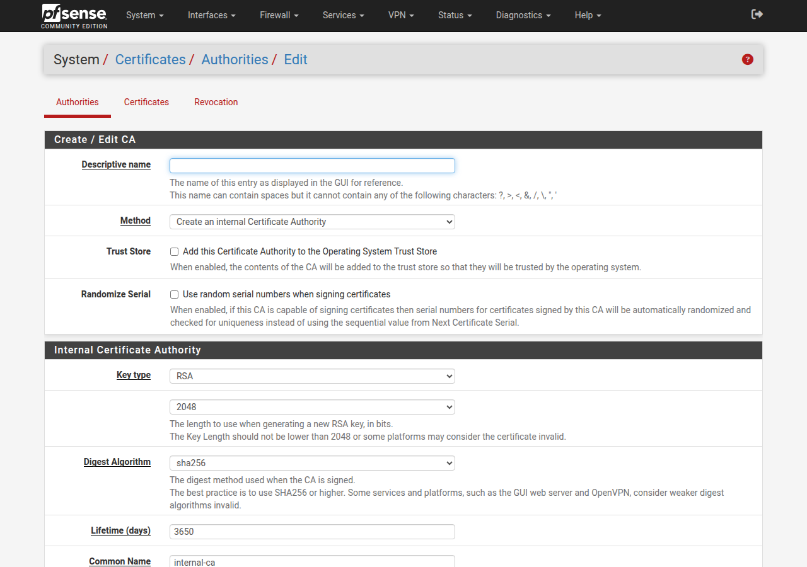
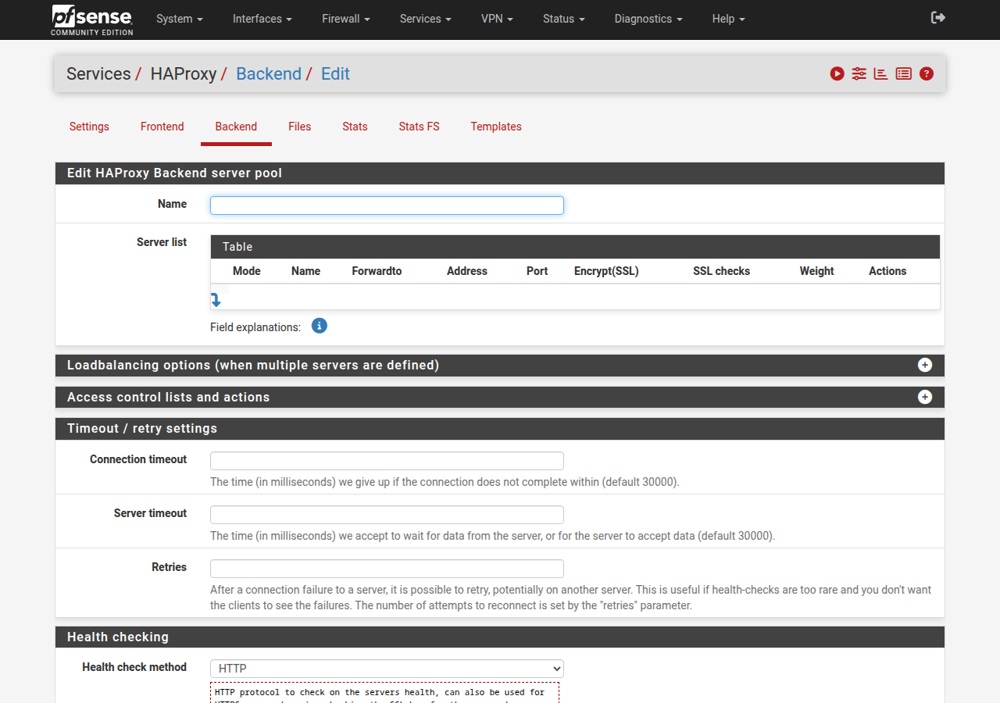

# pfSense `2.9.0-RELEASE` Edge Security Guide: GitHub-Only mTLS Access to `trusted-oss-gatekeeper`

- **Guide Version:** `2.0` (relocated alongside [`operations-manual.md`](operations-manual.md) with step-by-step WebGUI illustrations)
- **Target Firewall Platform:** pfSense `2.9.0-RELEASE (amd64)` (built `Fri Aug 28 13:53:00 EDT 2026`, `FreeBSD 16.0-CURRENT`)
- **Required pfSense Packages:** `acme`, `haproxy`, `cron` (**System $\rightarrow$ Package Manager**)

This guide configures **pfSense** so **only your GitHub Actions runners** can reach your `trusted-oss-gatekeeper` container on TrueNAS (`<TRUENAS_LAN_IP>:8080`) over WAN `:443`, while all other WAN traffic is stealth-dropped.

---

## Architecture Overview

```text
GitHub Actions Runner (vars.TRUSTED_OSS_CACHE_URL set)
  │  1. Source IP in GitHub Actions CIDRs (api.github.com/meta)
  │  2. Presents mTLS Client Cert (OSS_MTLS_CLIENT_CERT / OSS_MTLS_CLIENT_KEY)
  ▼
pfSense 2.9.0-RELEASE WAN (:443)
  ├─ Layer 1 (WAN Firewall Rule): Permit TCP/443 ONLY from alias `github_actions_cidrs`
  └─ Layer 2 (HAProxy Frontend `fe_trusted_oss_https`):
       ├─ ACME Let's Encrypt TLS Server Cert (`oss.yourdomain.com`)
       ├─ Verify Client Certificate (`Trusted-OSS-GitHub-Client-CA`, `ssl_c_used`)
       └─ Route `/maven/`, `/pypi/`, `/v2/`, `/keys/`, `/audit/`, `/catalog/`, `/healthz`
            ▼
TrueNAS Appliance Container (`trusted-oss-gatekeeper` on `<TRUENAS_LAN_IP>:8080`)
```

> **Note:** If a repository does **not** set `TRUSTED_OSS_CACHE_URL`, builds default to public upstream repositories (Maven Central, PyPI, `cgr.dev`) and do not contact pfSense. Setting `TRUSTED_OSS_CACHE_URL` on a repository triggers the trusted mTLS connection for that repository.

---

## Step 1: Generate & Import the mTLS Client CA (`System → Cert. Manager → CAs`)

1. Run the helper script on your Linux workstation to generate `ca.crt`, `client.crt`, and `client.key`:
   ```bash
   ./scripts/generate_mtls_keys.sh
   ```
2. In pfSense WebGUI, navigate to **System $\rightarrow$ Cert. Manager $\rightarrow$ CAs $\rightarrow$ + Add**:
   - **Descriptive name**: `Trusted-OSS-GitHub-Client-CA`
   - **Method**: `Import an existing Certificate Authority`
   - **Certificate data**: Paste the full PEM contents of `ca.crt`
   - Click **Save**.



*(Alternative)* Create the CA and Client Certificate directly inside pfSense **System $\rightarrow$ Cert. Manager**, then export `client.crt` and `client.key` as PEM for your GitHub Actions secrets (`OSS_MTLS_CLIENT_CERT`, `OSS_MTLS_CLIENT_KEY`).

---

## Step 2: Restrict WAN Access Strictly to GitHub Actions IPs

### 2.1 Sync GitHub Actions CIDRs (`Firewall → Aliases → URLs`)
1. Copy [`config/pfsense/update-github-cidrs.sh`](../config/pfsense/update-github-cidrs.sh) to `/usr/local/bin/update-github-cidrs.sh` on pfSense (or run it on your LAN host/NAS and serve `github_actions_cidrs.txt` over internal HTTP).
2. Schedule a daily cron job on pfSense (**Services $\rightarrow$ Cron** or `/etc/crontab`):
   ```cron
   15 3 * * * root /usr/local/bin/update-github-cidrs.sh -o /var/db/aliastables/github_actions_cidrs.txt
   ```
3. Run it once manually:
   ```bash
   /usr/local/bin/update-github-cidrs.sh -o /var/db/aliastables/github_actions_cidrs.txt
   ```
4. In pfSense WebGUI, navigate to **Firewall $\rightarrow$ Aliases $\rightarrow$ URLs $\rightarrow$ + Add**:
   - **Name**: `github_actions_cidrs`
   - **Type**: `URL Table (IPs)`
   - **URL Table (IPs)**: URL serving `github_actions_cidrs.txt`
   - **Update Frequency**: `1` day
   - Click **Save** and **Apply Changes**.


### 2.2 Create the WAN Firewall Rule (`Firewall → Rules → WAN`)
Navigate to **Firewall $\rightarrow$ Rules $\rightarrow$ WAN $\rightarrow$ + Add (Top)**:
- **Action**: `Pass`
- **Interface**: `WAN`
- **Address Family**: `IPv4+IPv6`
- **Protocol**: `TCP`
- **Source**: **Single host or alias** $\rightarrow$ `github_actions_cidrs`
- **Destination**: `WAN address`
- **Destination Port Range**: `HTTPS (443)`
- **Description**: `Allow GitHub Actions ONLY to Trusted OSS HAProxy mTLS`
- Click **Save** and **Apply Changes**.


> **Important:** Ensure there is **no** `Any` source rule on WAN port `443`. All non-GitHub IPs are dropped by pfSense's default WAN deny rule. For local LAN workstation access (e.g., `scripts/prime_cache.py` or local `mvn`/`uv`), connect directly to `http://<TRUENAS_LAN_IP>:8080` or `http://oss.jsigroup.local:8080` over your LAN/VPN.

---

## Step 3: Issue the ACME Let's Encrypt Server Certificate (`Services → ACME`)

1. Install the **acme** package (**System $\rightarrow$ Package Manager $\rightarrow$ Available Packages**).
2. Navigate to **Services $\rightarrow$ ACME $\rightarrow$ Certificates $\rightarrow$ + Add**:
   - **Name**: `oss-trusted-cache-acme`
   - **Domain SAN list**: `oss.yourdomain.com` (your public FQDN / DDNS hostname pointing to pfSense WAN)
   - **Method**: `DNS-Cloudflare` (or your DNS provider's DNS-01 API — requires no inbound port 80)
   - Click **Save**, then click **Issue/Renew**.


---

## Step 4: Configure HAProxy (`Services → HAProxy`)

Install the **haproxy** package and enable it under **Services $\rightarrow$ HAProxy $\rightarrow$ Settings**.

### 4.1 Create Backend (`be_trusted_oss_gatekeeper`)
Navigate to **Services $\rightarrow$ HAProxy $\rightarrow$ Backend $\rightarrow$ + Add**:
- **Name**: `be_trusted_oss_gatekeeper`
- **Server list**:
  - **Mode**: `active`
  - **Name**: `truenas-gatekeeper`
  - **Address**: `<TRUENAS_LAN_IP>`
  - **Port**: `8080`
  - **Encrypt(SSL)**: `Unchecked` (TLS terminates at pfSense HAProxy)
- **Health checking**:
  - **Health check method**: `HTTP`
  - **Http check method**: `GET`
  - **Url used by http check requests**: `/healthz`
- Click **Save**.



### 4.2 Create Frontend (`fe_trusted_oss_https`)
Navigate to **Services $\rightarrow$ HAProxy $\rightarrow$ Frontend $\rightarrow$ + Add**:
- **Name**: `fe_trusted_oss_https`
- **Status**: `Active`
- **Listen address**: `WAN address` | **Port**: `443` | **SSL Offloading**: `Checked`
- **Certificate (SSL Offloading)**: `oss-trusted-cache-acme` (`oss.yourdomain.com`)
- **Client verification**:
  - Check **Verify Client Certificate**
  - **Client verification CA certificates**: `Trusted-OSS-GitHub-Client-CA`
- **Access Control Lists (ACLs)**:
  - `has_client_cert` $\rightarrow$ `SSL Client certificate valid` (`ssl_c_used`)
  - `is_trusted_oss_route` $\rightarrow$ `Path starts with` $\rightarrow$ `/maven/ /pypi/ /v2/ /keys/ /audit/ /catalog/ /healthz`
- **Actions**:
  - **Use Backend** $\rightarrow$ `be_trusted_oss_gatekeeper` | **Condition acl names**: `has_client_cert is_trusted_oss_route`
  - **Default Backend**: `None` (rejects any request lacking a valid mTLS client cert)
- Click **Save** and **Apply Changes**.


---

## Step 5: Per-Repo Opt-In Configuration (Public Default vs. Trusted Cache)

Every repository defaults to **public upstream repositories** (Maven Central, PyPI, `cgr.dev`) when no trusted cache URL is configured.

### Option A: Local / Downloaded Repository Setup Script
Run [`scripts/configure_trusted_cache.py`](../scripts/configure_trusted_cache.py) on any downloaded repository:

```bash
# Interactive prompt (defaults to public repos; enter your Trusted Cache URL to opt in)
python3 scripts/configure_trusted_cache.py --repo /path/to/my-repo --interactive

# Non-interactive single-variable switch (configures .mvn/settings.xml, uv.toml, .env)
python3 scripts/configure_trusted_cache.py \
  --repo /path/to/my-repo \
  --url https://oss.yourdomain.com

# Revert a repository back to public upstream repositories
python3 scripts/configure_trusted_cache.py --repo /path/to/my-repo --public
```

### Option B: GitHub Actions Per-Repository Trigger
1. Add Organization or Repository **Secrets**:
   - `OSS_MTLS_CLIENT_CERT` (contents of `client.crt`)
   - `OSS_MTLS_CLIENT_KEY` (contents of `client.key`)
2. Add Repository **Variable** (only on repos that should use your trusted cache):
   - `TRUSTED_OSS_CACHE_URL` = `https://oss.yourdomain.com`
   - `TRUSTED_OSS_MODE` = `virtual` *(optional; defaults to `virtual` for pull-through, or `trusted` for pre-signed only)*
   - Or run: `python3 scripts/configure_trusted_cache.py --github-repo owner/repo --url https://oss.yourdomain.com`
3. Include [`client-templates/github-actions-trusted-oss.yml`](../client-templates/github-actions-trusted-oss.yml) in the repo's workflow.
   - If `TRUSTED_OSS_CACHE_URL` is **unset**, the step logs that it is using public upstream repos and exits `0`.
   - If `TRUSTED_OSS_CACHE_URL` is **set**, it configures mTLS and routes Maven, `pip`, and `uv` through `https://oss.yourdomain.com`.
4. Verify end-to-end WAN connectivity from GitHub Actions using [`.github/workflows/probe-wan-connectivity.yml`](../.github/workflows/probe-wan-connectivity.yml).
