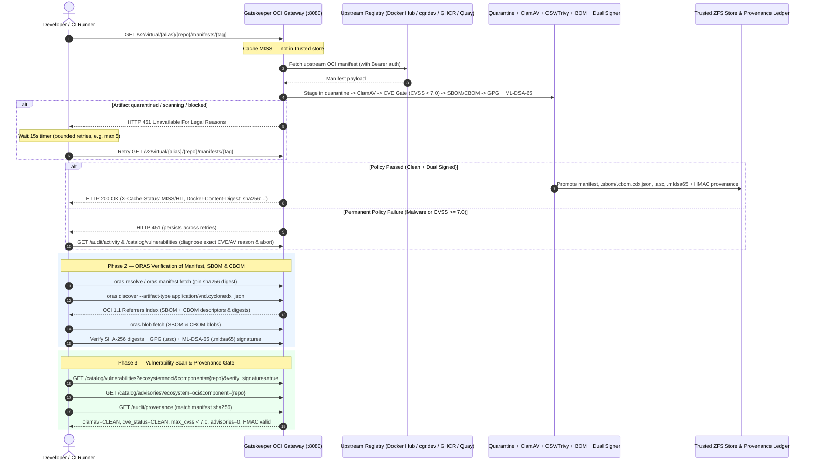

# Report: Acquiring Uncached Container Artifacts via the Trusted OSS Registry (`HTTP 451` 15s Timer Retry + ORAS SBOM/CBOM & Vulnerability Verification)

**Document Type:** Operational & Security Integration Report  
**Repository:** `jsoehner/trusted-oss-harbor`  
**Registry Endpoints:**
- **LAN (HTTP):** `http://oss.jsigroup.local:8080` (TrueNAS SCALE `192.168.100.50:8080`)
- **WAN (HTTPS + mTLS via pfSense HAProxy):** `https://oss.yourdomain.com`  
**Audience:** DevSecOps Engineers, Platform Operators, CI/CD Pipeline Maintainers  

---

## 1. Executive Summary

When a developer or CI/CD pipeline requests a **new container image that is not yet cached** on the Trusted OSS Harbor & Gatekeeper registry, the platform enforces a **fail-closed quarantine, scanning, attestation, and dual-signing pipeline** before any downstream consumer can trust or deploy the artifact.

This report documents the complete, end-to-end client interaction pattern for pulling a brand-new container artifact from the cache registry:

1. **Initial Pull-Through Request:** Request the uncached container manifest via Gatekeeper's OCI v2 pull-through route.
2. **`HTTP 451` Wait & 15-Second Timer Loop:** When `HTTP 451 Unavailable For Legal Reasons` is returned during quarantine/scanning or policy evaluation, wait **15 seconds** on a bounded timer before re-sending the request, allowing ClamAV malware scanning, Trivy/OSV CVE gating (`CVSS < 7.0`), CycloneDX 1.6 SBOM/CBOM generation, and dual signing (RSA-3072 GPG + NIST FIPS 204 ML-DSA-65) to complete—while detecting permanent policy blocks so automation never loops indefinitely.
3. **ORAS Re-Request & OCI 1.1 Referrers Verification:** Once the manifest returns `HTTP 200 OK`, use the CNCF **`oras`** CLI (`oras resolve`, `oras manifest fetch`, `oras discover`, `oras blob fetch`) to pull the digest-pinned manifest and its attached **CycloneDX 1.6 SBOM** and **CBOM** blobs.
4. **Cryptographic & Vulnerability Scan Verification:** Validate the detached **GPG (`.asc`)** and **Post-Quantum ML-DSA-65 (`.mldsa65`)** signatures, inspect the **SBOM/CBOM** payloads, and verify the live **ClamAV + CVE vulnerability scan verdict** via Gatekeeper's `/catalog/vulnerabilities`, `/catalog/advisories`, and `/audit/provenance` APIs.

---

## 2. End-to-End Acquisition & Verification Architecture



---

## 3. Supported Registry Routes & Virtual OCI Namespaces

Gatekeeper maps virtual OCI namespaces to upstream registries (defined in `gatekeeper/app/virtual_repo.py` and `gatekeeper/app/main.py`):

| Virtual Namespace (`NAMESPACE`) | Upstream Registry | Pull-Through Manifest Route | OCI 1.1 Referrers & Blobs Route |
| :--- | :--- | :--- | :--- |
| `chainguard-cache` | `https://cgr.dev` | `/v2/chainguard-cache/{repo}/manifests/{tag}` *(or `/v2/virtual/chainguard-cache/...`)* | `/v2/chainguard-cache/{repo}/referrers/{digest}` & `/blobs/{digest}` |
| `docker-cache` | `https://registry-1.docker.io` | `/v2/virtual/docker-cache/{repo}/manifests/{tag}` | `/v2/docker-cache/{repo}/referrers/{digest}` & `/blobs/{digest}` |
| `ghcr-cache` | `https://ghcr.io` | `/v2/virtual/ghcr-cache/{repo}/manifests/{tag}` | `/v2/ghcr-cache/{repo}/referrers/{digest}` & `/blobs/{digest}` |
| `quay-cache` | `https://quay.io` | `/v2/virtual/quay-cache/{repo}/manifests/{tag}` | `/v2/quay-cache/{repo}/referrers/{digest}` & `/blobs/{digest}` |

> [!IMPORTANT]
> **Docker Hub Official Images (`library/` prefix):** When pulling official Docker Hub images through `docker-cache` (such as `openjdk`, `alpine`, or `python`), Docker Registry v2 requires the `library/` prefix (e.g., `library/openjdk:17-slim`). Organization-scoped images use `<org>/<repo>` directly (e.g., `apache/airflow:slim-latest-python3.12`).

> [!NOTE]
> **Multi-Arch Image Indexes:** Most modern container tags resolve to an OCI Image Index (`application/vnd.oci.image.index.v1+json`) pointing to platform-specific manifests (e.g., `linux/amd64`, `linux/arm64`). If you also pull a specific platform manifest by digest (`sha256:...`), Gatekeeper caches, scans, attests, and signs that platform manifest as well, exposing its own SBOM/CBOM referrers.

---

## 4. Step-by-Step Interaction Guide

### Prerequisites

- **`oras` CLI (`v1.2+`)**:
  - Windows: `winget install ORASProject.ORAS`
  - macOS / Linux: `brew install oras`
  - GitHub Actions: `oras-project/setup-oras`
- **`curl` & `jq`** (or **PowerShell 7+** on Windows)
- **Optional for local signature verification:** `gpg` (RSA-3072 `.asc`) and `python3` with `client-templates/pqc-verify.py` (NIST FIPS 204 ML-DSA-65 `.mldsa65`)
- **WAN mTLS (if accessing via pfSense HAProxy):** Client certificate & key (`~/.oss-tls/client.crt`, `~/.oss-tls/client.key`). For LAN HTTP (`http://oss.jsigroup.local:8080`), pass `--plain-http` to `oras`.

---

### Step 1 — Trigger Cache Acquisition with a 15-Second `HTTP 451` Timer Loop

Request the target container manifest. If the registry returns `HTTP 451`, wait **15 seconds** and retry up to `MAX_RETRIES` times (default `5` attempts = 75 seconds total wait window).

```bash
export REGISTRY_HOST="oss.jsigroup.local:8080"
export REGISTRY_URL="http://${REGISTRY_HOST}"
export NAMESPACE="docker-cache"
export REPO="apache/airflow"
export TAG="slim-latest-python3.12"
export MAX_RETRIES=5
export RETRY_DELAY=15

# Select the correct Gatekeeper pull-through manifest path
if [[ "${NAMESPACE}" == "chainguard-cache" ]]; then
  MANIFEST_URL="${REGISTRY_URL}/v2/chainguard-cache/${REPO}/manifests/${TAG}"
  ORAS_PULL_REF="${REGISTRY_HOST}/chainguard-cache/${REPO}:${TAG}"
else
  MANIFEST_URL="${REGISTRY_URL}/v2/virtual/${NAMESPACE}/${REPO}/manifests/${TAG}"
  ORAS_PULL_REF="${REGISTRY_HOST}/virtual/${NAMESPACE}/${REPO}:${TAG}"
fi

attempt=1
acquired=false

while [[ "${attempt}" -le "${MAX_RETRIES}" ]]; do
  echo "[Attempt ${attempt}/${MAX_RETRIES}] Requesting ${MANIFEST_URL} ..."
  http_code="$(curl -sS -o /tmp/manifest_probe.json -w '%{http_code}' "${MANIFEST_URL}")"

  if [[ "${http_code}" == "200" ]]; then
    echo "[OK] HTTP 200 — Artifact is scanned, signed, and promoted to the trusted cache."
    acquired=true
    break
  elif [[ "${http_code}" == "451" ]]; then
    echo "[WAIT] HTTP 451 — Artifact is quarantined / undergoing scanning & signing. Waiting ${RETRY_DELAY}s..."
    if [[ "${attempt}" -lt "${MAX_RETRIES}" ]]; then
      sleep "${RETRY_DELAY}"
    fi
    attempt=$((attempt + 1))
  else
    echo "[ERROR] Unexpected HTTP ${http_code} from ${MANIFEST_URL}"
    cat /tmp/manifest_probe.json
    exit 1
  fi
done

if [[ "${acquired}" != "true" ]]; then
  echo "[BLOCKED] Artifact remained HTTP 451 after ${MAX_RETRIES} attempts."
  echo "Inspecting Gatekeeper activity log for permanent policy block (Malware / CVSS >= 7.0):"
  curl -fsSL "${REGISTRY_URL}/audit/activity?limit=10" | jq '.events[] | select(.event == "BLOCKED" or .event == "QUARANTINED")'
  exit 1
fi
```

> [!WARNING]
> **Distinguishing Wait vs. Permanent Policy Block:** In `trusted-oss-harbor`, `HTTP 451` is also returned when an artifact **fails** ClamAV malware detection, archive/Zip-Slip checks, or the vulnerability threshold (`CVSS >= 7.0`). Bounding the 15-second timer loop (e.g., `MAX_RETRIES=5`) and inspecting `GET /audit/activity` + `GET /catalog/vulnerabilities` on exhaustion ensures CI/CD pipelines never loop indefinitely on a permanently blocked image.

---

### Step 2 — Re-Request the Artifact via `oras` & Pin Its Immutable Digest

Once the manifest is promoted (`200 OK`), use **`oras`** to resolve the tag to its immutable `sha256` digest and fetch the signed manifest locally:

```bash
export PROOF_DIR="./oss-verification-proof"
mkdir -p "${PROOF_DIR}"

# 1. Resolve the tag to an immutable sha256 digest via ORAS
export MANIFEST_DIGEST="$(oras resolve --plain-http "${ORAS_PULL_REF}")"
echo "Resolved Immutable Digest: ${MANIFEST_DIGEST}"

# 2. Fetch the signed OCI manifest via ORAS
oras manifest fetch --plain-http \
  --output "${PROOF_DIR}/manifest.json" \
  "${ORAS_PULL_REF}"

# 3. Verify downloaded manifest bytes match the resolved digest
echo "${MANIFEST_DIGEST#sha256:}  ${PROOF_DIR}/manifest.json" | sha256sum -c -
```

---

### Step 3 — Discover & Fetch the SBOM and CBOM via `oras` (OCI 1.1 Referrers)

Gatekeeper attaches dual-signed **CycloneDX 1.6 SBOM** and **CBOM** documents to every promoted OCI manifest via the **OCI Distribution Spec v1.1 Referrers API** (`GET /v2/{namespace}/{repo}/referrers/{digest}` and `GET /v2/{namespace}/{repo}/blobs/{digest}`).

```bash
export ORAS_REFERRER_REF="${REGISTRY_HOST}/${NAMESPACE}/${REPO}@${MANIFEST_DIGEST}"

# 1. Visual tree of all attached CycloneDX 1.6 referrers (SBOM + CBOM)
oras discover --plain-http \
  --artifact-type application/vnd.cyclonedx+json \
  --format tree \
  "${ORAS_REFERRER_REF}"

# 2. Export machine-readable Referrers JSON
oras discover --plain-http \
  --artifact-type application/vnd.cyclonedx+json \
  --format json \
  "${ORAS_REFERRER_REF}" > "${PROOF_DIR}/referrers.json"

# 3. Extract SBOM and CBOM blob digests from the OCI 1.1 Referrers descriptors
export SBOM_DIGEST="$(jq -r '.referrers[] | select(.annotations["io.cyclonedx.type"]=="sbom") | .digest' "${PROOF_DIR}/referrers.json" | head -n1)"
export CBOM_DIGEST="$(jq -r '.referrers[] | select(.annotations["io.cyclonedx.type"]=="cbom") | .digest' "${PROOF_DIR}/referrers.json" | head -n1)"

# Fail closed if either BOM is missing
[[ -n "${SBOM_DIGEST}" && "${SBOM_DIGEST}" != "null" ]] || { echo "[FAIL] Missing SBOM referrer"; exit 1; }
[[ -n "${CBOM_DIGEST}" && "${CBOM_DIGEST}" != "null" ]] || { echo "[FAIL] Missing CBOM referrer"; exit 1; }

# 4. Pull both SBOM and CBOM blobs with `oras blob fetch`
oras blob fetch --plain-http \
  --output "${PROOF_DIR}/sbom.cdx.json" \
  "${REGISTRY_HOST}/${NAMESPACE}/${REPO}@${SBOM_DIGEST}"

oras blob fetch --plain-http \
  --output "${PROOF_DIR}/cbom.cdx.json" \
  "${REGISTRY_HOST}/${NAMESPACE}/${REPO}@${CBOM_DIGEST}"

# 5. Cryptographically verify blob SHA-256 digests against the Referrers descriptors
echo "${SBOM_DIGEST#sha256:}  ${PROOF_DIR}/sbom.cdx.json" | sha256sum -c -
echo "${CBOM_DIGEST#sha256:}  ${PROOF_DIR}/cbom.cdx.json" | sha256sum -c -
```

#### Inspecting the Pulled SBOM & CBOM Payloads

```bash
# Summarize SBOM metadata & component count
jq '{
  bomFormat,
  specVersion,
  component: .metadata.component.name,
  purl: .metadata.component.purl,
  component_count: (.components | length)
}' "${PROOF_DIR}/sbom.cdx.json"

# Summarize CBOM cryptographic posture (active/passive risks, certificates, PQC compiled vs. coding)
jq '{
  bomFormat,
  specVersion,
  purl: .metadata.component.purl,
  crypto_scan_status: (.metadata.properties[]? | select(.name=="trusted-oss:crypto-scan-status") | .value),
  scan_scope: (.metadata.properties[]? | select(.name=="trusted-oss:scan-scope") | .value),
  risk_level: (.metadata.properties[]? | select(.name=="trusted-oss:crypto-risk-level") | .value),
  active_risks: (.metadata.properties[]? | select(.name=="trusted-oss:active-risk-count") | .value),
  passive_risks: (.metadata.properties[]? | select(.name=="trusted-oss:passive-risk-count") | .value),
  cert_expired: (.metadata.properties[]? | select(.name=="trusted-oss:cert-expired") | .value),
  cert_sha1_roots: (.metadata.properties[]? | select(.name=="trusted-oss:cert-sha1-roots") | .value),
  pqc_adoption: (.metadata.properties[]? | select(.name=="trusted-oss:pqc-adoption-status") | .value),
  pqc_coding_risk: (.metadata.properties[]? | select(.name=="trusted-oss:pqc-coding-risk") | .value),
  crypto_assets: [.components[]? | select(.type=="cryptographic-asset") | .name]
}' "${PROOF_DIR}/cbom.cdx.json"
```

---

### Step 4 — Verify Dual Cryptographic Signatures (GPG RSA-3072 + NIST FIPS 204 ML-DSA-65)

Confirm that the manifest, SBOM, and CBOM were genuinely signed by the Trusted OSS Registry and have not been altered in transit:

```bash
# 1. Fetch Registry public keys
curl -fsSL "${REGISTRY_URL}/keys/trusted-oss-pubkey.asc"  -o "${PROOF_DIR}/trusted-oss-pubkey.asc"
curl -fsSL "${REGISTRY_URL}/keys/trusted-oss-mldsa65.pub" -o "${PROOF_DIR}/trusted-oss-mldsa65.pub"
gpg --batch --quiet --import "${PROOF_DIR}/trusted-oss-pubkey.asc"

# 2. Fetch detached GPG (.asc) and ML-DSA-65 (.mldsa65) signatures
curl -fsSL "${MANIFEST_URL}.asc"                -o "${PROOF_DIR}/manifest.json.asc"
curl -fsSL "${MANIFEST_URL}.mldsa65"            -o "${PROOF_DIR}/manifest.json.mldsa65"
curl -fsSL "${MANIFEST_URL}.sbom.cdx.json.asc"  -o "${PROOF_DIR}/sbom.cdx.json.asc"
curl -fsSL "${MANIFEST_URL}.sbom.cdx.json.mldsa65" -o "${PROOF_DIR}/sbom.cdx.json.mldsa65"
curl -fsSL "${MANIFEST_URL}.cbom.cdx.json.asc"  -o "${PROOF_DIR}/cbom.cdx.json.asc"
curl -fsSL "${MANIFEST_URL}.cbom.cdx.json.mldsa65" -o "${PROOF_DIR}/cbom.cdx.json.mldsa65"

# 3. Verify Classical GPG (RSA-3072) signatures
for target in manifest.json sbom.cdx.json cbom.cdx.json; do
  gpg --batch --verify "${PROOF_DIR}/${target}.asc" "${PROOF_DIR}/${target}"
done

# 4. Verify Post-Quantum NIST FIPS 204 (ML-DSA-65) signatures
for target in manifest.json sbom.cdx.json cbom.cdx.json; do
  python3 client-templates/pqc-verify.py \
    "${PROOF_DIR}/${target}" \
    "${PROOF_DIR}/${target}.mldsa65" \
    "${PROOF_DIR}/trusted-oss-mldsa65.pub"
done
```

---

### Step 5 — Verify the Vulnerability Scan, Malware Verdict & Provenance Ledger

Confirm that the registry's ClamAV malware scan, Trivy/OSV vulnerability scan (`CVSS < 7.0`), advisory feed, and tamper-evident HMAC-SHA384 provenance ledger all report `CLEAN`:

```bash
# 1. Query live vulnerability & signature posture for the OCI component
curl -fsSL "${REGISTRY_URL}/catalog/vulnerabilities?ecosystem=oci&components=${REPO}&verify_signatures=true" \
  | jq '.components[] | {
      component,
      version,
      signature_valid,
      pqc_signed,
      clamav_status,
      vulnerability_status,
      max_cvss,
      cve_ids
    }'

# 2. Confirm zero active security advisories / quarantines for this component
curl -fsSL "${REGISTRY_URL}/catalog/advisories?ecosystem=oci&component=${REPO}" \
  | jq '{count, advisories}'

# 3. Verify the tamper-evident HMAC-SHA384 provenance ledger entry for this exact digest
MANIFEST_HEX="${MANIFEST_DIGEST#sha256:}"
curl -fsSL "${REGISTRY_URL}/audit/provenance?limit=500" \
  | jq --arg sha "${MANIFEST_HEX}" '[.records[] | select(.sha256 == $sha)] | last | {
      timestamp,
      ecosystem,
      artifact,
      sha256,
      clamav_status,
      cve_status,
      max_cvss,
      cbom_scan_status,
      pqc_status,
      attestation_hmac
    }'
```

---

## 5. Automated Reference Scripts

### 5.1 Bash Automation Script (`acquire_and_verify_container.sh`)

```bash
#!/usr/bin/env bash
# Acquire an uncached container artifact with a 15s HTTP 451 retry timer,
# then verify Manifest, SBOM, CBOM (via ORAS), Signatures, and Vuln Scan.
set -euo pipefail

REGISTRY_HOST="${REGISTRY_HOST:-oss.jsigroup.local:8080}"
SCHEME="${SCHEME:-http}"
REGISTRY_URL="${SCHEME}://${REGISTRY_HOST}"
NAMESPACE="${NAMESPACE:-docker-cache}"
REPO="${REPO:-apache/airflow}"
TAG="${TAG:-slim-latest-python3.12}"
MAX_RETRIES="${MAX_RETRIES:-5}"
RETRY_DELAY="${RETRY_DELAY:-15}"
MAX_CVSS_ALLOWED="${MAX_CVSS_ALLOWED:-7.0}"

ORAS_FLAGS=()
[[ "${SCHEME}" == "http" ]] && ORAS_FLAGS=(--plain-http)

if [[ "${NAMESPACE}" == "chainguard-cache" ]]; then
  MANIFEST_URL="${REGISTRY_URL}/v2/chainguard-cache/${REPO}/manifests/${TAG}"
  ORAS_PULL_REF="${REGISTRY_HOST}/chainguard-cache/${REPO}:${TAG}"
else
  MANIFEST_URL="${REGISTRY_URL}/v2/virtual/${NAMESPACE}/${REPO}/manifests/${TAG}"
  ORAS_PULL_REF="${REGISTRY_HOST}/virtual/${NAMESPACE}/${REPO}:${TAG}"
fi

WORKDIR="$(mktemp -d)"
trap 'rm -rf "${WORKDIR}"' EXIT

echo "=== [1/4] Acquiring ${NAMESPACE}/${REPO}:${TAG} (15s timer on HTTP 451) ==="
attempt=1
acquired=false
while [[ "${attempt}" -le "${MAX_RETRIES}" ]]; do
  code="$(curl -sS -o "${WORKDIR}/probe.out" -w '%{http_code}' "${MANIFEST_URL}")"
  if [[ "${code}" == "200" ]]; then
    echo "  [OK] Attempt ${attempt}: HTTP 200 — Promoted to trusted store."
    acquired=true
    break
  elif [[ "${code}" == "451" ]]; then
    echo "  [WAIT] Attempt ${attempt}/${MAX_RETRIES}: HTTP 451 — Scanning/signing in progress. Sleeping ${RETRY_DELAY}s..."
    [[ "${attempt}" -lt "${MAX_RETRIES}" ]] && sleep "${RETRY_DELAY}"
    attempt=$((attempt + 1))
  else
    echo "  [FAIL] Unexpected HTTP ${code}" >&2
    cat "${WORKDIR}/probe.out" >&2
    exit 1
  fi
done

if [[ "${acquired}" != "true" ]]; then
  echo "  [BLOCKED] Remained HTTP 451 after ${MAX_RETRIES} attempts. Checking activity log..." >&2
  curl -fsSL "${REGISTRY_URL}/audit/activity?limit=10" | jq '.events[] | select(.event=="BLOCKED" or .event=="QUARANTINED")' >&2 || true
  exit 1
fi

echo "=== [2/4] Re-requesting Manifest, SBOM & CBOM via ORAS ==="
MANIFEST_DIGEST="$(oras resolve "${ORAS_FLAGS[@]}" "${ORAS_PULL_REF}")"
oras manifest fetch "${ORAS_FLAGS[@]}" --output "${WORKDIR}/manifest.json" "${ORAS_PULL_REF}"
echo "${MANIFEST_DIGEST#sha256:}  ${WORKDIR}/manifest.json" | sha256sum -c -

ORAS_REFERRER_REF="${REGISTRY_HOST}/${NAMESPACE}/${REPO}@${MANIFEST_DIGEST}"
oras discover "${ORAS_FLAGS[@]}" --artifact-type application/vnd.cyclonedx+json --format tree "${ORAS_REFERRER_REF}"
oras discover "${ORAS_FLAGS[@]}" --artifact-type application/vnd.cyclonedx+json --format json "${ORAS_REFERRER_REF}" > "${WORKDIR}/referrers.json"

SBOM_DIGEST="$(jq -r '.referrers[] | select(.annotations["io.cyclonedx.type"]=="sbom") | .digest' "${WORKDIR}/referrers.json" | head -n1)"
CBOM_DIGEST="$(jq -r '.referrers[] | select(.annotations["io.cyclonedx.type"]=="cbom") | .digest' "${WORKDIR}/referrers.json" | head -n1)"
[[ -n "${SBOM_DIGEST}" && -n "${CBOM_DIGEST}" ]] || { echo "[FAIL] Missing SBOM or CBOM referrer!" >&2; exit 1; }

oras blob fetch "${ORAS_FLAGS[@]}" --output "${WORKDIR}/sbom.cdx.json" "${REGISTRY_HOST}/${NAMESPACE}/${REPO}@${SBOM_DIGEST}"
oras blob fetch "${ORAS_FLAGS[@]}" --output "${WORKDIR}/cbom.cdx.json" "${REGISTRY_HOST}/${NAMESPACE}/${REPO}@${CBOM_DIGEST}"
echo "${SBOM_DIGEST#sha256:}  ${WORKDIR}/sbom.cdx.json" | sha256sum -c -
echo "${CBOM_DIGEST#sha256:}  ${WORKDIR}/cbom.cdx.json" | sha256sum -c -

echo "  SBOM components : $(jq '.components | length' "${WORKDIR}/sbom.cdx.json")"
echo "  CBOM status     : $(jq -r '.metadata.properties[]? | select(.name=="trusted-oss:crypto-scan-status") | .value' "${WORKDIR}/cbom.cdx.json")"

echo "=== [3/4] Verifying Dual Cryptographic Signatures (GPG + ML-DSA-65) ==="
export GNUPGHOME="${WORKDIR}/gnupg"
mkdir -p "${GNUPGHOME}" && chmod 700 "${GNUPGHOME}"
curl -fsSL "${REGISTRY_URL}/keys/trusted-oss-pubkey.asc"  -o "${WORKDIR}/pubkey.asc"
curl -fsSL "${REGISTRY_URL}/keys/trusted-oss-mldsa65.pub" -o "${WORKDIR}/mldsa65.pub"
gpg --batch --quiet --import "${WORKDIR}/pubkey.asc"

for item in "manifest.json:" "sbom.cdx.json:.sbom.cdx.json" "cbom.cdx.json:.cbom.cdx.json"; do
  file="${item%%:*}"
  suffix="${item#*:}"
  curl -fsSL "${MANIFEST_URL}${suffix}.asc"     -o "${WORKDIR}/${file}.asc"
  curl -fsSL "${MANIFEST_URL}${suffix}.mldsa65" -o "${WORKDIR}/${file}.mldsa65"
  gpg --batch --quiet --verify "${WORKDIR}/${file}.asc" "${WORKDIR}/${file}"
  python3 client-templates/pqc-verify.py "${WORKDIR}/${file}" "${WORKDIR}/${file}.mldsa65" "${WORKDIR}/mldsa65.pub"
done
echo "  [OK] GPG (RSA-3072) & NIST FIPS 204 (ML-DSA-65) verified for Manifest, SBOM & CBOM."

echo "=== [4/4] Verifying Vulnerability Scan, Advisories & Provenance ==="
VULN_JSON="$(curl -fsSL "${REGISTRY_URL}/catalog/vulnerabilities?ecosystem=oci&components=${REPO}&verify_signatures=true")"
ADV_COUNT="$(curl -fsSL "${REGISTRY_URL}/catalog/advisories?ecosystem=oci&component=${REPO}" | jq -r '.count // 0')"
echo "${VULN_JSON}" | jq '.components[] | {component, version, signature_valid, pqc_signed, clamav_status, vulnerability_status, max_cvss}'

if [[ "${ADV_COUNT}" -gt 0 ]]; then
  echo "[FAIL] ${ADV_COUNT} active security advisory(ies) found for ${REPO}!" >&2
  exit 1
fi

echo "=== APPROVED: ${NAMESPACE}/${REPO}@${MANIFEST_DIGEST} ==="
```

---

### 5.2 Interactive PowerShell Demo Script (`scripts/demo_container_acquisition_oras.ps1`)

For Windows operators (PowerShell 5.1 and PowerShell 7+), the repository includes an interactive demo script at [`scripts/demo_container_acquisition_oras.ps1`](../../scripts/demo_container_acquisition_oras.ps1) that walks through Stages 0–5 live and prints every HTTP request/response, `oras` CLI invocation, `[DOWNLOAD]` file status (filename, byte size, SHA-256, local path), and 6-gate approval summary.

#### Key Features
- **Single `<repo>:<tag>` Parameter (`-Image`)**: Accepts `repo:tag` (e.g., `chainguard/jre:latest`), `repo@sha256:...`, or `repo` (defaults to `:latest`) as a positional or named argument.
- **Auto-Derived `<repo>-cache` Namespace**: Automatically derives `-Namespace` from the leading repository segment plus `-cache` (e.g., `chainguard/jre:latest` $\rightarrow$ `chainguard-cache`), with optional explicit `-Namespace` override (e.g., `-Namespace "docker-cache"` for `apache/airflow:slim-latest-python3.12`).
- **No-Parameter Usage Banner**: Running with no arguments echoes usage syntax and copy-pasteable examples to the console without making network calls.
- **Collapsed Headers & `[DOWNLOAD]` Status**: Collapses HTTP response headers into a single status line (`HTTP 200 OK (cache: HIT | 1111 bytes | application/vnd.oci.image.index.v1+json)`) and logs a `[DOWNLOAD]` status line for every saved manifest, SBOM, CBOM, public key, and detached signature.
- **On-Demand Verbosity (`-Detailed` & `-ShowHeaders`)**: Pass `-Detailed` for full untruncated JSON bodies (Manifest, Referrers, SBOM, CBOM, Vulnerabilities, Advisories, Provenance) and `-ShowHeaders` to expand all raw HTTP response headers plus `oras --debug` wire traces.
- **ANSI Color Transcript Logging (`-TranscriptPath`)**: Writes a UTF-8 log file containing embedded ANSI SGR color escape sequences (`\x1b[...m`) so colorized runs can be replayed via `Get-Content .\demo-detailed.log` or `less -R` (ignored by Git via `.gitignore`).

```powershell
# Show usage & examples (no network calls)
.\scripts\demo_container_acquisition_oras.ps1

# Auto-derive namespace ('chainguard-cache') and run standard verification
.\scripts\demo_container_acquisition_oras.ps1 "chainguard/jre:latest"

# Full untruncated JSON bodies + ANSI-colored transcript log
.\scripts\demo_container_acquisition_oras.ps1 "chainguard/jre:latest" -Detailed -TranscriptPath ".\demo-detailed.log"

# Expand all raw HTTP response headers + ORAS --debug wire trace
.\scripts\demo_container_acquisition_oras.ps1 "chainguard/jre:latest" -Detailed -ShowHeaders

# Explicit namespace override for Docker Hub org repos + keep downloaded proof files
.\scripts\demo_container_acquisition_oras.ps1 "apache/airflow:slim-latest-python3.12" -Namespace "docker-cache" -KeepProofDir
```

> [!NOTE]
> **OCI 1.1 Referrers `Content-Type` Conformance (`oras` v1.4+):** `gatekeeper/app/main.py` (`get_oci_referrers`) serves `Content-Type: application/vnd.oci.image.index.v1+json` per the OCI Distribution Spec v1.1 so `oras discover` v1.4+ populates referrers natively. Against older deployed instances returning `application/json`, `scripts/demo_container_acquisition_oras.ps1` automatically logs a note, queries `/v2/{namespace}/{repo}/referrers/{digest}` directly, and continues with `oras blob fetch`.

---

## 6. Verification Gate Matrix & HTTP Status Code Reference

### 6.1 Mandatory Approval Criteria

A newly acquired container artifact should be promoted to build/deploy pipelines **only** when all six gates pass:

| Gate | Requirement | Verification Command / Endpoint |
| :--- | :--- | :--- |
| **1. Manifest Promotion** | `HTTP 200 OK` + immutable `sha256` digest pinned | `oras resolve` & `oras manifest fetch` |
| **2. SBOM Presence & Integrity** | CycloneDX 1.6 `application/vnd.cyclonedx+json` (`io.cyclonedx.type=sbom`) matches referrer `sha256` | `oras discover` + `oras blob fetch` + `sha256sum` |
| **3. CBOM Presence & Risk Posture** | CycloneDX 1.6 `application/vnd.cyclonedx+json` (`io.cyclonedx.type=cbom`) carries `trusted-oss.crypto.*` OCI 1.1 annotations (`CRYPTO_ASSETS_DETECTED` across OCI layers, active/passive risk counts, `cert-expired == 0`, `pqc-adoption`) | `oras discover` + `oras blob fetch` + `GET /catalog/crypto-risk` |
| **4. Dual Cryptographic Proof** | Valid GPG RSA-3072 (`.asc`) **and** NIST FIPS 204 ML-DSA-65 (`.mldsa65`) signatures | `gpg --verify` + `client-templates/pqc-verify.py` |
| **5. Malware & Vuln Scan** | `clamav_status == "CLEAN"`, `vulnerability_status == "CLEAN"`, `max_cvss < 7.0` | `GET /catalog/vulnerabilities?ecosystem=oci&components=<repo>&verify_signatures=true` |
| **6. Advisories & Provenance** | `advisories.count == 0` and matching `sha256` entry with valid HMAC-SHA384 in provenance ledger | `GET /catalog/advisories` & `GET /audit/provenance` |

### 6.2 HTTP Status Code Troubleshooting

| HTTP Status | Meaning in `trusted-oss-harbor` | Recommended Client Action |
| :--- | :--- | :--- |
| **`200 OK`** | Artifact is clean, dual-signed, and served from the trusted store (`X-Cache-Status: MISS` on first promotion, `HIT` thereafter). | Proceed to `oras` SBOM/CBOM & vulnerability verification. |
| **`451 Unavailable For Legal Reasons`** | Artifact is either in quarantine/evaluation **or** permanently blocked by ClamAV malware detection, archive guard, or `CVSS >= 7.0`. | Wait **15 seconds** and retry up to `MAX_RETRIES`. If `451` persists, query `/audit/activity` and `/catalog/vulnerabilities` and abort with the exact CVE/AV reason. |
| **`403 Forbidden`** | Read-time cryptographic signature verification failed (missing/corrupted `.asc` or `.mldsa65`) or mTLS client certificate rejected at pfSense HAProxy. | Do **not** retry blindly. Check mTLS cert/key or alert platform security on potential store tampering. |
| **`404 Not Found`** | Upstream image/tag does not exist, unknown virtual registry alias, or missing Docker Hub `library/` prefix for official images. | Verify `NAMESPACE` (`docker-cache`, `chainguard-cache`, `ghcr-cache`, `quay-cache`), `REPO` (e.g., `library/openjdk`), and `TAG`. |
| **`413 Payload Too Large`** | Artifact exceeds Gatekeeper's `MAX_ARTIFACT_BYTES` (`250 MB` default). | Review archive/layer size limits with the platform operator. |
| **`503 Service Unavailable`** | Scanner backend unreachable (fail-closed) or admin token not configured. | Check `GET /healthz` and ClamAV/Gatekeeper container logs. |

---

## 7. Related Documentation

- [`scripts/demo_container_acquisition_oras.ps1`](../../scripts/demo_container_acquisition_oras.ps1) — Interactive PowerShell demo printing every HTTP request/response, 15s `HTTP 451` retry countdown, `oras` CLI command/output, signature check, and vulnerability scan verdict
- [`docs/operations-manual.md`](../operations-manual.md) — Section 4.6 (ORAS CLI Proofs), Section 5 (HTTP 451 Troubleshooting), Section 7 (End-to-End Signed Container Demo)
- [`docs/reports/oras-supply-chain-security-architecture.md`](oras-supply-chain-security-architecture.md) — Enterprise ORAS & Post-Quantum Supply Chain Architecture
- [`scripts/trusted_container_demo.sh`](../../scripts/trusted_container_demo.sh) — Interactive `curl`-based container layer, SBOM/CBOM, signature, and tamper-detection demo
- [`client-templates/github-actions-verify-component.yml`](../../client-templates/github-actions-verify-component.yml) — Reusable GitHub Actions verification gate workflow
