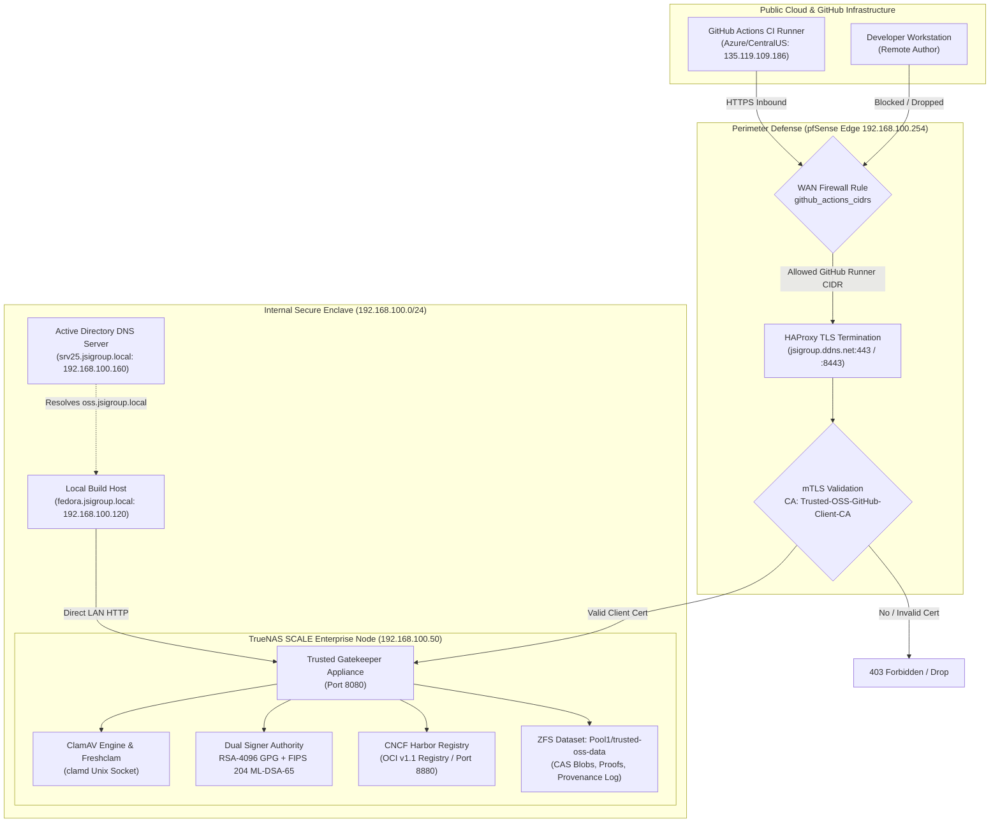
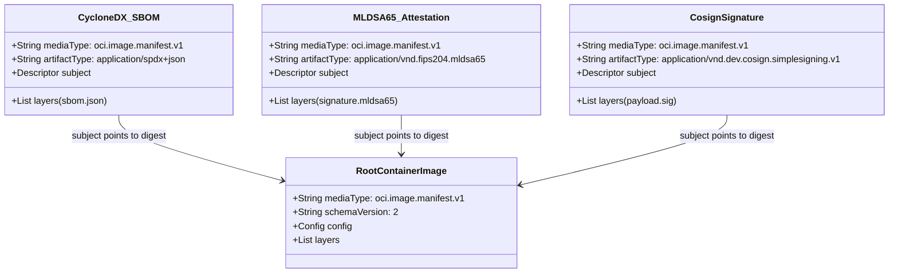
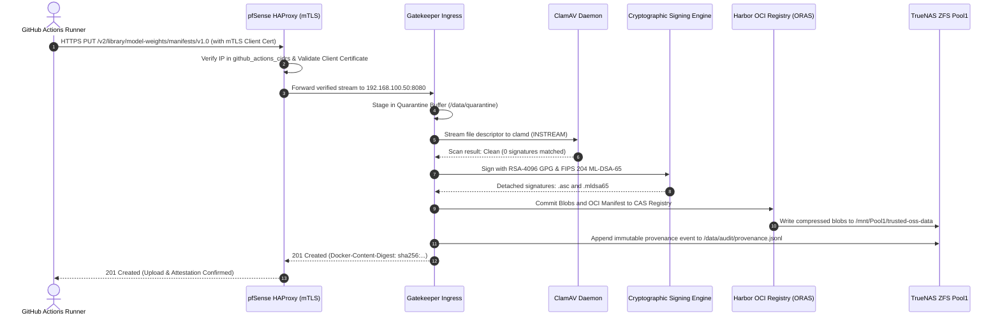

# Enterprise Architectural & Security Specification: OCI Registry As Storage (ORAS) in a Post-Quantum Trusted Software Supply Chain

**Document Classification:** Internal Technical Architecture & Security Review  
**Target Audience:** Enterprise Security Architects, CISOs, Principal Software Engineers, DevSecOps Auditors  
**Review Duration:** 60-Minute Comprehensive Technical Review  
**Repository:** `jsoehner/trusted-oss-harbor`  
**Host Appliance:** TrueNAS SCALE (`192.168.100.50`)  
**Edge Firewall:** pfSense Edge Gateway (`192.168.100.254` / `jsigroup.ddns.net`)  

---

## 1. Executive Summary & Industry Context

Modern enterprise software systems no longer suffer primarily from perimeter penetration; rather, **90% of modern vulnerabilities enter via third-party dependencies, unsigned build artifacts, and untracked supply chain pipelines** (e.g., SolarWinds, Codecov, Log4j, XZ Utils).

Traditional binary management solutions suffer from three fundamental deficiencies:
1. **Siloed Ecosystem Stores:** Distinct, uncoordinated registries for container images (Docker registry), language libraries (Maven, PyPI, npm), and metadata (SBOMs, test reports, signatures).
2. **Lack of Immutable Cryptographic Lineage:** Loose association between built binaries and their provenance, making verification in air-gapped or downstream production environments brittle.
3. **Quantum Vulnerability:** Reliance on classical asymmetric cryptography (RSA-2048/4096, ECDSA P-256) susceptible to future quantum cryptanalysis ("Harvest Now, Decrypt Later" threats).

This document establishes the architectural framework for integrating **ORAS (OCI Registry As Storage)** within the **Trusted OSS Harbor & Gatekeeper Platform**. By leveraging the Open Container Initiative (OCI) v1.1 Artifact and Distribution specifications on top of a private, ZFS-backed Harbor instance, the organization achieves **unified, content-addressable, cryptographically signed, and post-quantum resilient storage for any arbitrary file, artifact, or supply-chain attestation**.

---

## 2. High-Level Component & Network Topology



---

## 3. The Core Mechanics of ORAS (OCI Registry As Storage)

### 3.1 Content-Addressable Storage (CAS) Primitive
At the core of the OCI Distribution Specification is **Content-Addressable Storage**. Every artifact uploaded to the registry is decomposed into:
1. **Blobs:** Pure byte streams identified uniquely by their cryptographic digest (`sha256:<hex>` or Grover-safe `sha384:<hex>`).
2. **Config Descriptor:** A JSON blob specifying the execution profile or metadata schema.
3. **Manifest:** A structural document binding descriptors, layer digests, media types, and annotations.

Because storage is content-addressed, duplicate artifacts (such as identical base dependencies or common SBOM files) occupy physical disk space exactly once on TrueNAS ZFS.

### 3.2 OCI v1.0 vs. OCI v1.1 Artifact Manifest
Historically, OCI registries only accepted container images (`application/vnd.oci.image.manifest.v1+json`). Storing non-container assets required "fake" configs. 

The **OCI v1.1 Specification** officially standardizes generic artifacts via two enhancements:
- **`artifactType` Field:** Explicitly names the payload classification without masquerading as an operating system rootfs.
- **`subject` Field (Referrers API):** Allows child artifacts (e.g., signatures, SBOMs, scan reports) to reference a parent artifact without mutating the parent manifest.



---

## 4. End-to-End Artifact Lifecycle & Verification Workflow



---

## 5. Security & Threat Mitigation Matrix

| Threat Scenario | Attack Vector | Trusted OSS / ORAS Control | Security Impact |
|---|---|---|---|
| **Malicious Dependency Ingestion** | Attacker publishes backdoored wheel or JAR to public upstream. | **Gatekeeper Quarantine & ClamAV:** Dynamic pull-through scans every byte before promotion. Clean threshold enforced. | Malware blocked before reaching client build caches. |
| **Artifact Tampering in Transit** | Man-in-the-Middle (MitM) modifying bytes between registry and CI. | **Dual Detached Signatures:** RSA-4096 GPG + FIPS 204 ML-DSA-65 checked against local trusted keyring. | Client build halts immediately upon signature mismatch. |
| **Harvest Now, Decrypt Later (HNDL)** | Adversary records encrypted supply chain traffic to forge classical signatures once quantum computers arrive. | **NIST FIPS 204 (ML-DSA-65):** Lattice-based post-quantum signature algorithm immune to Shor's algorithm. | Provenance remains cryptographically irrevocable in the post-quantum era. |
| **Unauthorized Registry Exposure** | Port scanning or automated bots probing registry from public internet. | **Layer 1 pfSense IP Filter:** WAN rule drops all packets not originating from `github_actions_cidrs`. | Zero visibility on public internet (stealth drop). |
| **Rogue GitHub Runner Impersonation** | Attacker running a malicious GitHub Action within GitHub's shared runner pool. | **Layer 2 Mutual TLS (mTLS):** Connection rejected unless client presents valid certificate signed by `Trusted-OSS-GitHub-Client-CA`. | Foreign GitHub Actions runners receive TLS handshake failure. |
| **Ransomware / Storage Destruction** | Compromised LAN host attempting to wipe storage pool. | **ZFS Snapshot Immutability:** Periodic read-only ZFS snapshots on `/mnt/Pool1/trusted-oss-data`. | Instant point-in-time recovery with zero data loss. |

---

## 6. Deep Technical Guide: ORAS Command Reference

### 6.1 Authentication
```bash
# Log in to TrueNAS Harbor using scoped robotic credentials
oras login 192.168.100.50:8880 \
  --username "robot$supply-chain-ci" \
  --password "$HARBOR_ROBOT_SECRET"
```

### 6.2 Storing an Arbitrary Artifact (e.g., Compiled Machine Learning Model)
```bash
oras push 192.168.100.50:8880/ai-models/fraud-detector:v2.4.0 \
  --artifact-type application/vnd.onnx.model \
  model.onnx:application/octet-stream \
  hyperparameters.json:application/json \
  README.md:text/markdown
```

### 6.3 Attaching an SBOM & Security Scan to a Release Artifact
```bash
# Attach CycloneDX SBOM to the fraud-detector artifact
oras attach \
  --artifact-type application/vnd.cyclonedx+json \
  192.168.100.50:8880/ai-models/fraud-detector:v2.4.0 \
  ./bom.cdx.json

# Attach NIST FIPS 204 Cryptographic Attestation
oras attach \
  --artifact-type application/vnd.fips204.attestation \
  192.168.100.50:8880/ai-models/fraud-detector:v2.4.0 \
  ./provenance.attestation.mldsa65
```

### 6.4 Discovering and Visualizing the Supply Chain Graph
```bash
oras discover 192.168.100.50:8880/ai-models/fraud-detector:v2.4.0 --tree
```
*Expected Output:*
```text
192.168.100.50:8880/ai-models/fraud-detector@sha256:7e98a1...
├── application/vnd.cyclonedx+json
│   └── sha256:4b83c2... (bom.cdx.json)
└── application/vnd.fips204.attestation
    └── sha256:d19fe0... (provenance.attestation.mldsa65)
```

### 6.5 Retrieving Stored Artifacts
```bash
# Pull all artifacts packaged in the manifest
oras pull 192.168.100.50:8880/ai-models/fraud-detector:v2.4.0 -o ./release-bundle/

# Pull selectively based on media type (e.g. only the SBOM)
oras pull 192.168.100.50:8880/ai-models/fraud-detector:v2.4.0 \
  --include "bom.cdx.json"
```

---

## 7. 60-Minute Security Review Meeting Agenda

| Time Window | Topic | Key Focus & Discussion Points |
|---|---|---|
| **00:00 - 00:10** | **Executive Overview & Threat Vector Analysis** | Review recent supply chain breaches; justify moving beyond traditional binary storage to content-addressed, dual-signed OCI artifacts. |
| **00:10 - 00:25** | **Architecture Walkthrough: ORAS & TrueNAS Appliance** | Demonstrate the OCI v1.1 Referrers tree, ZFS persistence layer, and the Gatekeeper dynamic pull-through quarantine pipeline. |
| **00:25 - 00:40** | **Cryptographic Assurance & Post-Quantum Transition** | Audit the dual-signing implementation (GPG 4096-bit + NIST FIPS 204 ML-DSA-65). Review tamper-evident HMAC audit logs (`GET /audit/provenance`). |
| **00:40 - 00:50** | **Perimeter Hardening: pfSense mTLS & IP Allowlisting** | Walk through the defense-in-depth model: `github_actions_cidrs` IP table filter combined with mandatory client certificate verification. |
| **00:50 - 01:00** | **Red-Team Scenarios & Policy Enforcement Roadmap** | Discussion on key rotation procedures, disaster recovery RTO/RPO on TrueNAS ZFS, and future Kyverno/admission controller enforcement. |

---

## 8. Open Architectural Questions for Committee Alignment

1. **Root Key Lifecycle Management:** Should the NIST FIPS 204 ML-DSA-65 private keys be transitioned from ZFS-encrypted software keystores to a dedicated PKCS#11 Hardware Security Module (HSM) or YubiKey 5 FIPS?
2. **Public Edge Redundancy:** For exposing `jsigroup.ddns.net`, should pfSense terminate TLS via Let's Encrypt ACME with HAProxy mTLS, or should a secondary Cloudflare Authenticated Origin Pull (AOP) tunnel be evaluated?
3. **Registry Quota & Lifecycle Rules:** What retention policy should be enforced in Harbor for intermediate developer preview artifacts vs production-signed release bundles?

---

*Authored by Antigravity Autonomous Security Engineer on behalf of JSI Group Infrastructure & Security Architecture.*
