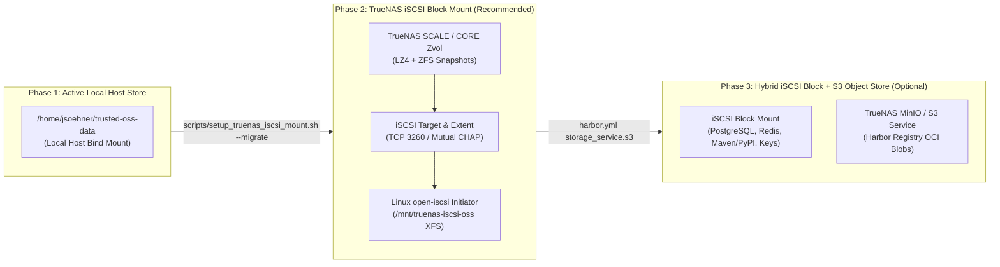

# TrueNAS iSCSI Block Storage & Object Storage Roadmap

## Overview

The **Trusted OSS Supply Chain Platform (`trusted-oss-harbor`)** uses a single parameterized storage root (`OSS_DATA_ROOT`) for all stateful data:
- Harbor OCI blobs, Helm charts, and ORAS artifacts (`${OSS_DATA_ROOT}/harbor/registry`)
- Harbor PostgreSQL and Redis state (`${OSS_DATA_ROOT}/harbor/database`, `${OSS_DATA_ROOT}/harbor/redis`)
- Quarantine staging and GPG-signed Maven/PyPI package repositories (`${OSS_DATA_ROOT}/packages/{quarantine,trusted-maven,trusted-pypi}`)
- ClamAV signatures, Trivy DB, and OWASP NVD H2 cache (`${OSS_DATA_ROOT}/scanners/`)
- GPG/Cosign signing keys and append-only provenance logs (`${OSS_DATA_ROOT}/keys/`, `${OSS_DATA_ROOT}/audit/`)

To enable immediate deployment without root-owned `/srv` partitioning while establishing a clean path to enterprise NAS storage, storage evolution is structured in three phases.



---

## Phase 1 (Active): Home Directory Persistent Store (`/home/jsoehner/trusted-oss-data`)

- **Configuration**: `OSS_DATA_ROOT=/home/jsoehner/trusted-oss-data` in `.env`.
- **Characteristics**:
  - Zero privileged mount dependencies; runs immediately under the local user profile.
  - Identical directory hierarchy (`harbor/`, `packages/`, `scanners/`, `keys/`, `audit/`) to the target TrueNAS iSCSI volume.

---

## Phase 2 (Target Roadmap): TrueNAS iSCSI External Block Storage Mount (`/mnt/truenas-iscsi-oss`)

Why **iSCSI Block Storage** over NFS/SMB for Harbor + PostgreSQL + Gatekeeper:
1. **POSIX Locking & Database Safety**: Harbor's embedded PostgreSQL (`harbor-db`), Redis, and the OWASP NVD H2 database (`odc.mv.db`) require strict block-level fsync and file-locking semantics that NFS frequently violates or degrades. An iSCSI Zvol formatted with `XFS` or `ext4` behaves as a native local SCSI disk (`/dev/sdX`) to the Linux kernel.
2. **Atomic Quarantine-to-Trusted Rename (`os.replace`)**: Because `packages/quarantine`, `packages/trusted-maven`, and `packages/trusted-pypi` reside on the same iSCSI block filesystem, promoting a scanned and GPG-signed package is a zero-copy atomic inode rename.
3. **ZFS Snapshots & Replication on TrueNAS**: Backing the iSCSI Extent with a **TrueNAS Zvol** (`sparse`, `lz4` compression, `16K`–`64K` block size) provides instant ZFS snapshots, clones, and off-site ZFS replication of the entire Trusted OSS repository and signing keys.

### Step 2.1: TrueNAS Zvol & iSCSI Target Configuration
1. **Create Zvol**:
   - Navigate to **Storage $\rightarrow$ Pools $\rightarrow$ Add Zvol**:
     - **Name**: `trusted-oss-zvol`
     - **Size**: `500 GiB` (or as needed; thin-provisioned / sparse enabled)
     - **Compression**: `LZ4` or `ZSTD`
     - **Block Size**: `16 KiB` (optimal balance for PostgreSQL + package blobs)
2. **Configure iSCSI Target**:
   - Navigate to **Shares $\rightarrow$ Block (iSCSI) Targets**:
     - **Portal**: Bind to your storage VLAN IP on port `3260`.
     - **Initiators Group**: Restrict to the Linux host's Initiator IQN (`/etc/iscsi/initiatorname.iscsi`) and IP address.
     - **Auth Method**: Enable **CHAP** (or Mutual CHAP).
     - **Target Name**: `trusted-oss-harbor-lun0` (full IQN e.g. `iqn.2005-10.org.freenas.ctl:trusted-oss-harbor-lun0`).
     - **Extent**: Device type $\rightarrow$ select `trusted-oss-zvol`, Logical Block Size `4096` (4K native), Enable TPC.

### Step 2.2: Linux Host iSCSI Attachment & Zero-Downtime Migration
Run the automated helper script [`scripts/setup_truenas_iscsi_mount.sh`](../../scripts/setup_truenas_iscsi_mount.sh):

```bash
# 1. Preview the iSCSI discovery, login, XFS formatting, and fstab configuration
bash scripts/setup_truenas_iscsi_mount.sh --dry-run

# 2. Attach TrueNAS iSCSI LUN, mount at /mnt/truenas-iscsi-oss, and migrate /home/jsoehner/trusted-oss-data
sudo bash scripts/setup_truenas_iscsi_mount.sh \
  --portal 192.168.1.50:3260 \
  --iqn iqn.2005-10.org.freenas.ctl:trusted-oss-harbor-lun0 \
  --mountpoint /mnt/truenas-iscsi-oss \
  --source-dir /home/jsoehner/trusted-oss-data \
  --migrate
```

What `scripts/setup_truenas_iscsi_mount.sh --migrate` performs:
1. Discovers and logs into the TrueNAS iSCSI target via `iscsiadm`, enabling automatic login on boot (`node.startup = automatic`).
2. Resolves the persistent `/dev/disk/by-path/ip-${PORTAL}-iscsi-${IQN}-lun-0` block device.
3. Formats the LUN as `XFS` (with `label=TRUSTED_OSS` if unformatted) and registers `/mnt/truenas-iscsi-oss` in `/etc/fstab` with `_netdev,noatime,nodiratime,nofail 0 2` so `systemd` waits for networking and `iscsid.service` before mounting.
4. Stops `docker compose` briefly, performs `rsync -aHAX --info=progress2` from `/home/jsoehner/trusted-oss-data/` to `/mnt/truenas-iscsi-oss/`, updates `OSS_DATA_ROOT=/mnt/truenas-iscsi-oss` in `.env`, re-renders `config/harbor/harbor.yml`, and restarts the stack.

---

## Phase 3 (Optional Scale-Out): Harbor Object Storage Backend (`storage_service.s3`)

If the OCI container registry grows to multi-terabyte scale and you wish to separate immutable OCI image layers from transactional block storage:
1. Keep `OSS_DATA_ROOT=/mnt/truenas-iscsi-oss` mounted via **TrueNAS iSCSI** for high-IOPS workloads (PostgreSQL, Redis, Maven/PyPI GPG-signed repositories, ClamAV/NVD databases, and GPG/Cosign private keys).
2. Enable S3/MinIO on TrueNAS (or attach a dedicated iSCSI LUN to a local MinIO container) and uncomment the `storage_service.s3` section in [`config/harbor/harbor.yml.tmpl`](../../config/harbor/harbor.yml.tmpl):
   ```yaml
   storage_service:
     s3:
       bucket: trusted-oss-registry
       regionendpoint: https://truenas-s3.internal.lan:9000
       accesskey: ${TRUENAS_S3_ACCESS_KEY}
       secretkey: ${TRUENAS_S3_SECRET_KEY}
       secure: true
       v4auth: true
       rootdirectory: /harbor-registry
   ```
3. Run `make bootstrap-harbor` to apply the updated `harbor.yml`.
